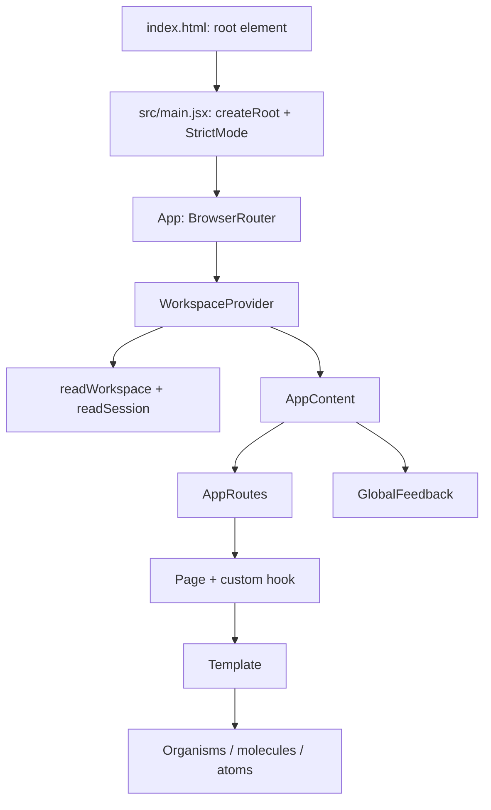
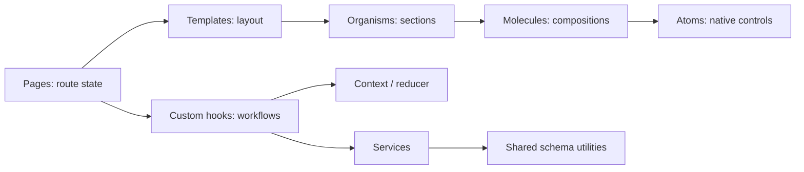
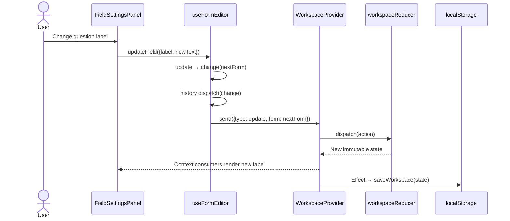
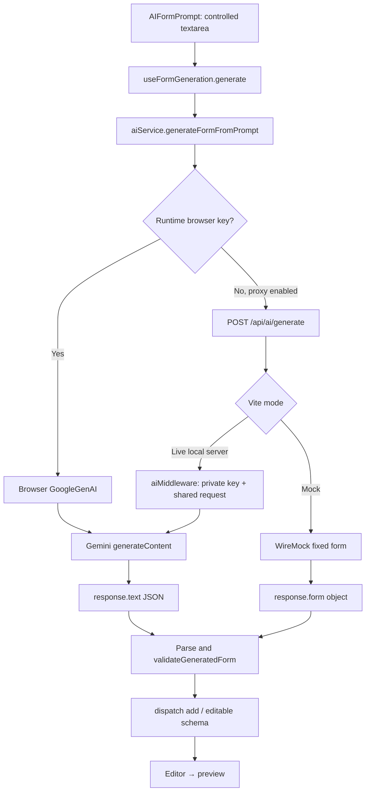

# Formeo AI: Project Technical Guide

Study guide based on the working source inspected on **23 November 2026**. This is a description of the existing implementation, not a proposed rebuild. No application files were changed to produce this guide. File links are relative to this document; line numbers in the file reference chapters describe this snapshot and can shift after future edits.

## Table of contents

1. [Purpose, technologies, and user journey](#1-purpose-technologies-and-user-journey)
2. [Startup and project structure](#2-startup-and-project-structure)
3. [Architecture, Atomic Design, and design principles](#3-architecture-atomic-design-and-design-principles)
4. [React and JavaScript concepts through this project](#4-react-and-javascript-concepts-through-this-project)
5. [State, persistence, and data flow](#5-state-persistence-and-data-flow)
6. [The form builder, step by step](#6-the-form-builder-step-by-step)
7. [AI generation and refinement](#7-ai-generation-and-refinement)
8. [Routing and authentication](#8-routing-and-authentication)
9. [WireMock and the service boundary](#9-wiremock-and-the-service-boundary)
10. [Storybook and the design system](#10-storybook-and-the-design-system)
11. [Ten complete execution flows](#11-ten-complete-execution-flows)
12. [Difficult code explained slowly](#12-difficult-code-explained-slowly)
13. [Limitations, inconsistencies, and future improvements](#13-limitations-inconsistencies-and-future-improvements)
14. [Professor preparation: 20 questions and answers](#14-professor-preparation-20-questions-and-answers)
15. [Technical glossary](#15-technical-glossary)
16. [Complete file-by-file reference](#16-complete-file-by-file-reference)
17. [Every effect and layout effect](#17-every-effect-and-layout-effect)
18. [Complete hook usage index](#18-complete-hook-usage-index)
19. [Configuration, assets, and mock file reference](#19-configuration-assets-and-mock-file-reference)
20. [Suggested study and demonstration sequence](#20-suggested-study-and-demonstration-sequence)

## 1. Purpose, technologies, and user journey

Formeo AI turns a form definition into several interfaces: an editor, a one-question-at-a-time respondent form, and a responses dashboard. A user can create a blank form, copy a template, or ask Gemini to generate questions. All three approaches eventually produce the same JavaScript form schema. That shared schema is the most important idea in the project.

The application reduces repetitive work such as creating labels, choosing question types, validating required answers, arranging questions, and summarizing submissions. It provides a working local form-authoring experience. It does **not** provide a cloud database or a publicly shared form service.

The typical journey is: browse templates or log in; create/generate a form; edit its questions; adjust its appearance; preview desktop/mobile; publish locally; fill the published respondent route; inspect locally stored responses and export CSV. An unauthenticated user selecting a template is sent to login and can resume that creation action afterward.

### Important technology choices

Versions here are the **declared ranges in package.json**, not a claim about the latest releases. package-lock.json records the exact installed resolution.

| Technology                                   | Declared range      | Its actual role and practical reason                                                                                                                   |
| -------------------------------------------- | ------------------- | ------------------------------------------------------------------------------------------------------------------------------------------------------ |
| React / React DOM                            | `^19.3.1`           | Function components, state, effects, context, and rendering into the browser DOM. Composition lets one control serve the editor, preview, and stories. |
| React Router DOM                             | `^7.18.6`           | Browser routes, protected route wrappers, location state, URL parameters, and client navigation. Avoids loading a new HTML document for every screen.  |
| Vite / React plugin                          | `^8.3.6` / `^6.1.2` | Development server, JSX transformation, CSS Modules, environment handling, production build, and a local Gemini middleware hook.                       |
| `@google/genai`                              | `^3.6.1`            | Google's SDK used to request JSON form definitions. Dynamically imported when AI is used.                                                              |
| Firebase                                     | `^13.4.0`           | Modular Google popup authentication. Email/password and reset requests use the Firebase REST API instead of importing the full SDK for those paths.    |
| `classnames`                                 | `^2.5.1`            | Combines default, conditional, variant, and custom CSS Module class names.                                                                             |
| `lucide-react`                               | `^1.77.0`           | Consistent vector icons selected through the Icon atom's registry.                                                                                     |
| Storybook + React/Vite + accessibility addon | `^10.6.8`           | Isolated visual examples, controls, theme review, and accessibility inspection.                                                                        |
| ESLint and React plugins                     | ESLint `^10.14.0`   | Static errors, hook dependency/rules checks, refresh rules, and blank-line conventions.                                                                |
| Prettier                                     | `^3.10.1`           | Consistent source formatting across supported text files.                                                                                              |
| WireMock                                     | `^3.13.2`           | Predictable local HTTP responses without building a database-backed server. Its npm launcher requires Java.                                            |
| `@types/react`, `@types/react-dom`           | `^19.3.0`           | Editor/tool type information; their presence does not make this a TypeScript application.                                                              |

CSS Modules are handled by Vite, not a separate runtime library. Charts are made with ordinary CSS bars and a conic gradient; there is no chart library. Drag-and-drop uses the browser's native API; there is no drag library. Context and reducers handle state; there is no Redux or Zustand.

These are reasonable roles inferred from usage. The source does not prove the original author's personal motivation for choosing each dependency.

## 2. Startup and project structure

Read [index.html](index.html), [src/main.jsx](src/main.jsx), [src/App.jsx](src/App.jsx), and [WorkspaceProvider.jsx](src/store/WorkspaceProvider.jsx) in that order.

1. Vite serves index.html. It includes the root div, favicon, viewport metadata, and `/src/main.jsx` module script.
2. main.jsx imports the global CSS and calls `createRoot(...).render(...)`.
3. StrictMode enables additional development checks. Effects must tolerate setup, cleanup, and setup again in development; this does not mean every user click intentionally runs twice.
4. App creates BrowserRouter, then WorkspaceProvider. Router context therefore exists inside the provider's children.
5. WorkspaceProvider lazily reads the saved workspace and identity. Missing/invalid saved data falls back to bundled forms, sample responses, and visits. In mock mode, a missing saved workspace additionally triggers mock initialization.
6. AppContent reads shared state with useWorkspace, renders a keyboard skip link, AppRoutes, and GlobalFeedback.
7. AppRoutes chooses a page. The page calls a workflow hook and passes data/actions into a template. The template assembles the visible sections.



### Folder map

| Folder                     | Responsibility                                                                                                             |
| -------------------------- | -------------------------------------------------------------------------------------------------------------------------- |
| `src/components/atoms`     | Native primitives and the icon adapter. Shared primitive styles live beside them.                                          |
| `src/components/molecules` | Small compositions: labeled field, password field, menu, rating-capable control, progress, device switch.                  |
| `src/components/organisms` | Whole functional sections: field library, canvas, settings, authentication, response table, header, sidebar.               |
| `src/components/templates` | Layouts that connect the sections using supplied data and callbacks.                                                       |
| `src/pages`                | Route entry components. Call workflow hooks and hold a few page-only visual choices.                                       |
| `src/hooks`                | Authentication, creation, editing, generation, answering, templates, analytics selection, positioning, and context access. |
| `src/store`                | Shared context, reducer, startup loading, local persistence, notices, theme, identity, and temporary AI key.               |
| `src/services`             | Network and storage boundaries: Fetch requests, Firebase, Gemini, local account/session storage.                           |
| `src/utils`                | Form factories/validation, AI request construction, drag payloads, analytics/CSV, colors, and password rules.              |
| `src/content`              | UI copy, navigation/action definitions, field type definitions, bundled forms, examples, and sample events.                |
| `src/config`               | Environment-derived non-secret client settings and form defaults.                                                          |
| `src/styles`               | Shared CSS tokens and theme overrides.                                                                                     |
| `src/stories`              | Component/layout examples; not production page routing.                                                                    |
| `server`                   | Gemini middleware run by local Vite development/preview servers. Not a deployed backend.                                   |
| `scripts`                  | Explicit fixture-generation utility. It writes WireMock files only when run.                                               |
| `wiremock/mappings`        | HTTP request matchers and response definitions.                                                                            |
| `wiremock/__files`         | JSON response bodies used by those mappings.                                                                               |
| `.storybook`               | Story discovery, React/Vite framework, theme/router decorators, accessibility addon.                                       |
| `public`                   | Static SVG assets served without a component import.                                                                       |

Generated `dist`, `storybook-static`, dependencies, logs, and local environment files are not study source and are Git-ignored. Do not regenerate mocks just to read them: the generator can create fresh UUIDs and timestamps.

## 3. Architecture, Atomic Design, and design principles

Atomic Design describes the size and responsibility of UI pieces. It is not a React feature or a security boundary.



The common phrase “Atoms → Molecules → Organisms → Templates → Pages” describes building larger concepts from smaller ones. In the import graph, the arrows usually point in the reverse direction: a Page imports a Template.

### Actual examples of each layer

**Atoms:** Button, Checkbox, Divider, Heading, Icon, Input, Label, Radio, Select, Spinner, Switch, Text, Textarea. They render a native element or icon, accept native attributes, and provide shared classes. Heading's `as: Tag = 'h2'` lets the caller choose semantic heading level without creating another component.

**Molecules:** FormField combines Label/Input/Text; IconButton combines Button/Icon; FieldControl chooses input, select, textarea, option controls, upload selection, or stars from a schema; Modal combines native dialog behavior with Heading/Button/Icon. Molecules do not import other molecule components in the current source. A native div or label is allowed: Atomic Design does not require wrapping every HTML tag in an atom.

**Organisms:** FormQuestionList is an editor section; FieldSettingsPanel configures the selected question; AuthenticationForm owns the visible login/signup composition. These assemble atoms and molecules. They do not import other organism components. AccountMenu is an organism passed as an `account` slot into AppHeader/Sidebar by templates. A slot is a React element supplied through props; this avoids a direct organism-to-organism import, although the resulting rendered tree still contains a nested section.

**Templates:** FormEditorTemplate lays out library, canvas, and settings; AuthTemplate chooses the auth or recovery section; FormPreviewTemplate combines progress, form, device chrome, header, and footer. Templates accept actions rather than sending service requests themselves.

**Pages:** PreviewPage owns `previewDevice`; EditorPage owns `tab`; ResponsesPage owns `showAll`. Authentication/generation/answer state stays in hooks. This is a practical split: a preview width choice should not complicate respondent validation, but moving every field of a workflow into a page would separate related code and require many extra parameters.

### Follow one callback through the layers

```jsx
// FormEditorTemplate passes the hook's command to a section:
<FieldLibrary types={fieldTypes} onAdd={addField} />

// FieldLibrary adapts a specific item to that command:
onClick={() => onAdd(type.type)}
```

The library knows which button was clicked; the hook knows how to create and save a field. The Button atom knows neither. This separation makes the same library easy to display with `fn()` callbacks in Storybook.

### SOLID, DRY, KISS, and patterns in the actual code

| Principle/pattern     | Concrete example                                                                                 | Honest boundary                                                                                                |
| --------------------- | ------------------------------------------------------------------------------------------------ | -------------------------------------------------------------------------------------------------------------- |
| Single responsibility | storage.js validates/reads/writes browser workspace data; FieldControl renders schema types.     | WorkspaceProvider and useFormEditor still carry several related responsibilities.                              |
| Open/closed           | Content, callbacks, className, actions, and types can be supplied through props.                 | Adding a genuinely new input type still requires code in FieldControl and validation, not just a config row.   |
| Liskov substitution   | Input/Button generally preserve familiar native behavior and attributes.                         | This is an analogy, not a formal class inheritance proof. DOM wrapper placement and spread order still matter. |
| Interface segregation | FieldLibrary only needs types/onAdd instead of knowing the entire store API.                     | Hooks often return the entire workspace using spread, which exposes more than consumers need.                  |
| Dependency inversion  | Visual components depend on callbacks, not network implementation.                               | Hooks/services still import concrete modules; there is no dependency injection framework.                      |
| DRY                   | One createField, one validateAnswer, one FieldControl, one shared AI request schema.             | Repeated account/header compositions and page copy remain.                                                     |
| KISS/YAGNI            | Native Fetch, native dialog/popover, native drag API, plain React context.                       | Avoid saying every abstraction is the simplest possible; the guide identifies tradeoffs.                       |
| Adapter               | FieldControl adapts form schema types to browser controls; formsApi adapts app commands to HTTP. | The type switch is explicit and must be maintained.                                                            |
| Command/reducer       | `{ type: 'update', form }` expresses a requested state transition.                               | No external command bus is present.                                                                            |
| Memento/history       | Editor past/present/future form snapshots implement undo/redo.                                   | Snapshots cost memory and are session-only.                                                                    |
| Provider/context      | WorkspaceProvider supplies shared values without manual props through every ancestor.            | All consumers can re-render on provider changes.                                                               |
| Controlled components | The parent holds value; input events call a callback to change it.                               | DOM focus/popover/dialog behavior is intentionally managed imperatively.                                       |

Strict architectural exceptions are listed in chapter 13. Do not claim full SOLID compliance or a perfectly strict Atomic Design implementation in an interview.

## 4. React and JavaScript concepts through this project

### Props, destructuring, defaults, rest, and spread

```jsx
export default function Input({ className, type = 'text', ...rest }) {
  return <input type={type} className={classNames(styles.input, className)} {...rest} />;
}
```

Props are inputs from a parent. Destructuring extracts className and type. The default only applies when type is undefined. `...rest` **collects** remaining properties; `{...rest}` later **spreads** them onto the input. Examples include `value`, `onChange`, `aria-label`, `disabled`, and `ref`. In this React 19 application, ordinary function components can receive a ref as a prop; the primitive's spread forwards it to the DOM without forwardRef.

Spread order matters. In Button, `disabled={disabled || loading}` appears before `{...rest}`; explicitly destructured disabled cannot also be in rest, but attributes such as aria-busy can be overridden by a caller. In FormField, rest goes to the default Input, not the wrapper; when custom children replace that Input, the caller must put IDs/ARIA props on the children itself.

`classNames(base, condition && modifier, className)` ignores false/undefined entries. CSS Modules map local names to generated class names, reducing accidental collisions. This does not prevent broad selectors inside the same module from overlapping.

### State, rendering, closures, and callbacks

`const [tab, setTab] = useState('questions')` creates page-local memory. Clicking Design calls setTab('design'), React renders the page again, the new tab is passed through the template, and FormQuestionList displays the Design branch. A render calls function components to calculate the desired UI; the commit updates the actual DOM. A re-render does not automatically mean a DOM node is replaced.

A callback is a function supplied for later use. `onClick={() => onAdd(type.type)}` is also a **closure**: the inner function remembers the type belonging to that render's list item. Dependencies in useCallback/useEffect prevent callbacks from keeping outdated values accidentally. An event handler should be passed, not executed while rendering: `onClick={publish}` is different from `onClick={publish()}`.

Controlled inputs use `value`/`checked` plus onChange. `value ?? ''` keeps text inputs controlled even before an answer exists; it preserves zero and false, unlike `value || ''`. Checkbox answers are arrays; rating answers are option strings; file answers are metadata objects.

### Built-in hooks actually present

| Hook            | Meaning and use here                                                                                            | Re-render behavior / necessity                                                                                                                       |
| --------------- | --------------------------------------------------------------------------------------------------------------- | ---------------------------------------------------------------------------------------------------------------------------------------------------- |
| useState        | Values that affect rendered output: page mode, form answers, loading/errors, menu open, visibility.             | Setter schedules rendering when the value changes. State is not an immediately mutable local variable.                                               |
| useEffect       | Synchronizes committed UI with networking, timers, focus, listeners, storage, or route scroll.                  | Runs after commit when dependencies change. Every actual occurrence is explained in chapter 17.                                                      |
| useLayoutEffect | Synchronous DOM work after commit and before paint: menu/password geometry and root theme.                      | Avoids showing a misplaced panel or old theme first; it blocks paint briefly and should stay small.                                                  |
| useRef          | Stable mutable container: DOM nodes, abort controller, duplicate-request lock, submission guard, visit session. | `.current` changes do not render. Useful for facts that do not directly draw UI.                                                                     |
| useContext      | useWorkspace reads WorkspaceContext's current provider value.                                                   | Provider value changes propagate to consumers. This is in-app shared state, not persistent storage by itself.                                        |
| useReducer      | Workspace commands and editor history transitions.                                                              | Dispatch produces next state and triggers rendering; immutable copies make changes visible.                                                          |
| useCallback     | Workspace send, auth complete/authenticate, respondent start.                                                   | Keeps a function identity until its dependencies change; does not cache the function's result. Important for respondent start's effect dependencies. |
| useId           | Accessible dialog heading IDs and unique menu/popover target IDs.                                               | Stable component-instance identifier; not the UUID factory for saved data and not a list key generator.                                              |

**Not used in application source:** useMemo and useSyncExternalStore. Derived filters, analytics, password score, initials, and selected field are recalculated during rendering. There is no custom external-store subscription. These hooks should not be invented just because a checklist mentions them. Router/library internals may use hooks not visible in this project's source.

React Router hooks are also present: useNavigate returns a navigation function; useParams reads `:id`; useLocation supplies path and state. They depend on BrowserRouter in the app or MemoryRouter in stories.

### Immutability and asynchronous operations

```js
forms: state.forms.map((form) =>
  form.id === action.form.id ? { ...action.form, updatedAt: new Date().toISOString() } : form,
);
```

map returns a new array. The edited form is a new object, while unrelated forms can keep their references. The editor sometimes uses splice on `[...form.fields]`; this mutates a new working array, not the stored original. structuredClone also copies nested field data when duplication must be independent.

An async function returns a Promise: a future success value or error. await pauses that function's continuation, not the whole browser. try/catch/finally sets error/loading state reliably. Promise.all loads independent Firebase modules or mock startup data together. Fetch resolves even for HTTP error statuses, so the services explicitly check response.ok.

An AbortController exposes a signal. Passing it to a service allows navigation or dialog close to cancel a request. The `request.current === controller` comparison prevents an older request's finally block from clearing a newer request's loading state.

## 5. State, persistence, and data flow

### Ownership map

| Owner                       | State/data                                                                         | Lifetime                                                                                                                               |
| --------------------------- | ---------------------------------------------------------------------------------- | -------------------------------------------------------------------------------------------------------------------------------------- |
| WorkspaceProvider reducer   | forms, responses, visits, initialized                                              | Shared; serialized under `formeo.workspace.v1`.                                                                                        |
| WorkspaceProvider state     | theme, user, notice, saveError, apiKey, keyDialog                                  | Theme/identity have separate storage paths; notice/errors/key dialog/key are runtime state. API key is never written by saveWorkspace. |
| EditorPage                  | tab                                                                                | Current page instance only.                                                                                                            |
| PreviewPage                 | previewDevice                                                                      | Current page instance; switching devices keeps respondent answers.                                                                     |
| ResponsesPage               | showAll                                                                            | Page-only table display choice.                                                                                                        |
| useForms/useTemplates       | query, status/category, dialog/catalog                                             | Screen workflow; not persisted as workspace preferences.                                                                               |
| useFormEditor               | selected ID, history, publish/refine dialog state, prompt, proposal, loading/error | Current editor session; actual form is taken from workspace.                                                                           |
| useFormGeneration           | prompt/loading/error and abort ref                                                 | Current generation workflow.                                                                                                           |
| useRespondent               | index/answers/error/complete, visit/submission refs                                | Current route session. Answers are persisted only in a final submitted response.                                                       |
| useAuth/usePasswordRecovery | fields, pending/error, destination, cooldown and locks                             | Current auth/recovery flow.                                                                                                            |
| Small UI components         | password visibility, hovered rating, open menu, expanded library, rename/key draft | Local to the smallest component that needs it.                                                                                         |

The source does not use useState for data that can simply be derived, such as completion percentage, filtered templates, or whether the current field is selected. This avoids maintaining two conflicting copies.

### Interaction → update → persistence



In mock mode, send also starts an HTTP acknowledgement request. That is optimistic behavior: the local state update happens first and is not rolled back if WireMock fails. The failure produces a notice, not a replacement workspace.

### Persistence order and failure handling

readWorkspace returns null for missing, malformed, or structurally invalid saved data. A valid empty forms array is valid data; it must not be replaced merely because it is empty. With no saved data, bundled defaults appear; mock mode fetches forms plus event response/visit fixtures before initialization completes. A failed startup request initializes bundled forms and shows a connection notice.

saveWorkspace serializes the reducer state synchronously to localStorage and returns an empty string or an error message. Its caller queues saveError state updates through queueMicrotask. This is not a debounce, background database, or transaction. Edits save after reducer state commits, including frequent label keystrokes. The header's “All changes saved” reflects absence of a storage error, not a remote acknowledgement or an explicit in-flight save state.

There is **no storage-event listener**, cross-tab merging, user-partitioned workspace, or server synchronization. Another tab does not automatically re-render when this tab saves. Refresh reads the current stored value. Storage quota/privacy restrictions can make writes fail; the UI shows a persistent error and installs a beforeunload warning while the error exists.

## 6. The form builder, step by step

### The data contract

The JSDoc types and factories in [formSchema.js](src/utils/formSchema.js) are the common contract. JSDoc helps readers/tools; it does not enforce runtime data by itself. Validation functions provide the actual checks.

```js
// Representative shape, with illustrative IDs rather than a copied user record:
{
  id: 'form-id', title: 'Contact form', description: 'Tell us what you need.',
  status: 'draft', sections: [], appearance: { color: '#5b43e7' },
  createdAt: 'ISO timestamp', updatedAt: 'ISO timestamp',
  fields: [{
    id: 'field-id', type: 'email', label: 'Email address',
    placeholder: 'you@example.com', required: true,
    helpText: '', section: '', options: [], validation: {}
  }]
}
```

createForm supplies UUID, timestamps, defaults, empty fields, and default accent. createField checks the type registry and supplies its default label/options/placeholder. patch is spread last so callers can override defaults. copyForm deep-copies the source, generates new form and field IDs/timestamps, and resets status to draft. IDs matter because answers, selection, drag payloads, and React keys use them.

Field types are text, email, select, radio, checkbox, date, file, textarea, number, tel, and rating. `sections` is metadata collected from field section labels, not a separate branching or multipage layout engine. The respondent advances one field at a time.

### Create, insert, and select

useFormActions.create(template) either stores a resume action in login location state or creates/copies a schema, dispatches add, and navigates to edit. The editor hook finds the form by URL ID. Its selected field is found by selectedId with a first-field fallback. Clicking an article changes only selection; its real field control is disabled so the canvas is an editing view, not an answer form.

Clicking a library item calls addField(type). Its default insertion position is after the selected field, or at the end when none exists. The bottom Add question button explicitly appends a text field. addField clamps the insertion index, checks a 100-field limit, creates the field, updates the new array, and selects the new ID.

### Configuration

FieldSettingsPanel sends small patches: `{ label }`, `{ required }`, `{ helpText }`, or `{ options }`. updateField maps only the selected field into a new object. Options are one-per-line text split with `split('\n')`; editing can temporarily contain empty/duplicate lines, but publishError catches invalid choices before publishing.

Advanced settings choose type, section, min/max for numbers, or minLength/maxLength for text/textarea/tel. Empty numeric input deletes a rule rather than storing an empty string. changeType supplies defaults from createField and preserves existing nonempty options for choice types. Form title/description are editable in Settings; the Questions heading is display-only. Design updates appearance.color through onUpdate.

### Native drag-and-drop, in exact order

1. A library Button is draggable; dragstart calls startEditorDrag(event, 'field', type). A question handle instead uses kind 'question' and its saved ID.
2. editorDrag writes custom DataTransfer types: `application/x-formeo-field-type` or `application/x-formeo-question-id`. effectAllowed is copy for new fields, move for existing questions.
3. On the Questions canvas, dragOver checks recognized payload types, calls preventDefault to permit a drop, finds the nearest article, and compares pointer Y with its vertical midpoint.
4. The result is an **insertion slot**: before that article or after it. A point outside an article targets the tail. dropIndex draws an insertion marker.
5. drop reads and validates the payload, prevents browser default/propagation, then calls onAdd(type, slot) or onReorder(id, slot).
6. reorder finds the source index. If moving downward, removing the source shifts later slots left by one, so it subtracts one from insertionIndex. It clamps the target and ignores a no-op move.
7. A cloned fields array is spliced, update saves it through history/workspace, and selection follows the moved ID.
8. Drop, leaving the canvas, or global dragend clears the marker. The listener is cleaned up when the component unmounts.

For `[A, B, C, D]`, moving B to the slot after D means insertionIndex 4. Removing B first leaves three items, so target becomes 3. The final order is `[A, C, D, B]`. Move-up/down buttons offer alternatives where native dragging is awkward, including touch/keyboard use. There is no custom touch dragging sensor or auto-scroll engine.

### Duplicate, delete, undo, and redo

fieldAction locates the field. Duplicate clones it and assigns a fresh UUID; delete removes it and chooses a nearby selected field if necessary. Up/down swaps adjacent items and checks list boundaries. Every actual edit calls change(next), which dispatches to history and workspace.

History is `{ past: [], present: form, future: [] }`. A change keeps at most 49 prior past entries plus the old present, stores the new present, and clears future. Undo takes the last past snapshot; redo takes the first future snapshot. travel then dispatches the resulting form to workspace. There is one displayed/saved form source: workspace. History stores old snapshots to restore, not an independently edited live form. History resets with the keyed editor route and is not saved across refresh.

### Validation, preview, publishing, and answering

publishError checks title, question count/labels, unique nonempty choice options, and valid ordering/integer length limits. It returns text rather than throwing; callers display notices. Publishing updates status and opens a link dialog. The link is `${window.location.origin}/f/${id}`. That route only works where the form exists in this origin's browser storage.

PreviewPage calls useRespondent({ preview: true }); the public route passes false. The page rejects unavailable/empty forms. useRespondent derives field from form.fields[index]. change stores an answer and clears the current error. next validates the current answer and advances; at the final step it revalidates **every** question before finishing. This protects against earlier answers becoming invalid. `submitted.current` prevents repeated final submission during the same session.

Actual submission dispatches a response with answers, formId, field-label snapshot, ISO date, duration, and visit ID. The reducer marks that visit complete. Preview instead only displays completion and does not record visits/submissions. Restart clears answers/index/error/completion and guards; the next real interaction can begin a new visit. These are browser session guards, not server-side exactly-once guarantees.

validateAnswer handles empty required answers, email/tel patterns, numeric finiteness/ranges, string length limits, membership of choices, and parseable dates. It returns an empty string on success. File selection stores `{ name, size, type }` only; it neither uploads bytes nor validates an actual remote file.

## 7. AI generation and refinement

### Actual model and transport

The code currently defaults to **`gemini-3.5-flash-lite`**, not Gemini 2.5 Flash. Both appConfig and vite.config.js contain this default. GEMINI_MODEL can override the server setting; Vite defines the matching client-visible VITE_GEMINI_MODEL value. The guide reports configuration, not a live provider availability/pricing test. The app does not enable billing or dynamically verify a free-tier entitlement.

The SDK is `@google/genai`, using `new GoogleGenAI({ apiKey })` and `ai.models.generateContent(...)`.



### Prompt construction and structured output

AIFormPrompt owns no prompt state; it receives prompt/setPrompt from the hook. Examples are real prompt strings from fixtures. The textarea default limit is 1,000 characters; the server separately accepts at most 4,000. generate rejects blank/loading requests and opens key configuration when aiReady is false.

createGenerationRequest(prompt, current) builds contents, systemInstruction, responseMimeType application/json, responseJsonSchema, maxOutputTokens 8192, timeout 60,000 ms, and retry attempts 1. The schema's allowed field types come from fieldTypes. It asks for title, description, fields, question IDs/types/labels/required/options, and optional text/validation settings. The instruction asks for form data, never executable code.

For refinement, contents includes the serialized current form and asks to preserve existing IDs/questions/settings unless changes require otherwise. A prompt is not a security guarantee: returned data must still be checked.

aiService.generate uses a runtime key directly if provided. Otherwise, when aiProxy is enabled, it sends prompt/current to `/api/ai/generate`, combines a caller abort signal with a 65-second timeout, parses the transport JSON, and checks HTTP status. It accepts a text JSON string or a form object. JSON.parse is data parsing, **not eval**. No returned JavaScript is executed.

### Normalization is a separate boundary

validateGeneratedForm requires a title, description, 1–100 fields, supported types, nonblank labels, boolean required flags, valid choice options, and allowed numeric validation rules. It rejects duplicate supplied IDs. Refinement requires IDs and preserves IDs that match current fields; new generated fields receive app UUIDs. Optional missing text/settings can retain existing values. Choice strings are trimmed/deduplicated. Rating with missing/empty options uses an existing rating scale or the configured default, solving the empty-options rating response case without silently fixing unrelated invalid choice fields.

The result passes through createField/createForm and publishError. Thus Gemini output becomes the same editable schema as a manual form. Generation adds it to workspace and opens the editor. Refinement instead returns a proposal for review.

### Refinement review and race protection

useFormEditor records `proposalBase.current = form` before calling refineFormFromPrompt. The template displays proposed title/questions/options/help text. Apply checks that the currently saved form object still equals that base. If the user edited it meanwhile, apply shows an error instead of overwriting newer changes. Otherwise change(proposal) puts it into history and workspace. Discard drops only the proposal. Closing refinement aborts the request and clears loading/proposal/error.

### Error, fallback, and credential behavior

HTTP statuses map to readable authorization, quota, unavailable-model, busy, or timeout errors through aiErrorMessage. Network/message matching handles direct SDK failures. Parse/schema errors are reported separately. Loading disables the generation/submit action; abort prevents stale successful responses from navigating after leaving. There is no automatic model switch and no silent replacement with a template when real AI fails.

The generator's demo() is explicitly a copied student registration **template**, with a demo marker and notice; it is not generated AI. In mock mode with no runtime key, Vite routes AI to WireMock. Generation returns a fixed student form; refinement echoes current unchanged. **A manually supplied runtime key takes the direct SDK branch even in mock mode**; mockMode is primarily Vite/proxy/UI configuration, not a guard in aiService against that override.

GEMINI_API_KEY is a server environment value with no VITE prefix. The local middleware reads it; Vite only defines a boolean readiness flag and model for the browser. A manually entered key stays in provider memory and is cleared on logout/reload. It is still visible to the browser user/network and cannot be treated as a server secret.

aiMiddleware accepts only loopback clients, rejects mismatched Origin, enforces POST, requires a key, limits body to 256 KiB, validates prompt/current, and aborts disconnected requests. It returns sanitized errors instead of provider details that could contain credentials. This is useful local protection, not a production authentication/rate-limit service. A static dist deployment cannot run it. A public deployment needs a secured server endpoint and real authorization.

## 8. Routing and authentication

| Route                          | Page                 | Access / behavior                                                            |
| ------------------------------ | -------------------- | ---------------------------------------------------------------------------- |
| `/`                            | FormsPage            | Requires local identity.                                                     |
| `/templates`                   | TemplatesPage        | Public browsing; use/create can request login.                               |
| `/generate`                    | GeneratorPage        | Requires local identity.                                                     |
| `/forms/:id/edit`              | EditorPage           | Requires identity; keyed by path to reset editor session on form change.     |
| `/forms/:id/preview`           | PreviewPage          | Requires identity; preview=true.                                             |
| `/responses`, `/responses/:id` | ResponsesPage        | Requires identity; chooses default form or explicit ID.                      |
| `/f/:id`                       | PreviewPage          | Public, preview=false; requires a locally available published nonempty form. |
| `/login`, `/signup`            | AuthPage             | Same page with signingUp prop; redirects when identity exists.               |
| `/forgot-password`             | PasswordRecoveryPage | Request/confirmation flow.                                                   |
| Anything else                  | NotFoundTemplate     | Missing-page message.                                                        |

RequireAuth uses user from context, otherwise Navigate replace to login with pathname+search+hash in state.returnTo. useAuth rejects unsafe return paths such as `//external` and login/signup loops. useFormActions additionally preserves create/template actions. AuthPage responds to successful setUser by rendering Navigate to the intended destination.

useAuth collects name/email/password/agree/remember, shares a pending method across password and Google, and uses a synchronous busy ref to stop immediate duplicate requests. complete stores only an identity record, optionally creates the requested form, updates destination, then sets the user. It does not upload the local workspace to Firebase.

**Email/password:** authService delegates to Firebase REST when a public Firebase API key exists and mock is off. firebaseRequest uses a 10-second Fetch timeout, maps errors, and identity reduces the response to id/email/name/provider. Access/refresh tokens are not retained by this service. Without that live configuration, signup/login use browser-local salted SHA-256 account records. This is an educational fallback, not production password storage.

**Google:** useAuth preloads prepareGoogleSignIn on auth screens. googleAuth dynamically loads firebase/app and firebase/auth, reuses a named app, initializes in-memory persistence, and requests account selection in a popup. googleUser requires UID, email, and emailVerified, returns a small identity, and signs out of the SDK in finally. Errors such as blocked popup, cancellation, unauthorized domain, and alternate account method receive messages. The branded button is ordinary app styling; the actual authentication occurs in Firebase's popup.

**Recovery:** requestPasswordReset normalizes email, calls WireMock in mock mode or Firebase sendOobCode with PASSWORD_RESET in live mode. Unknown Firebase addresses get the same confirmation behavior. usePasswordRecovery sets sent and a 60-second resend deadline. PasswordRecoveryForm changes to confirmation and focuses the heading. The app does not contain its own new-password/oobCode completion route; Firebase's hosted email action page handles that. A browser-only fallback account cannot be recovered through Firebase.

Remember me chooses localStorage versus sessionStorage for `formeo.demo.session`. The historical key name does not indicate that all current login paths are simulated. This stored identity can be edited by the browser user; the route guard is a UI guard, not trusted backend authorization. Logout clears identity/runtime key but does not delete shared forms/responses.

## 9. WireMock and the service boundary

WireMock provides stable HTTP contracts while the workspace remains local. Start it using `npm run start:mock` on port 8081; set VITE_USE_MOCK_API=true and restart Vite. Vite proxies `/api` to VITE_API_PROXY_TARGET. formsApi.request prefixes VITE_API_BASE_URL (default `/api`), uses JSON headers and a four-second timeout, throws on non-OK responses, and handles 204 without parsing a body.

| Method / path                                                                 | Actual response                                                                        |
| ----------------------------------------------------------------------------- | -------------------------------------------------------------------------------------- |
| GET `/api/forms`                                                              | Static six-form workspace fixture.                                                     |
| GET `/api/forms/contact`, `/course`, `/event`, `/feedback`, `/job`, `/survey` | Corresponding static form file; not arbitrary newly created IDs.                       |
| POST `/api/forms`                                                             | 201 acknowledgement; does not mutate GET fixtures.                                     |
| PUT `/api/forms/:id`                                                          | 200 acknowledgement.                                                                   |
| DELETE `/api/forms/:id`                                                       | 204 acknowledgement.                                                                   |
| GET `/api/templates`                                                          | Eight template definitions.                                                            |
| GET `/api/forms/event/responses`                                              | Event sample responses and visits.                                                     |
| GET `/api/forms/:id/responses`                                                | Lower-priority generic empty responses/visits.                                         |
| POST `/api/forms/:id/responses`                                               | 201 acknowledgement.                                                                   |
| POST `/api/auth/google`                                                       | A fixed identity marked provider mock, not a real Google login.                        |
| POST `/api/auth/password-reset`                                               | accepted=true, delivery=mock; no email.                                                |
| POST `/api/ai/generate`                                                       | Fixed student form, or higher-priority response-template echo when current is present. |

Mappings define request method/path/body matchers and response status/headers/body source. Lower numerical priority wins: refinement priority 1 beats generic AI generation priority 10. The refinement mapping uses matchesJsonPath and response-template/jsonPath to return current. There is no database write, access control, account creation endpoint, or actual AI inside WireMock.

The provider fetches mock forms/responses only during missing-workspace initialization. It does not re-fetch after every edit. This is why a new form remains after refresh even though GET /forms is static: localStorage is read first. formsApi.read exists but is not currently called by the live page workflows. Changing the configured API base must remain consistent with the mappings' `/api` prefix.

## 10. Storybook and the design system

Storybook's main.js finds `.stories.jsx` files, uses the React/Vite framework, disables telemetry, and enables the accessibility addon. preview.jsx imports app CSS, supplies MemoryRouter, wraps stories in a theme-scoped div, and exposes a light/dark toolbar. The accessibility parameter is `test: 'todo'`; do not claim this is a strict automated accessibility gate.

Each atom has a story file. Molecules.stories.jsx groups compositions including validation/password guidance, action menu, ratings, device selection, and phone chrome. Organisms.stories.jsx demonstrates loaded/empty/loading/error sections. Templates.stories.jsx supplies fixture props and callback spies for whole layouts, including login/signup/recovery/preview. It does not mount production providers or perform real login/generation requests. Most `fn()` handlers record actions rather than implementing full workflows; a few rating/device examples use real local state.

To study a new variant, follow the existing CSF object pattern:

```jsx
// Example for understanding the convention; no new source file is required.
import Button from '../components/atoms/Button';

export default { title: 'Atoms/Button', component: Button };
export const Example = { args: { children: 'Save', variant: 'secondary' } };
```

Default export is story metadata; named exports become stories. args are component props. argTypes define controls such as Button's variant/size dropdowns. Use a router decorator for Link-dependent components. Run `npm run storybook`; build isolated docs with `npm run build-storybook`.

### Styling layers and responsive behavior

tokens.css centralizes colors, font sizes, spacing, control/panel radii, widths, and theme overrides. index.css applies defaults/reset, typography, native font inheritance, focus visibility, disabled rules, skip link, and reduced-motion handling. Each component layer imports its CSS Module: Primitives, Molecules, Organisms, Templates.

Light/dark theme changes set `document.documentElement.dataset.theme` and a separate theme localStorage key. Storybook instead sets data-theme on its wrapper. Accent colors are intentionally separate: accentStyle returns `--form-accent`, readable white-button color variables, and hover shade. It does not overwrite app primary. Brand text/focus remain primary, required/error text remains danger, and ratings use yellow/gold tokens.

The respondent inner wrapper is a named inline-size container, `form-preview`. Container queries adapt form/progress/buttons to the form's available width, so phone preview changes correctly even on a wide desktop monitor. Media queries instead react to the viewport. The simulated phone has bezel, camera/status/gesture chrome and an internal scroll region; it is ordinary HTML/CSS, not a device emulator or iframe. Decorative clock/network icons are static, aria-hidden, and do not reflect a real phone's status.

## 11. Ten complete execution flows

### 1. Open the application

index.html → main.jsx → App → BrowserRouter/WorkspaceProvider → readWorkspace/readSession → AppRoutes. Root without identity redirects to login. Valid saved workspace is used before mock fixtures. AppContent renders global notices independently of the active page.

### 2. Log in

AuthenticationForm's controlled inputs → change(name, value) in useAuth → submit → authenticate('password', operation) → authService.login → configured Firebase or local digest comparison → complete → rememberUser/setUser → AuthPage Navigate. Google uses onGoogle with the same authenticate/complete path after real popup or mock identity. Errors clear when fields change.

### 3. Create a form

Header Create form → template callback create() → useFormActions.create → login/resume if needed → createForm → send add → reducer prepends → storage effect → navigate edit → EditorPage/useFormEditor → library/canvas/settings. A template uses copyForm, so editing a copy does not mutate the catalog.

### 4. Generate with AI

Dashboard AIBanner → `/generate` → GeneratorPage/useFormGeneration → AIFormPrompt setPrompt → submit/generate → aiService → local middleware or browser SDK → structured JSON → validateGeneratedForm → open/add/navigate → editor. Failure leaves prompt visible with error for retry; the registration template is an explicit alternative.

### 5. Modify a generated question

Canvas article onSelect → setSelectedId → selected field derived → FieldSettingsPanel change patch → updateField → update/change → history + workspace → all views receive new field props → storage persists. Generated/manual fields follow the same path.

### 6. Drag a question

Grip dragstart writes ID → canvas dragover calculates slot → marker → drop reads payload → reorder corrects downward index → immutable fields array → update/history/send → selected moved field scrolls into view → storage saves order. Chapter 6 explains the off-by-one calculation.

### 7. Preview

Header Preview → useFormEditor.preview navigate → keyed PreviewPage creates device state and respondent hook → FormPreviewTemplate → FormPreview/FieldControl. Desktop/mobile switch changes only presentation. Answers/index remain. Continue validates; Finish preview shows completion without response/visit persistence.

### 8. Publish

Header Publish → hook publishError → invalid form gets notify and stays unchanged; valid form update status published → storage save → publishOpen true → local link Modal. Copy catches clipboard failures; Open uses a new tab with noopener/noreferrer. Publishing does not upload data to a remote service.

### 9. Respond and submit

Public `/f/:id` → published/nonempty checks → useRespondent effect records a visit → FieldControl onChange stores local answers → next validates each step → final all-field validation → submitted guard → send submit with fieldSnapshot/duration → reducer response append/visit completion → storage → thank-you section. A missing local form produces NotFoundTemplate.

### 10. View responses/statistics

Sidebar Responses or form action → ResponsesPage/useFormResponses → derive form/filter response and visit arrays → getAnalytics(days) → AnalyticsOverview charts/metrics and ResponsesTable. Show-all is page state. A row sets selected and opens details from responseDetails. Export calls exportCsv on the currently date-filtered response set; it does not download all forms or unfiltered history.

## 12. Difficult code explained slowly

### History reducer and why selection is separate

The form snapshot is the document; selectedId and tab are editor interface choices. Undo changes a document snapshot, not the active tab. First past gets the previous present; then present becomes the new form; future clears because an edit creates a new branch. Undo reverses that direction. A bounded past avoids unlimited snapshots, but large forms and per-keystroke history can still cost memory and require many undo presses. See historyReducer/change/travel in useFormEditor.

### Refs, state, and request races

In useAuth, setting pending changes the button, but React might not render before a second click. busy.current changes immediately, so it protects the interval before the next render. active.current becomes false on unmount to suppress late UI updates. In useFormEditor/useFormGeneration, an AbortController is retained in request.current, and the callback checks the signal before applying a result. A ref persists across renders without drawing anything; state draws UI.

### The rating adapter

FieldControl's hoveredRating stores both field ID and index. The ID prevents hover from a previous question appearing on a new rating question. activeIndex prefers matching hover, otherwise selected value. All stars up to that index are filled. Each star label contains a native radio; checking it calls onChange(option). Pointer leave restores the saved selection. Blur leaving the group clears hover. Keyboard focus is still visible; FormPreview focuses the heading for radio/checkbox fields instead of putting an automatic focus ring on the first star.

### Viewport-aware floating panels

useMenuPosition reads trigger and menu rectangles, compares below/above space, chooses upward placement when needed, clamps the horizontal position, and limits height. The native popover enters the top layer, avoiding ordinary ancestor overflow clipping. Listeners track resize and scrolling, including nested scroll containers through capture=true. PasswordStrength uses a similar comparison but positions an absolutely positioned section relative to its wrapper, not a top-layer popover. It can scroll its content when space is limited; it does not have the same clipping guarantees as the menu.

### Safe CSV and historical labels

responseDetails first builds a map of current labels, then lets saved snapshot labels describe the original submission. CSV creates a union of current fields, historical snapshot fields, and unknown answer keys so removed questions do not erase values. safe wraps cells in double quotes, doubles internal quotes, and prefixes spreadsheet-formula-like leading characters with an apostrophe. Blob plus createObjectURL creates a browser download; delayed revoke releases the temporary URL. This does not send submissions anywhere.

### Accent contrast calculation

accentStyle accepts only six-digit hex. It converts channels from sRGB into linear light, computes weighted luminance, and scales overly bright colors so a white button label can reach the intended 4.5:1 contrast threshold. It encodes channels back into hex and provides separate button/hover CSS variables. The original accent can remain in progress/icons while button color darkens for legibility. This is color math, not React state; the result is a plain style object inherited by descendants.

## 13. Limitations, inconsistencies, and future improvements

These are findings, **not changes made for this task**.

1. **Local persistence is the real database.** Accounts share one origin's forms/responses. There is no per-user ownership, cross-device retrieval, cross-tab reconciliation, server authorization, or database-backed publication.
2. **Authentication establishes an identity, not a protected server session.** Firebase results are reduced to a browser-stored record; the Google SDK signs out afterward. A user can edit browser storage. A future backend would need verified credentials, authorization, and per-user storage.
3. **Static deployment does not include the Vite middleware.** A production Gemini service needs server-side authentication, rate limits, secret management, and storage. No Firebase CLI/deployment setup or Analytics initialization exists here.
4. **Mocking is partial and explicit.** CRUD acknowledgements do not persist remotely, only certain read IDs have fixtures, and refinement echoes input. Runtime browser AI key can bypass proxy mocking. There is no mock email delivery.
5. **Atomic Design is pragmatic rather than literal.** Templates import molecules/atoms as well as organisms. App/Routes have page-like orchestration. Slot composition avoids direct organism imports but can render organism content inside another organism's DOM. FieldControl imports domain content; Logo and ThemeSwitch know routing/branding. PasswordStrength includes layout effect behavior within a molecule. These are important exceptions to an absolute layering rule.
6. **UI/business separation is incomplete.** FormQuestionList handles drag geometry; analytics sections format numbers; response templates format dates and use navigate; several templates still contain literal text and inline styles. Not every component exposes a complete configurable content object or forwards every native attribute uniformly.
7. **Context propagation can be broad.** Provider constructs a new value object on render, many hooks spread the whole workspace, and filters/analytics recalculate. There is no memoized provider value or selector subscription. This is understandable at this scale; a profiler should justify optimization before adding complexity.
8. **Reducer purity has a caveat.** workspaceReducer update calls new Date(). A textbook pure reducer would receive the timestamp in its action. This implementation remains immutable but is time-dependent. StrictMode can call reducer-related code extra times in development.
9. **Stored validation is shallower than AI validation.** validStoredForm checks structural text/options/type data, but does not fully validate every validation rule, timestamp, field limit, required semantics, or all response/visit metadata. Browser storage remains untrusted. Checks defend common corruption, not a hostile security boundary.
10. **No advanced form engine is implemented.** No conditional branching, multipage section navigation, collaborative editing, real file upload, or durable answer drafts. Native drag has move-button alternatives but no custom touch sensor or drag auto-scroll algorithm.
11. **Some state can survive a route change unexpectedly.** Responses routes are not keyed by form ID, so days/showAll/selected may carry over when changing form. An open selected response can become stale relative to the new form. Editor/preview are keyed and reset their workflows.
12. **Autosave/history are eager.** There is no debounce; every document change creates a history snapshot and persistence work. Save-success text has no distinct pending state. A queued saveError update is not cancelled during provider unmount.
13. **Statistics have limited meaning.** Initial data contains 124 example submissions and 135 example visits with fixed November 2026 dates. Last-seven-day views naturally change as the real date moves. “Not completed” includes unfinished visits, not proven abandonment. Responses and visits are date-filtered independently and can cross the window boundary. Analytics has a start cutoff but no explicit future-date upper cutoff. A zero-height bar still has a CSS minimum for visibility; the sixth bar is highlighted by CSS position, not detected as today's date.
14. **Some validation/UX edges remain.** Tel/email/date checks are lightweight, no email verification flow is requested at signup, strength counts four rules rather than measuring password entropy, and native/custom child field attributes require care. Google finally signOut errors could replace an earlier result/error. Effect active flags suppress updates but do not cancel all auth/template HTTP operations.
15. **No permanent functional test runner is configured.** package.json has lint/format/build/Storybook commands, but no test script. Storybook callback spies and accessibility addon are useful study tools, not proof of end-to-end auth/AI correctness. This documentation task did not send live provider requests, create accounts, send reset emails, or spend AI quota.
16. **Historical docs may be stale.** README's description of an editable heading differs from the current static Questions heading. Trust the actual source and this snapshot's file reference for current behavior. No cleanup/refactor was performed while documenting.

Future work could address those boundaries in priority order: trusted backend/data ownership and publish sharing, automated workflow verification, stronger validation contracts, then focused UI/state simplification based on actual usage. These are study observations, not a requirement to add abstractions now.

## 14. Professor preparation: 20 questions and answers

1. **What does your application do?** It creates form schemas manually, from templates, or through Gemini; the same schema drives editing, one-question-at-a-time answering, and local response analysis.
2. **Why Atomic Design?** It separates small native controls from compositions, functional sections, layouts, and route entry points. For example, Input → FormField → FieldSettingsPanel → FormEditorTemplate → EditorPage.
3. **Is the architecture perfectly strict?** No. Templates also compose atoms/molecules, and some organisms contain UI behavior. I can point to the exact exceptions rather than claim perfect compliance.
4. **Why use custom hooks?** They group state and related workflow functions without mixing networking/data changes into visual layouts. A hook call has its own local state; hooks do not automatically share state unless they read context.
5. **What is shared state here?** WorkspaceProvider holds forms/responses/visits and common runtime settings. useWorkspace is a checked useContext wrapper.
6. **Why a reducer instead of many unrelated setters?** Named add/update/delete/visit/submit actions make the shared data transitions explicit, including deleting related responses/visits together.
7. **How does autosave work?** A state-dependent provider effect calls saveWorkspace after reducer updates. It writes localStorage, reports failure, and is not a debounced or remote save.
8. **Why use map/spread rather than mutate arrays?** New references preserve the previous state/history and let React recognize the next value. splice is used only on a copied array in editor commands.
9. **What is the difference between state and ref?** State updates affect rendering; ref.current stores mutable DOM/request/session facts without rendering. busy.current can synchronously block a second request before pending state renders.
10. **Why do effect dependencies matter?** They identify changing values used by synchronization. Respondent start is useCallback-stable and depends on preview/id/send; the effect rechecks availability when those meaningful inputs change.
11. **Which Gemini model do you actually use?** The current default is gemini-3.5-flash-lite, configurable through GEMINI_MODEL. It is not currently a hardcoded Gemini 2.5 Flash integration.
12. **How do you trust AI output?** I do not trust it directly. Structured output narrows the response format, then JSON parsing and validateGeneratedForm check types/options/rules/IDs and construct the normal schema before use.
13. **Can an AI refinement overwrite new edits?** Apply compares the current form reference with proposalBase captured before the request. A changed document rejects the stale proposal.
14. **How does drag reorder avoid an off-by-one bug?** The pointer chooses an insertion slot. When the source was before that slot, removing it shifts the target left, so reorder subtracts one before insertion.
15. **How does preview differ from actual submission?** Both use useRespondent and FormPreview, but preview suppresses visit/submit dispatches and ends with a preview-only message.
16. **What does publishing really mean?** It changes status to published and exposes a local `/f/:id` route. The schema is not uploaded, so the link is not a cross-device distribution mechanism.
17. **Why both Storybook and WireMock?** Storybook isolates visible component variants; WireMock simulates HTTP responses. They test different boundaries and neither is a real cloud database.
18. **How are credentials handled?** Firebase Web settings are public client configuration. The local server's GEMINI_API_KEY is not bundled; an optional manually entered key is browser-visible runtime memory. No Admin SDK private key belongs in the client.
19. **How are statistics calculated?** getAnalytics filters by date, counts saved responses/visits, computes completion from completed visits, averages recorded durations, and builds daily bars. Sample data is explicitly marked and fixed-date.
20. **What would you improve for production?** Add a trusted authenticated backend, database and per-user authorization, server-held Gemini credentials/rate limits, real published form/file storage, server validation, and repeatable workflow tests. Browser-only route guards and storage are insufficient for that role.

### A short explanation you can say aloud

“Formeo AI is a schema-driven React form builder. Pages connect workflow hooks to templates; templates compose reusable UI sections. Context and a reducer hold forms and responses, which persist in localStorage. Gemini returns structured JSON that is validated into the same schema as manual forms. Storybook demonstrates UI variants, and WireMock simulates HTTP contracts. Firebase handles configured sign-in, but the form workspace is still local, so a production system would need trusted backend authorization and shared storage.”

## 15. Technical glossary

| Term                                         | Meaning in this project                                                                        |
| -------------------------------------------- | ---------------------------------------------------------------------------------------------- |
| Atom / molecule / organism / template / page | Increasing levels of UI composition and route orchestration.                                   |
| Schema                                       | The agreed JavaScript shape describing forms/fields.                                           |
| Factory                                      | Function creating valid defaults, such as createField/createForm.                              |
| Controlled input                             | Value comes from React props and changes through a callback.                                   |
| Prop drilling                                | Passing data through many intermediate components; context reduces this for workspace values.  |
| Context provider                             | Component supplying shared values to descendants.                                              |
| Reducer / action / dispatch                  | Next-state function / change description / function sending that description.                  |
| Derived data                                 | Calculated from existing state instead of stored separately.                                   |
| Immutable update                             | Create changed copies rather than altering previous state.                                     |
| Closure                                      | Function retaining values from the render/scope where it was created.                          |
| Hook dependency                              | Reactive input that causes synchronization or callback identity to be reconsidered.            |
| Cleanup                                      | Undo an effect's subscriptions/timers/DOM resource when replaced or unmounted.                 |
| Memoization                                  | Cache a function/value by dependencies; useCallback is present, useMemo is not.                |
| Ref                                          | Persistent mutable `.current` container not tracked for rendering.                             |
| UUID                                         | Unique identifier from crypto.randomUUID used for saved forms/fields/events.                   |
| Promise / async / await                      | Future result / promise-returning function / continuation waiting for that result.             |
| Fetch / HTTP status                          | Browser request API / server response outcome checked explicitly.                              |
| Abort signal                                 | Cancellation channel for pending requests.                                                     |
| Proxy / middleware                           | Local server forwarding requests / handler intercepting a request before the next handler.     |
| Fixture / mock                               | Example data / simulated behavior with a defined contract.                                     |
| Structured output                            | Model response constrained toward a JSON schema; still needs validation.                       |
| Runtime validation                           | Checks performed on actual values when code runs.                                              |
| localStorage / sessionStorage                | Persistent-per-origin browser storage / per-tab session storage. Neither is a secure database. |
| CSS Module / token                           | Locally mapped class names / shared CSS variable such as --border.                             |
| Container query                              | Styles based on a named ancestor's size instead of overall viewport size.                      |
| Popover top layer                            | Browser-managed floating layer used by menus to avoid normal clipping.                         |
| ARIA / live region                           | Accessible semantics / announcement region for statuses and errors.                            |
| Snapshot                                     | Saved copy of document history or field labels at submission time.                             |
| SPA                                          | Single-page application; router changes screen without a new HTML document request.            |
| CSF / args                                   | Storybook Component Story Format / props used by a story.                                      |

## 16. Complete file-by-file reference

Each entry states its purpose, dependencies, exported API, component/hook parameters, state/hooks, important behavior, consumers, and an example. Exact parameter lists are included so a small prop is not silently omitted. Native `...rest` means supported native properties continue to the target described in that entry. Inline anonymous event callbacks are explained under behavior; named helper signatures are listed. CSS entries use selectors rather than function/state concepts. Story consumers are included to show isolated reuse.

### Entry and routing

#### src/App.jsx

**Source:** [src/App.jsx](src/App.jsx) (30 lines at this snapshot).

**Purpose, responsibility, and important behavior:** App creates BrowserRouter and WorkspaceProvider. Its internal AppContent reads workspace context, renders the skip link, routes, and feedback. The provider must wrap AppContent so useWorkspace can succeed; BrowserRouter must wrap routes and links.

**Imports and their roles:** `BrowserRouter` from `react-router-dom`; `WorkspaceProvider` from `./store/WorkspaceProvider`; `AppRoutes` from `./routes/AppRoutes`; `GlobalFeedback` from `./components/templates/GlobalFeedback`; `useWorkspace` from `./hooks/useWorkspace`.

**Exports:** `default` (line 21).

**Functions, parameters, and component props** (line numbers refer to this source):

- `AppContent()` — line 7.
- `App()` — line 21.

The component parameters above are its prop interface, including defaults; hook/helper parameters are ordinary function arguments. The behavior paragraph explains their collaboration, and chapters 5–12 trace the important callbacks in execution order.

**State and refs:** No local useState/useReducer/useRef calls. Derived values are recalculated from props/data when evaluated.

**Hooks at this file:** `useWorkspace` at line 8.

**Direct source consumers:** [src/main.jsx](src/main.jsx).

**Practical example:** A storage failure appears through GlobalFeedback regardless of whether the user is in the editor or dashboard.

#### src/main.jsx

**Source:** [src/main.jsx](src/main.jsx) (11 lines at this snapshot).

**Purpose, responsibility, and important behavior:** Browser entry point. Imports React StrictMode, React DOM createRoot, global CSS, and App. It mounts one React tree into the root div; it exports nothing and is loaded by index.html rather than another source import.

**Imports and their roles:** `StrictMode` from `react`; `createRoot` from `react-dom/client`; `side effect` from `./index.css`; `App` from `./App.jsx`.

**Exports:** None; this is an entry script with side effects.

**Functions/props:** This file exports data/configuration rather than a function component, or runs top-level entry code. Arrow callbacks nested in data/configuration are described in its behavior.

**State and refs:** No local useState/useReducer/useRef calls. Derived values are recalculated from props/data when evaluated.

**Hooks at this file:** None.

**Direct source consumers:** index.html module script.

**Practical example:** Opening any routed URL begins with this module after Vite serves the SPA document.

#### src/routes/AppRoutes.jsx

**Source:** [src/routes/AppRoutes.jsx](src/routes/AppRoutes.jsx) (50 lines at this snapshot).

**Purpose, responsibility, and important behavior:** AppRoutes declares the complete route table. RequireAuth uses Outlet for authenticated children and Navigate with returnTo state otherwise. Editor/preview use location.pathname as a key to remount when changing forms. The route-scroll effect follows pathname, not search/hash changes.

**Imports and their roles:** `Routes, Route, Navigate, Outlet, useLocation` from `react-router-dom`; `useEffect` from `react`; `useWorkspace` from `../hooks/useWorkspace`; `FormsPage` from `../pages/FormsPage`; `GeneratorPage` from `../pages/GeneratorPage`; `TemplatesPage` from `../pages/TemplatesPage`; `EditorPage` from `../pages/EditorPage`; `PreviewPage` from `../pages/PreviewPage`; `ResponsesPage` from `../pages/ResponsesPage`; `AuthPage` from `../pages/AuthPage`; `PasswordRecoveryPage` from `../pages/PasswordRecoveryPage`; `NotFoundTemplate` from `../components/templates/NotFoundTemplate`.

**Exports:** `default` (line 25).

**Functions, parameters, and component props** (line numbers refer to this source):

- `RequireAuth()` — line 14.
- `AppRoutes()` — line 25.

The component parameters above are its prop interface, including defaults; hook/helper parameters are ordinary function arguments. The behavior paragraph explains their collaboration, and chapters 5–12 trace the important callbacks in execution order.

**State and refs:** No local useState/useReducer/useRef calls. Derived values are recalculated from props/data when evaluated.

**Hooks at this file:** `useWorkspace` at line 15, `useLocation` at line 16, `useLocation` at line 26, `useEffect` at line 27.

**Direct source consumers:** [src/App.jsx](src/App.jsx).

**Practical example:** Opening a protected editor URL without identity sends the user to login while retaining that intended URL.

### State and workflow hooks

#### src/hooks/useAuth.js

**Source:** [src/hooks/useAuth.js](src/hooks/useAuth.js) (127 lines at this snapshot).

**Purpose, responsibility, and important behavior:** Shared login/signup workflow with signingUp parameter. Validates a safe local destination, keeps controlled field values, error and pending method, and preloads Google support. busy ref prevents immediate double requests; active ref suppresses late UI writes. complete remembers identity, resumes requested creation, and setsUser. authenticate(method, operation) handles pending/try/catch/finally for both methods. submit checks signup name/consent then delegates password auth; change updates fields/clears errors; onForgotPassword preserves route state/email.

**Imports and their roles:** `useCallback, useEffect, useRef, useState` from `react`; `useLocation, useNavigate` from `react-router-dom`; `createForm, copyForm` from `../utils/formSchema`; `login, signup, rememberUser` from `../services/authService`; `useWorkspace` from `./useWorkspace`; `appConfig` from `../config/appConfig`; `googleUser, mockGoogleUser, prepareGoogleSignIn` from `../services/googleAuth`; `checkPassword, passwordMinimum` from `../utils/password`.

**Exports:** `useAuth` (line 10).

**Functions, parameters, and component props** (line numbers refer to this source):

- `useAuth(signingUp)` — line 10.
- `change(name, value)` — line 85.
- `submit()` — line 90.

The component parameters above are its prop interface, including defaults; hook/helper parameters are ordinary function arguments. The behavior paragraph explains their collaboration, and chapters 5–12 trace the important callbacks in execution order.

**State and refs:** `[destination, setDestination]` via useState (line 15; initial `() => typeof returnTo === 'string' && returnTo.startsWith('/') && !returnTo.startsWith('//') && !/^\/(login\|signup)([/?#]\|$)/.test(returnTo) ? returnTo : '/'`); `[values, setValues]` via useState (line 23; initial `{ name: '', email: '', password: '', agree: false, remember: false, }`); `[error, setError]` via useState (line 30; initial `''`); `[pending, setPending]` via useState (line 31; initial `''`); `[preparingGoogle, setPreparingGoogle]` via useState (line 32; initial `!appConfig.useMock`); `busy` via useRef (line 33; initial `false`); `active` via useRef (line 34; initial `true`).

**Hooks at this file:** `useNavigate` at line 11, `useWorkspace` at line 12, `useLocation` at line 13, `useState` at line 15, `useState` at line 23, `useState` at line 30, `useState` at line 31, `useState` at line 32, `useRef` at line 33, `useRef` at line 34, `useEffect` at line 35, `useCallback` at line 50, `useCallback` at line 64.

**Direct source consumers:** [src/pages/AuthPage.jsx](src/pages/AuthPage.jsx).

**Practical example:** A user arriving from Use template can authenticate with either provider and reach a newly copied editor instead of losing the intended action.

#### src/hooks/useFormActions.js

**Source:** [src/hooks/useFormActions.js](src/hooks/useFormActions.js) (29 lines at this snapshot).

**Purpose, responsibility, and important behavior:** Shared create(template) command. Uses location/navigate/workspace; unauthenticated creation passes returnTo/create/template in navigation state, authenticated creation calls createForm or copyForm, sends add, navigates, and returns the new form. It returns workspace and navigation methods for callers.

**Imports and their roles:** `useLocation, useNavigate` from `react-router-dom`; `useWorkspace` from `./useWorkspace`; `createForm, copyForm` from `../utils/formSchema`.

**Exports:** `useFormActions` (line 6).

**Functions, parameters, and component props** (line numbers refer to this source):

- `useFormActions()` — line 6.
- `create(template)` — line 11.

The component parameters above are its prop interface, including defaults; hook/helper parameters are ordinary function arguments. The behavior paragraph explains their collaboration, and chapters 5–12 trace the important callbacks in execution order.

**State and refs:** No local useState/useReducer/useRef calls. Derived values are recalculated from props/data when evaluated.

**Hooks at this file:** `useWorkspace` at line 7, `useNavigate` at line 8, `useLocation` at line 9.

**Direct source consumers:** [src/hooks/useForms.js](src/hooks/useForms.js), [src/hooks/useTemplates.js](src/hooks/useTemplates.js), [src/pages/ResponsesPage.jsx](src/pages/ResponsesPage.jsx).

**Practical example:** Use template on the public gallery resumes copying that chosen template after successful login.

#### src/hooks/useFormEditor.js

**Source:** [src/hooks/useFormEditor.js](src/hooks/useFormEditor.js) (257 lines at this snapshot).

**Purpose, responsibility, and important behavior:** Document editing workflow. historyReducer and travel implement undo/redo; change updates history and workspace, update merges form patches, updateField patches the selected field, addField/fieldAction/reorder manipulate cloned arrays, and changeType adapts choice defaults. selected is derived with first-field fallback. copyLink catches Clipboard errors; openForm opens a safe new tab. publish validates before changing status. refine stores a proposal base, requests a validated candidate, and applyProposal rejects stale documents before applying. setRefineOpen(false) aborts and clears proposal/error/loading; discardProposal only clears the candidate.

**Imports and their roles:** `useEffect, useReducer, useRef, useState` from `react`; `useNavigate, useParams` from `react-router-dom`; `useWorkspace` from `./useWorkspace`; `createField, uid, publishError` from `../utils/formSchema`; `choiceTypes` from `../content/fieldTypes`; `refineFormFromPrompt` from `../services/aiService`.

**Exports:** `useFormEditor` (line 29).

**Functions, parameters, and component props** (line numbers refer to this source):

- `historyReducer(state, action)` — line 8.
- `useFormEditor()` — line 29.
- `setRefineOpen(open)` — line 46.
- `copyLink()` — line 60.
- `change(next)` — line 69.
- `update(patch)` — line 74.
- `updateField(patch)` — line 78.
- `addField(type = 'text', index = selected ? form.fields.indexOf(selected) + 1 : form.fields.length)` — line 83.
- `fieldAction(action, fieldId)` — line 100.
- `reorder(from, insertionIndex)` — line 135.
- `changeType(type)` — line 153.
- `travel(type)` — line 165.
- `refine()` — line 174.

The component parameters above are its prop interface, including defaults; hook/helper parameters are ordinary function arguments. The behavior paragraph explains their collaboration, and chapters 5–12 trace the important callbacks in execution order.

**State and refs:** `[selectedId, setSelectedId]` via useState (line 34; initial `form?.fields[0]?.id`); `[history, dispatch]` via useReducer (line 35; reducer `historyReducer`, initial `{ past: [], present: form, future: [] }`); `[publishOpen, setPublishOpen]` via useState (line 36; initial `false`); `[refinePrompt, setRefinePrompt]` via useState (line 37; initial `''`); `[refineOpen, setRefineVisible]` via useState (line 38; initial `false`); `[proposal, setProposal]` via useState (line 39; initial `null`); `[loading, setLoading]` via useState (line 40; initial `false`); `[error, setError]` via useState (line 41; initial `''`); `request` via useRef (line 42; initial `null`); `proposalBase` via useRef (line 43; initial `null`).

**Hooks at this file:** `useParams` at line 30, `useNavigate` at line 31, `useWorkspace` at line 32, `useState` at line 34, `useReducer` at line 35, `useState` at line 36, `useState` at line 37, `useState` at line 38, `useState` at line 39, `useState` at line 40, `useState` at line 41, `useRef` at line 42, `useRef` at line 43, `useEffect` at line 44.

**Direct source consumers:** [src/pages/EditorPage.jsx](src/pages/EditorPage.jsx).

**Practical example:** A generated question can be duplicated, reordered, edited, undone, or refined using exactly the same schema operations as a manually added question. Tab lives in EditorPage, not this workflow.

#### src/hooks/useFormGeneration.js

**Source:** [src/hooks/useFormGeneration.js](src/hooks/useFormGeneration.js) (54 lines at this snapshot).

**Purpose, responsibility, and important behavior:** Generation workflow with prompt/loading/error and an AbortController ref. open(form) adds then navigates. generate guards loading/blank prompt, requests key configuration if needed, calls the AI service, and ignores aborted results. Cleanup aborts on unmount. demo creates a copied registration template with an explicit marker/notice; it does not call Gemini.

**Imports and their roles:** `useEffect, useRef, useState` from `react`; `useNavigate` from `react-router-dom`; `useWorkspace` from `./useWorkspace`; `studentForm` from `../content/fixtures`; `copyForm` from `../utils/formSchema`; `generateFormFromPrompt` from `../services/aiService`.

**Exports:** `useFormGeneration` (line 8).

**Functions, parameters, and component props** (line numbers refer to this source):

- `useFormGeneration()` — line 8.
- `open(form)` — line 17.
- `generate()` — line 22.
- `demo()` — line 47.

The component parameters above are its prop interface, including defaults; hook/helper parameters are ordinary function arguments. The behavior paragraph explains their collaboration, and chapters 5–12 trace the important callbacks in execution order.

**State and refs:** `[prompt, setPrompt]` via useState (line 11; initial `''`); `[loading, setLoading]` via useState (line 12; initial `false`); `[error, setError]` via useState (line 13; initial `''`); `request` via useRef (line 14; initial `null`).

**Hooks at this file:** `useWorkspace` at line 9, `useNavigate` at line 10, `useState` at line 11, `useState` at line 12, `useState` at line 13, `useRef` at line 14, `useEffect` at line 15.

**Direct source consumers:** [src/pages/GeneratorPage.jsx](src/pages/GeneratorPage.jsx).

**Practical example:** Describe an event form, click Generate, and the returned normalized schema is added before the editor route opens.

#### src/hooks/useFormResponses.js

**Source:** [src/hooks/useFormResponses.js](src/hooks/useFormResponses.js) (35 lines at this snapshot).

**Purpose, responsibility, and important behavior:** Selects a form by route ID, or a first form with responses/first form fallback when no ID is supplied. days controls analytics range; selected controls response details. Filters response/visit arrays by form, calls getAnalytics, derives snapshot-based details, and returns a CSV callback using the filtered responses. It does not fetch new data per form route; shared workspace is the source.

**Imports and their roles:** `useState` from `react`; `useParams, useNavigate` from `react-router-dom`; `useWorkspace` from `./useWorkspace`; `getAnalytics, exportCsv, responseDetails` from `../utils/analytics`.

**Exports:** `useFormResponses` (line 6).

**Functions, parameters, and component props** (line numbers refer to this source):

- `useFormResponses()` — line 6.

The component parameters above are its prop interface, including defaults; hook/helper parameters are ordinary function arguments. The behavior paragraph explains their collaboration, and chapters 5–12 trace the important callbacks in execution order.

**State and refs:** `[days, setDays]` via useState (line 10; initial `7`); `[selected, setSelected]` via useState (line 11; initial `null`).

**Hooks at this file:** `useWorkspace` at line 7, `useParams` at line 8, `useNavigate` at line 9, `useState` at line 10, `useState` at line 11.

**Direct source consumers:** [src/pages/ResponsesPage.jsx](src/pages/ResponsesPage.jsx).

**Practical example:** Switch Last 7 days to Last 30 days and metrics, bars, table data, and exported response set are all recomputed together.

#### src/hooks/useForms.js

**Source:** [src/hooks/useForms.js](src/hooks/useForms.js) (77 lines at this snapshot).

**Purpose, responsibility, and important behavior:** Dashboard workflow. query/status filter the title/status in memory; dialog selects rename/delete. action(name, form) routes edit/preview/responses, duplicates with fresh IDs, toggles publication after validation, or requests confirmation. confirm(value) deletes or saves a nonblank renamed title, then clears dialog. total counts all forms, not just the filtered result.

**Imports and their roles:** `useState` from `react`; `useFormActions` from `./useFormActions.js`; `copyForm, publishError` from `../utils/formSchema.js`.

**Exports:** `useForms` (line 5).

**Functions, parameters, and component props** (line numbers refer to this source):

- `useForms()` — line 5.
- `action(name, form)` — line 17.
- `confirm(value)` — line 53.

The component parameters above are its prop interface, including defaults; hook/helper parameters are ordinary function arguments. The behavior paragraph explains their collaboration, and chapters 5–12 trace the important callbacks in execution order.

**State and refs:** `[query, setQuery]` via useState (line 8; initial `''`); `[status, setStatus]` via useState (line 9; initial `'all'`); `[dialog, setDialog]` via useState (line 10; initial `null`).

**Hooks at this file:** `useFormActions` at line 6, `useState` at line 8, `useState` at line 9, `useState` at line 10.

**Direct source consumers:** [src/pages/FormsPage.jsx](src/pages/FormsPage.jsx).

**Practical example:** Searching contact changes the visible cards without deleting unrelated forms; a delete action opens WorkspaceDialogs before a reducer delete.

#### src/hooks/useMenuPosition.js

**Source:** [src/hooks/useMenuPosition.js](src/hooks/useMenuPosition.js) (40 lines at this snapshot).

**Purpose, responsibility, and important behavior:** DOM positioning behavior parameterized by open and two refs. Its layout effect sizes the popover, measures trigger/menu, flips above when below cannot fit and above offers more room, clamps horizontal position, and updates position during resize/captured scroll. Cleanup removes listeners. It mutates DOM styles for geometry without creating extra React position state.

**Imports and their roles:** `useLayoutEffect` from `react`.

**Exports:** `useMenuPosition` (line 4).

**Functions, parameters, and component props** (line numbers refer to this source):

- `useMenuPosition(open, trigger, menu)` — line 4.
- `position()` — line 10.

The component parameters above are its prop interface, including defaults; hook/helper parameters are ordinary function arguments. The behavior paragraph explains their collaboration, and chapters 5–12 trace the important callbacks in execution order.

**State and refs:** No local useState/useReducer/useRef calls. Derived values are recalculated from props/data when evaluated.

**Hooks at this file:** `useLayoutEffect` at line 5.

**Direct source consumers:** [src/components/molecules/MenuButton.jsx](src/components/molecules/MenuButton.jsx).

**Practical example:** A card near the viewport bottom opens its action list above instead of hiding Delete below the screen.

#### src/hooks/usePasswordRecovery.js

**Source:** [src/hooks/usePasswordRecovery.js](src/hooks/usePasswordRecovery.js) (72 lines at this snapshot).

**Purpose, responsibility, and important behavior:** Recovery workflow initialized from optional location state email. active/busy refs protect async continuations and repeat clicks. submit normalizes through the service, switches to sent, records an absolute retry deadline, and starts a 60-second countdown; errors remain visible. The interval derives remaining seconds from Date.now so delayed ticks do not accumulate drift. back navigates to login retaining auth state.

**Imports and their roles:** `useEffect, useRef, useState` from `react`; `useLocation, useNavigate` from `react-router-dom`; `requestPasswordReset` from `../services/authService`; `appConfig` from `../config/appConfig`.

**Exports:** `usePasswordRecovery` (line 6).

**Functions, parameters, and component props** (line numbers refer to this source):

- `usePasswordRecovery()` — line 6.
- `submit()` — line 36.

The component parameters above are its prop interface, including defaults; hook/helper parameters are ordinary function arguments. The behavior paragraph explains their collaboration, and chapters 5–12 trace the important callbacks in execution order.

**State and refs:** `[email, setEmail]` via useState (line 9; initial `state?.email \|\| ''`); `[sent, setSent]` via useState (line 10; initial `false`); `[loading, setLoading]` via useState (line 11; initial `false`); `[error, setError]` via useState (line 12; initial `''`); `[cooldown, setCooldown]` via useState (line 13; initial `0`); `busy` via useRef (line 14; initial `false`); `retryAt` via useRef (line 15; initial `0`); `active` via useRef (line 16; initial `true`).

**Hooks at this file:** `useLocation` at line 7, `useNavigate` at line 8, `useState` at line 9, `useState` at line 10, `useState` at line 11, `useState` at line 12, `useState` at line 13, `useRef` at line 14, `useRef` at line 15, `useRef` at line 16, `useEffect` at line 17, `useEffect` at line 25.

**Direct source consumers:** [src/pages/PasswordRecoveryPage.jsx](src/pages/PasswordRecoveryPage.jsx).

**Practical example:** After requesting a reset, the request form becomes Check your inbox and Send again remains disabled until the deadline.

#### src/hooks/useRespondent.js

**Source:** [src/hooks/useRespondent.js](src/hooks/useRespondent.js) (117 lines at this snapshot).

**Purpose, responsibility, and important behavior:** Answering workflow parameter preview defaults false. Finds form by route id; index chooses a field. start records a visit once only outside preview. change stores an answer and clears error; next validates the current field, then all fields at final completion, guards repeat submission, and dispatches a response plus visit completion. back clamps the index and clears error; restart resets session/answers/guards; exit navigates back to editor. Includes save/theme state from workspace but no device-layout state.

**Imports and their roles:** `useCallback, useEffect, useRef, useState` from `react`; `useNavigate, useParams` from `react-router-dom`; `useWorkspace` from `./useWorkspace`; `uid, validateAnswer` from `../utils/formSchema`.

**Exports:** `useRespondent` (line 6).

**Functions, parameters, and component props** (line numbers refer to this source):

- `useRespondent({ preview = false } = {})` — line 6.
- `change(value)` — line 38.
- `next()` — line 44.

The component parameters above are its prop interface, including defaults; hook/helper parameters are ordinary function arguments. The behavior paragraph explains their collaboration, and chapters 5–12 trace the important callbacks in execution order.

**State and refs:** `[index, setIndex]` via useState (line 11; initial `0`); `[answers, setAnswers]` via useState (line 12; initial `{}`); `[error, setError]` via useState (line 13; initial `''`); `[complete, setComplete]` via useState (line 14; initial `false`); `session` via useRef (line 15; initial `null`); `submitted` via useRef (line 16; initial `false`).

**Hooks at this file:** `useParams` at line 7, `useWorkspace` at line 8, `useNavigate` at line 9, `useState` at line 11, `useState` at line 12, `useState` at line 13, `useState` at line 14, `useRef` at line 15, `useRef` at line 16, `useCallback` at line 20, `useEffect` at line 34.

**Direct source consumers:** [src/pages/PreviewPage.jsx](src/pages/PreviewPage.jsx).

**Practical example:** Completing the same schema in preview gives a thank-you without data; completing /f/:id stores one response for that visit.

#### src/hooks/useTemplates.js

**Source:** [src/hooks/useTemplates.js](src/hooks/useTemplates.js) (45 lines at this snapshot).

**Purpose, responsibility, and important behavior:** Catalog workflow. Starts from bundled templates; mock mode attempts a validated replacement catalog once. query/category combine case-insensitive title matching with exact category matching. Returns the shared create command along with filtered templates and setters. A failed catalog request leaves bundled templates usable.

**Imports and their roles:** `useEffect, useState` from `react`; `templates` from `../content/fixtures`; `useFormActions` from `./useFormActions`; `templateCategories` from `../content/navigation`; `appConfig` from `../config/appConfig`; `formsApi` from `../services/formsApi`; `validStoredForm` from `../utils/formSchema`.

**Exports:** `useTemplates` (line 9).

**Functions, parameters, and component props** (line numbers refer to this source):

- `useTemplates()` — line 9.

The component parameters above are its prop interface, including defaults; hook/helper parameters are ordinary function arguments. The behavior paragraph explains their collaboration, and chapters 5–12 trace the important callbacks in execution order.

**State and refs:** `[query, setQuery]` via useState (line 11; initial `''`); `[category, setCategory]` via useState (line 12; initial `templateCategories[0]`); `[catalog, setCatalog]` via useState (line 13; initial `templates`).

**Hooks at this file:** `useFormActions` at line 10, `useState` at line 11, `useState` at line 12, `useState` at line 13, `useEffect` at line 14.

**Direct source consumers:** [src/pages/TemplatesPage.jsx](src/pages/TemplatesPage.jsx).

**Practical example:** Choosing Feedback plus a search term narrows the catalog; Use template still copies the full chosen definition.

#### src/hooks/useWorkspace.js

**Source:** [src/hooks/useWorkspace.js](src/hooks/useWorkspace.js) (11 lines at this snapshot).

**Purpose, responsibility, and important behavior:** A checked useContext wrapper. It exports the current workspace value and throws when no matching provider exists. It has no private state or effect: multiple callers read the same provider, rather than independent stores.

**Imports and their roles:** `useContext` from `react`; `WorkspaceContext` from `../store/WorkspaceContext.js`.

**Exports:** `useWorkspace` (line 4).

**Functions, parameters, and component props** (line numbers refer to this source):

- `useWorkspace()` — line 4.

The component parameters above are its prop interface, including defaults; hook/helper parameters are ordinary function arguments. The behavior paragraph explains their collaboration, and chapters 5–12 trace the important callbacks in execution order.

**State and refs:** No local useState/useReducer/useRef calls. Derived values are recalculated from props/data when evaluated.

**Hooks at this file:** `useContext` at line 5.

**Direct source consumers:** [src/App.jsx](src/App.jsx), [src/hooks/useAuth.js](src/hooks/useAuth.js), [src/hooks/useFormActions.js](src/hooks/useFormActions.js), [src/hooks/useFormEditor.js](src/hooks/useFormEditor.js), [src/hooks/useFormGeneration.js](src/hooks/useFormGeneration.js), [src/hooks/useFormResponses.js](src/hooks/useFormResponses.js), [src/hooks/useRespondent.js](src/hooks/useRespondent.js), [src/routes/AppRoutes.jsx](src/routes/AppRoutes.jsx).

**Practical example:** Both the header workflow and editor workflow can read the current theme/user without manually passing them through AppRoutes.

#### src/store/WorkspaceContext.js

**Source:** [src/store/WorkspaceContext.js](src/store/WorkspaceContext.js) (4 lines at this snapshot).

**Purpose, responsibility, and important behavior:** Creates and exports a null-default React context. Keeping the context object separate allows the provider and useWorkspace to share its exact identity without exporting unrelated component code from the provider module.

**Imports and their roles:** `createContext` from `react`.

**Exports:** `WorkspaceContext` (line 3).

**Functions/props:** This file exports data/configuration rather than a function component, or runs top-level entry code. Arrow callbacks nested in data/configuration are described in its behavior.

**State and refs:** No local useState/useReducer/useRef calls. Derived values are recalculated from props/data when evaluated.

**Hooks at this file:** None.

**Direct source consumers:** [src/hooks/useWorkspace.js](src/hooks/useWorkspace.js), [src/store/WorkspaceProvider.jsx](src/store/WorkspaceProvider.jsx).

**Practical example:** useWorkspace outside the provider detects null and reports WorkspaceProvider required.

#### src/store/WorkspaceProvider.jsx

**Source:** [src/store/WorkspaceProvider.jsx](src/store/WorkspaceProvider.jsx) (134 lines at this snapshot).

**Purpose, responsibility, and important behavior:** Owns the shared reducer and runtime settings. Lazy initialization reads validated storage or fixtures. send dispatches first, then optionally requests mock acknowledgements. aiReady derives from proxy readiness or a runtime key; notify is setNotice. logout clears the session/key/key dialog and changes identity, while retaining workspace data. It supplies children through WorkspaceContext.Provider.

**Imports and their roles:** `useCallback, useEffect, useLayoutEffect, useReducer, useState` from `react`; `WorkspaceContext` from `./WorkspaceContext.js`; `workspaceReducer` from `./workspaceReducer.js`; `initialForms, initialResponses, initialVisits` from `../content/fixtures.js`; `readWorkspace, saveWorkspace` from `../services/storage.js`; `formsApi` from `../services/formsApi.js`; `appConfig` from `../config/appConfig.js`; `validStoredForm` from `../utils/formSchema.js`; `readSession, clearSession` from `../services/authService.js`.

**Exports:** `default` (line 11).

**Functions, parameters, and component props** (line numbers refer to this source):

- `WorkspaceProvider({ children })` — line 11.
- `warn(event)` — line 79.

The component parameters above are its prop interface, including defaults; hook/helper parameters are ordinary function arguments. The behavior paragraph explains their collaboration, and chapters 5–12 trace the important callbacks in execution order.

**State and refs:** `[state, dispatch]` via useReducer (line 12; reducer `workspaceReducer`, initial argument `null`, lazy initializer reads stored workspace or bundled fixtures); `[saveError, setSaveError]` via useState (line 20; initial `''`); `[notice, setNotice]` via useState (line 21; initial `''`); `[apiKey, setApiKey]` via useState (line 22; initial `''`); `[user, setUser]` via useState (line 23; initial `readSession`); `[keyDialog, setKeyDialog]` via useState (line 24; initial `false`); `[theme, setTheme]` via useState (line 25; initial `() => { try { return localStorage.getItem('formeo.theme') \|\| 'light'; } catch { return 'light'; } }`).

**Hooks at this file:** `useReducer` at line 12, `useState` at line 20, `useState` at line 21, `useState` at line 22, `useState` at line 23, `useState` at line 24, `useState` at line 25, `useLayoutEffect` at line 32, `useEffect` at line 40, `useEffect` at line 64, `useEffect` at line 69, `useEffect` at line 76, `useCallback` at line 87.

**Direct source consumers:** [src/App.jsx](src/App.jsx).

**Practical example:** Typing a label sends update; the provider re-renders consumers, persists state, and exposes saveError if browser storage fails. All five effects/layout behavior are covered individually in chapter 17.

#### src/store/workspaceReducer.js

**Source:** [src/store/workspaceReducer.js](src/store/workspaceReducer.js) (47 lines at this snapshot).

**Purpose, responsibility, and important behavior:** workspaceReducer(state, action) handles initialize, add, update, delete, visit, and submit. Initialize ignores repeated initialization; add prepends; update maps the matching form and timestamps it; delete removes related data; submit appends a response and marks its visit complete. Unknown actions return the same state. Arrays/objects are copied rather than mutating stored state.

**Imports:** No imported modules; this module is self-contained.

**Exports:** `workspaceReducer` (line 1).

**Functions, parameters, and component props** (line numbers refer to this source):

- `workspaceReducer(state, action)` — line 1.

The component parameters above are its prop interface, including defaults; hook/helper parameters are ordinary function arguments. The behavior paragraph explains their collaboration, and chapters 5–12 trace the important callbacks in execution order.

**State and refs:** No local useState/useReducer/useRef calls. Derived values are recalculated from props/data when evaluated.

**Hooks at this file:** None.

**Direct source consumers:** [src/store/WorkspaceProvider.jsx](src/store/WorkspaceProvider.jsx).

**Practical example:** Deleting the event form also removes its response and visit records instead of leaving orphan analytics.

### Services and shared utilities

#### src/services/aiService.js

**Source:** [src/services/aiService.js](src/services/aiService.js) (78 lines at this snapshot).

**Purpose, responsibility, and important behavior:** Private generate(prompt, apiKey, current, signal) chooses direct SDK or proxy, builds/cancels requests, checks errors, accepts response.form or parses response.text, and calls validateGeneratedForm. Exported generateFormFromPrompt calls it without current; refineFormFromPrompt supplies the existing form. Network/model failures become controlled error messages; validation remains a separate stage after transport.

**Imports and their roles:** `appConfig` from `../config/appConfig.js`; `createGenerationRequest, aiErrorMessage` from `../utils/aiRequest.js`; `validateGeneratedForm` from `../utils/formSchema.js`.

**Exports:** `generateFormFromPrompt` (line 73), `refineFormFromPrompt` (line 76).

**Functions, parameters, and component props** (line numbers refer to this source):

- `generate(prompt, apiKey, current, signal)` — line 5.
- `generateFormFromPrompt(prompt, key, signal)` — line 73.
- `refineFormFromPrompt(form, prompt, key, signal)` — line 76.

The component parameters above are its prop interface, including defaults; hook/helper parameters are ordinary function arguments. The behavior paragraph explains their collaboration, and chapters 5–12 trace the important callbacks in execution order.

**State and refs:** No local useState/useReducer/useRef calls. Derived values are recalculated from props/data when evaluated.

**Hooks at this file:** None.

**Direct source consumers:** [src/hooks/useFormEditor.js](src/hooks/useFormEditor.js), [src/hooks/useFormGeneration.js](src/hooks/useFormGeneration.js).

**Practical example:** The user-supplied customer feedback JSON with rating options [] can be normalized to the registry rating scale rather than rejected as an unrelated malformed choice.

#### src/services/authService.js

**Source:** [src/services/authService.js](src/services/authService.js) (116 lines at this snapshot).

**Purpose, responsibility, and important behavior:** Coordinates live Firebase and local fallback accounts. readAccounts filters stored record shapes; digest hashes salt+password with SHA-256; signup validates shared rules, normalizes email, rejects duplicate local accounts and stores salt/digest; login compares digests or delegates Firebase. requestPasswordReset chooses mock acknowledgement or Firebase, never local reset emails. rememberUser clears old session locations then writes an identity to chosen storage; readSession validates name/email; clearSession removes both locations.

**Imports and their roles:** `validPassword` from `../utils/password`; `appConfig` from `../config/appConfig`; `firebaseEmailAccount, firebasePasswordReset` from `./firebaseAuth`; `request` from `./formsApi`.

**Exports:** `signup` (line 34), `login` (line 59), `requestPasswordReset` (line 71), `rememberUser` (line 92), `readSession` (line 98), `clearSession` (line 112).

**Functions, parameters, and component props** (line numbers refer to this source):

- `readAccounts()` — line 8.
- `digest(password, salt)` — line 27.
- `signup({ name, email, password })` — line 34.
- `login({ email, password })` — line 59.
- `requestPasswordReset(email)` — line 71.
- `rememberUser(user, remember)` — line 92.
- `readSession()` — line 98.
- `clearSession()` — line 112.

The component parameters above are its prop interface, including defaults; hook/helper parameters are ordinary function arguments. The behavior paragraph explains their collaboration, and chapters 5–12 trace the important callbacks in execution order.

**State and refs:** No local useState/useReducer/useRef calls. Derived values are recalculated from props/data when evaluated.

**Hooks at this file:** None.

**Direct source consumers:** [src/hooks/useAuth.js](src/hooks/useAuth.js), [src/hooks/usePasswordRecovery.js](src/hooks/usePasswordRecovery.js), [src/store/WorkspaceProvider.jsx](src/store/WorkspaceProvider.jsx).

**Practical example:** Remember me survives browser reopening through localStorage; without it, sessionStorage keeps identity only for that tab session. Local digests are not production-grade password hashing.

#### src/services/firebaseAuth.js

**Source:** [src/services/firebaseAuth.js](src/services/firebaseAuth.js) (75 lines at this snapshot).

**Purpose, responsibility, and important behavior:** Private firebaseRequest sends a named Identity Toolkit action with public Web API key and a ten-second timeout, translates provider codes, and attaches code to thrown errors. identity checks localId/email and returns a reduced account DTO. firebaseEmailAccount chooses signUp/signInWithPassword and includes signup display name; firebasePasswordReset sends PASSWORD_RESET and suppresses EMAIL_NOT_FOUND for a neutral response. Returned tokens are not persisted.

**Imports and their roles:** `appConfig` from `../config/appConfig`.

**Exports:** `firebaseEmailAccount` (line 53), `firebasePasswordReset` (line 67).

**Functions, parameters, and component props** (line numbers refer to this source):

- `firebaseRequest(action, body)` — line 16.
- `identity({ localId, email, displayName })` — line 46.
- `firebaseEmailAccount(signingUp, { name, email, password })` — line 53.
- `firebasePasswordReset(email)` — line 67.

The component parameters above are its prop interface, including defaults; hook/helper parameters are ordinary function arguments. The behavior paragraph explains their collaboration, and chapters 5–12 trace the important callbacks in execution order.

**State and refs:** No local useState/useReducer/useRef calls. Derived values are recalculated from props/data when evaluated.

**Hooks at this file:** None.

**Direct source consumers:** [src/services/authService.js](src/services/authService.js).

**Practical example:** An incorrect password becomes a readable login error; an unknown reset address does not expose whether an account exists.

#### src/services/formsApi.js

**Source:** [src/services/formsApi.js](src/services/formsApi.js) (29 lines at this snapshot).

**Purpose, responsibility, and important behavior:** request(path, options={}) is the common Fetch adapter with API prefix, JSON headers, four-second timeout, HTTP checking and special 204 handling. formsApi exports list/read/create/update/remove/templates/responses/submit methods that map objects and IDs to endpoints. It has no state, caching, or database; live usage is primarily mock acknowledgements/loading.

**Imports and their roles:** `appConfig` from `../config/appConfig.js`.

**Exports:** `request` (line 3), `formsApi` (line 15).

**Functions, parameters, and component props** (line numbers refer to this source):

- `request(path, options = {})` — line 3.

The component parameters above are its prop interface, including defaults; hook/helper parameters are ordinary function arguments. The behavior paragraph explains their collaboration, and chapters 5–12 trace the important callbacks in execution order.

**State and refs:** No local useState/useReducer/useRef calls. Derived values are recalculated from props/data when evaluated.

**Hooks at this file:** None.

**Direct source consumers:** [src/hooks/useTemplates.js](src/hooks/useTemplates.js), [src/services/authService.js](src/services/authService.js), [src/services/googleAuth.js](src/services/googleAuth.js), [src/store/WorkspaceProvider.jsx](src/store/WorkspaceProvider.jsx).

**Practical example:** formsApi.remove(id) accepts a 204 without incorrectly trying to parse an empty response as JSON.

#### src/services/googleAuth.js

**Source:** [src/services/googleAuth.js](src/services/googleAuth.js) (89 lines at this snapshot).

**Purpose, responsibility, and important behavior:** Module-level client caches the initialization Promise, not a React hook. prepareGoogleSignIn requires config, lazy-imports Firebase modules, reuses a named app or initializes in-memory Auth, and selects Google accounts. A failure resets client to allow retry. googleUser opens a popup, validates verified identity, maps errors, and signs out of SDK in finally. mockGoogleUser calls the mock endpoint only when enabled and validates provider mock/name/email.

**Imports and their roles:** `appConfig` from `../config/appConfig`; `request` from `./formsApi`.

**Exports:** `prepareGoogleSignIn` (line 7), `googleUser` (line 45), `mockGoogleUser` (line 79).

**Functions, parameters, and component props** (line numbers refer to this source):

- `prepareGoogleSignIn()` — line 7.
- `googleUser()` — line 45.
- `mockGoogleUser()` — line 79.

The component parameters above are its prop interface, including defaults; hook/helper parameters are ordinary function arguments. The behavior paragraph explains their collaboration, and chapters 5–12 trace the important callbacks in execution order.

**State and refs:** No local useState/useReducer/useRef calls. Derived values are recalculated from props/data when evaluated.

**Hooks at this file:** None.

**Direct source consumers:** [src/hooks/useAuth.js](src/hooks/useAuth.js).

**Practical example:** Clicking the custom purple-hover Google button uses the real provider popup in live mode and a clearly identified fixture account in mock mode.

#### src/services/storage.js

**Source:** [src/services/storage.js](src/services/storage.js) (62 lines at this snapshot).

**Purpose, responsibility, and important behavior:** readWorkspace safely parses localStorage, checks forms with validStoredForm, validates responses/visits and optional label snapshots, and returns null on missing/corrupt/inaccessible data. saveWorkspace writes serialized data and returns a user-facing error string instead of throwing. It does not subscribe to cross-tab storage events.

**Imports and their roles:** `appConfig` from `../config/appConfig.js`; `validStoredForm` from `../utils/formSchema.js`.

**Exports:** `readWorkspace` (line 4), `saveWorkspace` (line 53).

**Functions, parameters, and component props** (line numbers refer to this source):

- `readWorkspace()` — line 4.
- `saveWorkspace(data)` — line 53.

The component parameters above are its prop interface, including defaults; hook/helper parameters are ordinary function arguments. The behavior paragraph explains their collaboration, and chapters 5–12 trace the important callbacks in execution order.

**State and refs:** No local useState/useReducer/useRef calls. Derived values are recalculated from props/data when evaluated.

**Hooks at this file:** None.

**Direct source consumers:** [src/store/WorkspaceProvider.jsx](src/store/WorkspaceProvider.jsx).

**Practical example:** A saved empty workspace survives refresh; invalid JSON returns null and lets provider startup choose fixtures.

#### src/utils/aiRequest.js

**Source:** [src/utils/aiRequest.js](src/utils/aiRequest.js) (74 lines at this snapshot).

**Purpose, responsibility, and important behavior:** generationSchema declares structured output using registry field types and rating defaults. createGenerationRequest(prompt,current) returns model/contents/config for either creation or refinement, including instructions, JSON schema, output limit and request timeout. aiErrorMessage maps safe HTTP statuses. Shared use keeps browser SDK and local middleware contracts consistent.

**Imports and their roles:** `appConfig` from `../config/appConfig.js`; `fieldTypes` from `../content/fieldTypes.js`.

**Exports:** `generationSchema` (line 4), `createGenerationRequest` (line 46), `aiErrorMessage` (line 71).

**Functions, parameters, and component props** (line numbers refer to this source):

- `createGenerationRequest(prompt, current)` — line 46.
- `aiErrorMessage(status)` — line 71.

The component parameters above are its prop interface, including defaults; hook/helper parameters are ordinary function arguments. The behavior paragraph explains their collaboration, and chapters 5–12 trace the important callbacks in execution order.

**State and refs:** No local useState/useReducer/useRef calls. Derived values are recalculated from props/data when evaluated.

**Hooks at this file:** None.

**Direct source consumers:** [src/services/aiService.js](src/services/aiService.js), [server/aiMiddleware.js](server/aiMiddleware.js).

**Practical example:** The server and browser key override both ask Gemini for the same shape instead of maintaining duplicate prompts.

#### src/utils/analytics.js

**Source:** [src/utils/analytics.js](src/utils/analytics.js) (91 lines at this snapshot).

**Purpose, responsibility, and important behavior:** getAnalytics(responses,visits,days=7,now=new Date()) builds a local-day cutoff, independently filters events, sorts responses descending, computes count/completion/average duration, and creates daily bars. formatAnswer adapts missing/array/object/scalar values; responseDetails merges snapshot/current labels; exportCsv creates a union of field columns, quotes/formula-protects cells and downloads a UTF-8 BOM Blob before revoking its URL.

**Imports:** No imported modules; this module is self-contained.

**Exports:** `getAnalytics` (line 1), `formatAnswer` (line 37), `responseDetails` (line 47), `exportCsv` (line 58).

**Functions, parameters, and component props** (line numbers refer to this source):

- `getAnalytics(responses, visits, days = 7, now = new Date())` — line 1.
- `formatAnswer(value, empty = '—', separator = ', ')` — line 37.
- `responseDetails(response, form)` — line 47.
- `exportCsv(form, responses)` — line 58.
- `safe(value)` — line 68.

The component parameters above are its prop interface, including defaults; hook/helper parameters are ordinary function arguments. The behavior paragraph explains their collaboration, and chapters 5–12 trace the important callbacks in execution order.

**State and refs:** No local useState/useReducer/useRef calls. Derived values are recalculated from props/data when evaluated.

**Hooks at this file:** None.

**Direct source consumers:** [src/hooks/useFormResponses.js](src/hooks/useFormResponses.js), [src/stories/Organisms.stories.jsx](src/stories/Organisms.stories.jsx), [src/stories/Templates.stories.jsx](src/stories/Templates.stories.jsx).

**Practical example:** A response to a later-deleted question remains intelligible in details/CSV through its stored snapshot instead of disappearing.

#### src/utils/colors.js

**Source:** [src/utils/colors.js](src/utils/colors.js) (39 lines at this snapshot).

**Purpose, responsibility, and important behavior:** accentStyle(color) checks a six-digit hex and returns undefined for invalid input. Converts sRGB to linear values, computes luminance, darkens overly bright button colors to the intended white-text contrast threshold, encodes back to hex and returns separate form accent/button/hover variables. It deliberately leaves brand/focus/danger tokens unchanged.

**Imports:** No imported modules; this module is self-contained.

**Exports:** `accentStyle` (line 2).

**Functions, parameters, and component props** (line numbers refer to this source):

- `accentStyle(color)` — line 2.

The component parameters above are its prop interface, including defaults; hook/helper parameters are ordinary function arguments. The behavior paragraph explains their collaboration, and chapters 5–12 trace the important callbacks in execution order.

**State and refs:** No local useState/useReducer/useRef calls. Derived values are recalculated from props/data when evaluated.

**Hooks at this file:** None.

**Direct source consumers:** [src/components/templates/FormPreviewTemplate.jsx](src/components/templates/FormPreviewTemplate.jsx).

**Practical example:** Choosing yellow can retain a yellow progress accent while the actual button is dark enough for a white label.

#### src/utils/editorDrag.js

**Source:** [src/utils/editorDrag.js](src/utils/editorDrag.js) (25 lines at this snapshot).

**Purpose, responsibility, and important behavior:** Defines private MIME-like payload keys. startEditorDrag(event,kind,value) writes field type or question ID and copy/move effect. isEditorDrag checks recognized DataTransfer types; readEditorDrag verifies field type against the registry or returns a question ID. External ordinary text/files are not interpreted as new questions.

**Imports and their roles:** `fieldTypes` from `../content/fieldTypes`.

**Exports:** `startEditorDrag` (line 7), `isEditorDrag` (line 12), `readEditorDrag` (line 16).

**Functions, parameters, and component props** (line numbers refer to this source):

- `startEditorDrag(event, kind, value)` — line 7.
- `isEditorDrag(transfer)` — line 12.
- `readEditorDrag(transfer)` — line 16.

The component parameters above are its prop interface, including defaults; hook/helper parameters are ordinary function arguments. The behavior paragraph explains their collaboration, and chapters 5–12 trace the important callbacks in execution order.

**State and refs:** No local useState/useReducer/useRef calls. Derived values are recalculated from props/data when evaluated.

**Hooks at this file:** None.

**Direct source consumers:** [src/components/organisms/FieldLibrary.jsx](src/components/organisms/FieldLibrary.jsx), [src/components/organisms/FormQuestionList.jsx](src/components/organisms/FormQuestionList.jsx).

**Practical example:** Dragging an email palette item inserts an email; dragging arbitrary text from another page does not.

#### src/utils/formSchema.js

**Source:** [src/utils/formSchema.js](src/utils/formSchema.js) (289 lines at this snapshot).

**Purpose, responsibility, and important behavior:** Core form contract and factories. uid uses crypto.randomUUID; createField(type, patch) checks registry/defaults; createForm(patch) creates full schema; copyForm(source, title) clones with fresh identities/draft status. validateGeneratedForm(data,current) validates and normalizes AI fields, preserves matching refinement IDs/settings, restores rating scales and validates publication. validStoredForm is a shallower persisted-structure guard. publishError returns document-level errors; validateAnswer(field,value) returns answer-level errors. Parameters and execution details are covered in chapters 6 and 7.

**Imports and their roles:** `fieldTypes, choiceTypes` from `../content/fieldTypes.js`; `formDefaults` from `../config/appConfig.js`.

**Exports:** `uid` (line 6), `createField` (line 8), `createForm` (line 27), `copyForm` (line 44), `validateGeneratedForm` (line 58), `validStoredForm` (line 177), `publishError` (line 207), `validateAnswer` (line 244).

**Functions, parameters, and component props** (line numbers refer to this source):

- `uid()` — line 6.
- `createField(type = 'text', patch = {})` — line 8.
- `createForm(patch = {})` — line 27.
- `copyForm(source, title = source.title)` — line 44.
- `validateGeneratedForm(data, current)` — line 58.
- `validStoredForm(form)` — line 177.
- `publishError(form)` — line 207.
- `validateAnswer(field, value)` — line 244.

The component parameters above are its prop interface, including defaults; hook/helper parameters are ordinary function arguments. The behavior paragraph explains their collaboration, and chapters 5–12 trace the important callbacks in execution order.

**State and refs:** No local useState/useReducer/useRef calls. Derived values are recalculated from props/data when evaluated.

**Hooks at this file:** None.

**Direct source consumers:** [src/content/fixtures.js](src/content/fixtures.js), [src/hooks/useAuth.js](src/hooks/useAuth.js), [src/hooks/useFormActions.js](src/hooks/useFormActions.js), [src/hooks/useFormEditor.js](src/hooks/useFormEditor.js), [src/hooks/useFormGeneration.js](src/hooks/useFormGeneration.js), [src/hooks/useForms.js](src/hooks/useForms.js), [src/hooks/useRespondent.js](src/hooks/useRespondent.js), [src/hooks/useTemplates.js](src/hooks/useTemplates.js), [src/services/aiService.js](src/services/aiService.js), [src/services/storage.js](src/services/storage.js), [src/store/WorkspaceProvider.jsx](src/store/WorkspaceProvider.jsx), [src/stories/Molecules.stories.jsx](src/stories/Molecules.stories.jsx), [server/aiMiddleware.js](server/aiMiddleware.js).

**Practical example:** A required email is checked on Continue with validateAnswer, while a dropdown with duplicate options is rejected before Publish with publishError. These are different validation moments.

#### src/utils/password.js

**Source:** [src/utils/password.js](src/utils/password.js) (12 lines at this snapshot).

**Purpose, responsibility, and important behavior:** Exports passwordMinimum=10, checkPassword(value) and validPassword(value). Private rules pair IDs with lowercase/uppercase/number/minimum-length predicates. checkPassword produces met booleans for UI; validPassword requires all predicates. No entropy estimate, breach lookup, special-character requirement, or confirmation password is implemented.

**Imports:** No imported modules; this module is self-contained.

**Exports:** `passwordMinimum` (line 1), `checkPassword` (line 9), `validPassword` (line 11).

**Functions, parameters, and component props** (line numbers refer to this source):

- `checkPassword(value)` — line 9.
- `validPassword(value)` — line 11.

The component parameters above are its prop interface, including defaults; hook/helper parameters are ordinary function arguments. The behavior paragraph explains their collaboration, and chapters 5–12 trace the important callbacks in execution order.

**State and refs:** No local useState/useReducer/useRef calls. Derived values are recalculated from props/data when evaluated.

**Hooks at this file:** None.

**Direct source consumers:** [src/content/uiContent.js](src/content/uiContent.js), [src/hooks/useAuth.js](src/hooks/useAuth.js), [src/services/authService.js](src/services/authService.js), [src/stories/Molecules.stories.jsx](src/stories/Molecules.stories.jsx), [src/stories/Templates.stories.jsx](src/stories/Templates.stories.jsx).

**Practical example:** Typing a capital letter updates one checklist item immediately; signup and the visible checklist use the same rules.

### Configuration and content

#### src/config/appConfig.js

**Source:** [src/config/appConfig.js](src/config/appConfig.js) (18 lines at this snapshot).

**Purpose, responsibility, and important behavior:** Exports appConfig for model/API/mock/Firebase/proxy/storage settings and formDefaults for new schemas. import.meta.env values are build-time client configuration. Optional env access allows shared utilities to be imported outside Vite. This is configuration data, not state.

**Imports:** No imported modules; this module is self-contained.

**Exports:** `appConfig` (line 1), `formDefaults` (line 12).

**Functions/props:** This file exports data/configuration rather than a function component, or runs top-level entry code. Arrow callbacks nested in data/configuration are described in its behavior.

**State and refs:** No local useState/useReducer/useRef calls. Derived values are recalculated from props/data when evaluated.

**Hooks at this file:** None.

**Direct source consumers:** [src/components/organisms/FormQuestionList.jsx](src/components/organisms/FormQuestionList.jsx), [src/hooks/useAuth.js](src/hooks/useAuth.js), [src/hooks/usePasswordRecovery.js](src/hooks/usePasswordRecovery.js), [src/hooks/useTemplates.js](src/hooks/useTemplates.js), [src/services/aiService.js](src/services/aiService.js), [src/services/authService.js](src/services/authService.js), [src/services/firebaseAuth.js](src/services/firebaseAuth.js), [src/services/formsApi.js](src/services/formsApi.js), [src/services/googleAuth.js](src/services/googleAuth.js), [src/services/storage.js](src/services/storage.js), [src/store/WorkspaceProvider.jsx](src/store/WorkspaceProvider.jsx), [src/utils/aiRequest.js](src/utils/aiRequest.js), [src/utils/formSchema.js](src/utils/formSchema.js).

**Practical example:** createForm reads the default title/color, while formsApi reads the same API prefix for every endpoint.

#### src/content/fieldTypes.js

**Source:** [src/content/fieldTypes.js](src/content/fieldTypes.js) (21 lines at this snapshot).

**Purpose, responsibility, and important behavior:** Exports the 11 allowed field definitions and choiceTypes. Definitions specify type, label, icon and optional placeholder/options. Factories, palette, type selector, renderer metadata and AI schema consume this registry. It does not itself render controls or validate answers.

**Imports:** No imported modules; this module is self-contained.

**Exports:** `fieldTypes` (line 1), `choiceTypes` (line 20).

**Functions/props:** This file exports data/configuration rather than a function component, or runs top-level entry code. Arrow callbacks nested in data/configuration are described in its behavior.

**State and refs:** No local useState/useReducer/useRef calls. Derived values are recalculated from props/data when evaluated.

**Hooks at this file:** None.

**Direct source consumers:** [src/components/organisms/FieldSettingsPanel.jsx](src/components/organisms/FieldSettingsPanel.jsx), [src/components/organisms/FormPreview.jsx](src/components/organisms/FormPreview.jsx), [src/components/templates/FormEditorTemplate.jsx](src/components/templates/FormEditorTemplate.jsx), [src/hooks/useFormEditor.js](src/hooks/useFormEditor.js), [src/stories/Organisms.stories.jsx](src/stories/Organisms.stories.jsx), [src/utils/aiRequest.js](src/utils/aiRequest.js), [src/utils/editorDrag.js](src/utils/editorDrag.js), [src/utils/formSchema.js](src/utils/formSchema.js).

**Practical example:** Adding a rating uses the shared 1–5 string scale instead of copying numeric defaults in each component.

#### src/content/fixtures.js

**Source:** [src/content/fixtures.js](src/content/fixtures.js) (208 lines at this snapshot).

**Purpose, responsibility, and important behavior:** Private field helper wraps createField with required=true. Builds studentForm, eight catalog templates, six initial forms, 124 marked event example responses, 135 example visits, and four prompt examples. Stable named IDs exist for important fixture fields/forms; other fields get factory UUIDs at module evaluation. Sample dates are fixed around 19 November 2026. These are examples, not users or analytics fetched from Firebase.

**Imports and their roles:** `createField, createForm` from `../utils/formSchema.js`.

**Exports:** `studentForm` (line 5), `templates` (line 133), `initialForms` (line 137), `initialResponses` (line 150), `initialVisits` (line 174), `examples` (line 182).

**Functions, parameters, and component props** (line numbers refer to this source):

- `field(type, label, patch = {})` — line 3.

The component parameters above are its prop interface, including defaults; hook/helper parameters are ordinary function arguments. The behavior paragraph explains their collaboration, and chapters 5–12 trace the important callbacks in execution order.

**State and refs:** No local useState/useReducer/useRef calls. Derived values are recalculated from props/data when evaluated.

**Hooks at this file:** None.

**Direct source consumers:** [src/components/templates/AIGeneratorTemplate.jsx](src/components/templates/AIGeneratorTemplate.jsx), [src/hooks/useFormGeneration.js](src/hooks/useFormGeneration.js), [src/hooks/useTemplates.js](src/hooks/useTemplates.js), [src/store/WorkspaceProvider.jsx](src/store/WorkspaceProvider.jsx), [src/stories/Molecules.stories.jsx](src/stories/Molecules.stories.jsx), [src/stories/Organisms.stories.jsx](src/stories/Organisms.stories.jsx), [src/stories/Templates.stories.jsx](src/stories/Templates.stories.jsx), [scripts/create-mocks.js](scripts/create-mocks.js).

**Practical example:** Storybook uses a fixed now date with these events so its analytics screenshot is stable even when the real clock changes.

#### src/content/navigation.js

**Source:** [src/content/navigation.js](src/content/navigation.js) (39 lines at this snapshot).

**Purpose, responsibility, and important behavior:** Exports sidebar route items, status labels, template categories, editor tab descriptors, form action descriptors and question actions. Publish includes active Unpublish label/icon; Delete has danger variant. These are data descriptions consumed by visual lists and command hooks.

**Imports:** No imported modules; this module is self-contained.

**Exports:** `navigation` (line 1), `statusLabels` (line 7), `templateCategories` (line 9), `editorTabs` (line 11), `formActions` (line 17), `fieldActions` (line 33).

**Functions/props:** This file exports data/configuration rather than a function component, or runs top-level entry code. Arrow callbacks nested in data/configuration are described in its behavior.

**State and refs:** No local useState/useReducer/useRef calls. Derived values are recalculated from props/data when evaluated.

**Hooks at this file:** None.

**Direct source consumers:** [src/components/organisms/AppHeader.jsx](src/components/organisms/AppHeader.jsx), [src/components/organisms/FormQuestionList.jsx](src/components/organisms/FormQuestionList.jsx), [src/components/organisms/FormsGrid.jsx](src/components/organisms/FormsGrid.jsx), [src/components/organisms/Sidebar.jsx](src/components/organisms/Sidebar.jsx), [src/components/templates/TemplatesGalleryTemplate.jsx](src/components/templates/TemplatesGalleryTemplate.jsx), [src/hooks/useTemplates.js](src/hooks/useTemplates.js), [src/stories/Molecules.stories.jsx](src/stories/Molecules.stories.jsx).

**Practical example:** FormsGrid maps a published form action to Unpublish while still calling the same publish action name.

#### src/content/uiContent.js

**Source:** [src/content/uiContent.js](src/content/uiContent.js) (348 lines at this snapshot).

**Purpose, responsibility, and important behavior:** Exports one grouped uiContent object for reusable sections/molecules. Includes visible strings, accessible labels, icon names, password rule labels derived from passwordMinimum, device choices and static phone status. Most sections accept an overriding content prop; templates also retain some literal text. Importing this file does not initiate requests.

**Imports and their roles:** `passwordMinimum` from `../utils/password`.

**Exports:** `uiContent` (line 4).

**Functions/props:** This file exports data/configuration rather than a function component, or runs top-level entry code. Arrow callbacks nested in data/configuration are described in its behavior.

**State and refs:** No local useState/useReducer/useRef calls. Derived values are recalculated from props/data when evaluated.

**Hooks at this file:** None.

**Direct source consumers:** [src/components/molecules/FieldControl.jsx](src/components/molecules/FieldControl.jsx), [src/components/molecules/FormProgress.jsx](src/components/molecules/FormProgress.jsx), [src/components/molecules/Logo.jsx](src/components/molecules/Logo.jsx), [src/components/molecules/Modal.jsx](src/components/molecules/Modal.jsx), [src/components/molecules/PasswordField.jsx](src/components/molecules/PasswordField.jsx), [src/components/molecules/PhoneStatusBar.jsx](src/components/molecules/PhoneStatusBar.jsx), [src/components/molecules/PreviewDeviceSwitch.jsx](src/components/molecules/PreviewDeviceSwitch.jsx), [src/components/molecules/SearchField.jsx](src/components/molecules/SearchField.jsx), [src/components/molecules/ThemeSwitch.jsx](src/components/molecules/ThemeSwitch.jsx), [src/components/organisms/AccountMenu.jsx](src/components/organisms/AccountMenu.jsx), [src/components/organisms/AIBanner.jsx](src/components/organisms/AIBanner.jsx), [src/components/organisms/AIFormPrompt.jsx](src/components/organisms/AIFormPrompt.jsx), [src/components/organisms/AnalyticsOverview.jsx](src/components/organisms/AnalyticsOverview.jsx), [src/components/organisms/AppHeader.jsx](src/components/organisms/AppHeader.jsx), [src/components/organisms/AuthenticationForm.jsx](src/components/organisms/AuthenticationForm.jsx), [src/components/organisms/FieldLibrary.jsx](src/components/organisms/FieldLibrary.jsx), [src/components/organisms/FieldSettingsPanel.jsx](src/components/organisms/FieldSettingsPanel.jsx), [src/components/organisms/FormPreview.jsx](src/components/organisms/FormPreview.jsx), [src/components/organisms/FormQuestionList.jsx](src/components/organisms/FormQuestionList.jsx), [src/components/organisms/FormsGrid.jsx](src/components/organisms/FormsGrid.jsx), [src/components/organisms/ResponsesTable.jsx](src/components/organisms/ResponsesTable.jsx), [src/components/organisms/Sidebar.jsx](src/components/organisms/Sidebar.jsx), [src/components/organisms/TemplateGallery.jsx](src/components/organisms/TemplateGallery.jsx), [src/components/organisms/WorkspaceDialogs.jsx](src/components/organisms/WorkspaceDialogs.jsx), [src/components/templates/AIGeneratorTemplate.jsx](src/components/templates/AIGeneratorTemplate.jsx), [src/components/templates/AuthTemplate.jsx](src/components/templates/AuthTemplate.jsx), [src/components/templates/DashboardTemplate.jsx](src/components/templates/DashboardTemplate.jsx), [src/components/templates/FormEditorTemplate.jsx](src/components/templates/FormEditorTemplate.jsx), [src/components/templates/FormPreviewTemplate.jsx](src/components/templates/FormPreviewTemplate.jsx), [src/components/templates/GlobalFeedback.jsx](src/components/templates/GlobalFeedback.jsx), [src/components/templates/NotFoundTemplate.jsx](src/components/templates/NotFoundTemplate.jsx), [src/components/templates/ResponsesTemplate.jsx](src/components/templates/ResponsesTemplate.jsx), [src/components/templates/TemplatesGalleryTemplate.jsx](src/components/templates/TemplatesGalleryTemplate.jsx), [src/stories/Molecules.stories.jsx](src/stories/Molecules.stories.jsx).

**Practical example:** AIBanner can receive a different title/description/actionLabel via a content override without changing its markup.

### Atoms

#### src/components/atoms/Button.jsx

**Source:** [src/components/atoms/Button.jsx](src/components/atoms/Button.jsx) (27 lines at this snapshot).

**Purpose, responsibility, and important behavior:** Native button with default primary variant, md size, button type and loading=false. Combines base/variant/size/custom classes. Loading adds a decorative spinner, sets aria-busy and disables interaction. Props such as onClick/type/ref pass to the DOM. It intentionally defaults to button so nested non-submit actions do not accidentally submit forms.

**Imports and their roles:** `classNames` from `classnames`; `styles` from `./Primitives.module.css`.

**Exports:** `default` (line 4).

**Functions, parameters, and component props** (line numbers refer to this source):

- `Button({ variant = 'primary', size = 'md', className, type = 'button', loading = false, disabled, children, ...rest })` — line 4.

The component parameters above are its prop interface, including defaults; hook/helper parameters are ordinary function arguments. The behavior paragraph explains their collaboration, and chapters 5–12 trace the important callbacks in execution order.

**State and refs:** No local useState/useReducer/useRef calls. Derived values are recalculated from props/data when evaluated.

**Hooks at this file:** None.

**Direct source consumers:** [src/components/molecules/FieldTypeItem.jsx](src/components/molecules/FieldTypeItem.jsx), [src/components/molecules/GoogleSignInButton.jsx](src/components/molecules/GoogleSignInButton.jsx), [src/components/molecules/IconButton.jsx](src/components/molecules/IconButton.jsx), [src/components/molecules/MenuButton.jsx](src/components/molecules/MenuButton.jsx), [src/components/molecules/Modal.jsx](src/components/molecules/Modal.jsx), [src/components/molecules/PasswordField.jsx](src/components/molecules/PasswordField.jsx), [src/components/molecules/PreviewDeviceSwitch.jsx](src/components/molecules/PreviewDeviceSwitch.jsx), [src/components/molecules/ThemeSwitch.jsx](src/components/molecules/ThemeSwitch.jsx), [src/components/organisms/AIBanner.jsx](src/components/organisms/AIBanner.jsx), [src/components/organisms/AIFormPrompt.jsx](src/components/organisms/AIFormPrompt.jsx), [src/components/organisms/AppHeader.jsx](src/components/organisms/AppHeader.jsx), [src/components/organisms/AuthenticationForm.jsx](src/components/organisms/AuthenticationForm.jsx), [src/components/organisms/FieldLibrary.jsx](src/components/organisms/FieldLibrary.jsx), [src/components/organisms/FormPreview.jsx](src/components/organisms/FormPreview.jsx), [src/components/organisms/FormQuestionList.jsx](src/components/organisms/FormQuestionList.jsx), [src/components/organisms/FormsGrid.jsx](src/components/organisms/FormsGrid.jsx), [src/components/organisms/PasswordRecoveryForm.jsx](src/components/organisms/PasswordRecoveryForm.jsx), [src/components/organisms/ResponsesTable.jsx](src/components/organisms/ResponsesTable.jsx), [src/components/organisms/TemplateGallery.jsx](src/components/organisms/TemplateGallery.jsx), [src/components/organisms/WorkspaceDialogs.jsx](src/components/organisms/WorkspaceDialogs.jsx), [src/components/templates/FormEditorTemplate.jsx](src/components/templates/FormEditorTemplate.jsx), [src/components/templates/ResponsesTemplate.jsx](src/components/templates/ResponsesTemplate.jsx), [src/components/templates/TemplatesGalleryTemplate.jsx](src/components/templates/TemplatesGalleryTemplate.jsx), [src/stories/Button.stories.jsx](src/stories/Button.stories.jsx).

**Practical example:** The same atom renders Publish, Back, and a loading Generate button using props, not separate business components.

#### src/components/atoms/Checkbox.jsx

**Source:** [src/components/atoms/Checkbox.jsx](src/components/atoms/Checkbox.jsx) (7 lines at this snapshot).

**Purpose, responsibility, and important behavior:** Native input type checkbox with shared class and native prop forwarding. Parent owns checked and onChange. No state, effects, helpers, or business validation.

**Imports and their roles:** `classNames` from `classnames`; `styles` from `./Primitives.module.css`.

**Exports:** `default` (line 4).

**Functions, parameters, and component props** (line numbers refer to this source):

- `Checkbox({ className, ...rest })` — line 4.

The component parameters above are its prop interface, including defaults; hook/helper parameters are ordinary function arguments. The behavior paragraph explains their collaboration, and chapters 5–12 trace the important callbacks in execution order.

**State and refs:** No local useState/useReducer/useRef calls. Derived values are recalculated from props/data when evaluated.

**Hooks at this file:** None.

**Direct source consumers:** [src/components/molecules/FieldControl.jsx](src/components/molecules/FieldControl.jsx), [src/components/organisms/AuthenticationForm.jsx](src/components/organisms/AuthenticationForm.jsx), [src/stories/Checkbox.stories.jsx](src/stories/Checkbox.stories.jsx).

**Practical example:** AuthenticationForm uses it for remember/consent; FieldControl uses it for an array-valued question.

#### src/components/atoms/Divider.jsx

**Source:** [src/components/atoms/Divider.jsx](src/components/atoms/Divider.jsx) (7 lines at this snapshot).

**Purpose, responsibility, and important behavior:** Styled semantic hr with custom class and remaining native props. No state or application content.

**Imports and their roles:** `classNames` from `classnames`; `styles` from `./Primitives.module.css`.

**Exports:** `default` (line 4).

**Functions, parameters, and component props** (line numbers refer to this source):

- `Divider({ className, ...rest })` — line 4.

The component parameters above are its prop interface, including defaults; hook/helper parameters are ordinary function arguments. The behavior paragraph explains their collaboration, and chapters 5–12 trace the important callbacks in execution order.

**State and refs:** No local useState/useReducer/useRef calls. Derived values are recalculated from props/data when evaluated.

**Hooks at this file:** None.

**Direct source consumers:** [src/components/organisms/FieldSettingsPanel.jsx](src/components/organisms/FieldSettingsPanel.jsx), [src/stories/Divider.stories.jsx](src/stories/Divider.stories.jsx).

**Practical example:** FieldSettingsPanel separates required/help areas using the same border token.

#### src/components/atoms/Heading.jsx

**Source:** [src/components/atoms/Heading.jsx](src/components/atoms/Heading.jsx) (11 lines at this snapshot).

**Purpose, responsibility, and important behavior:** Polymorphic heading: as is aliased to capitalized Tag, default h2; renders children with base/custom text classes. Semantic level comes from caller, while global heading CSS supplies typography. Capitalized Tag tells JSX this is a dynamic component/tag value.

**Imports and their roles:** `classNames` from `classnames`; `styles` from `./Primitives.module.css`.

**Exports:** `default` (line 4).

**Functions, parameters, and component props** (line numbers refer to this source):

- `Heading({ as: Tag = 'h2', className, children, ...rest })` — line 4.

The component parameters above are its prop interface, including defaults; hook/helper parameters are ordinary function arguments. The behavior paragraph explains their collaboration, and chapters 5–12 trace the important callbacks in execution order.

**State and refs:** No local useState/useReducer/useRef calls. Derived values are recalculated from props/data when evaluated.

**Hooks at this file:** None.

**Direct source consumers:** [src/components/molecules/Modal.jsx](src/components/molecules/Modal.jsx), [src/stories/Heading.stories.jsx](src/stories/Heading.stories.jsx).

**Practical example:** Modal uses Heading for its accessible dialog title rather than hardcoding a special heading component.

#### src/components/atoms/Icon.jsx

**Source:** [src/components/atoms/Icon.jsx](src/components/atoms/Icon.jsx) (126 lines at this snapshot).

**Purpose, responsibility, and important behavior:** Explicit registry maps supported string names to imported Lucide SVG components. Defaults to FileText and size19, falls back to FileText for unknown names, and uses strokeWidth1.7. Icons are decorative aria-hidden by default, so their action needs text or an accessible parent label. No dynamic remote SVG execution.

**Imports and their roles:** `AlignLeft, ArrowLeft, ArrowUp, ArrowDown, ArrowRight, Calendar, ChartNoAxesColumn, CheckCircle, ChevronDown, ChevronUp, Sun, Moon, LogOut, Pencil, Square, CircleCheck, CircleHelp, CircleAlert, Clock, Copy, Download, Eye, EyeOff, FileText, GripVertical, Hash, Lock, KeyRound, Mail, MessageSquare, Monitor, Smartphone, Signal, Wifi, BatteryFull, MoreHorizontal, Phone, Plus, Redo2, Search, Send, Settings, Sparkles, SquareCheck, Star, Table2, Text, Trash2, Undo2, Upload, Users, X` from `lucide-react`; `classNames` from `classnames`; `styles` from `./Primitives.module.css`.

**Exports:** `default` (line 113).

**Functions, parameters, and component props** (line numbers refer to this source):

- `Icon({ name = 'FileText', size = 19, className, ...rest })` — line 113.

The component parameters above are its prop interface, including defaults; hook/helper parameters are ordinary function arguments. The behavior paragraph explains their collaboration, and chapters 5–12 trace the important callbacks in execution order.

**State and refs:** No local useState/useReducer/useRef calls. Derived values are recalculated from props/data when evaluated.

**Hooks at this file:** None.

**Direct source consumers:** [src/components/molecules/Badge.jsx](src/components/molecules/Badge.jsx), [src/components/molecules/FieldControl.jsx](src/components/molecules/FieldControl.jsx), [src/components/molecules/FieldTypeItem.jsx](src/components/molecules/FieldTypeItem.jsx), [src/components/molecules/IconButton.jsx](src/components/molecules/IconButton.jsx), [src/components/molecules/IconTile.jsx](src/components/molecules/IconTile.jsx), [src/components/molecules/MenuButton.jsx](src/components/molecules/MenuButton.jsx), [src/components/molecules/Modal.jsx](src/components/molecules/Modal.jsx), [src/components/molecules/PasswordField.jsx](src/components/molecules/PasswordField.jsx), [src/components/molecules/PhoneStatusBar.jsx](src/components/molecules/PhoneStatusBar.jsx), [src/components/molecules/PreviewDeviceSwitch.jsx](src/components/molecules/PreviewDeviceSwitch.jsx), [src/components/molecules/SearchField.jsx](src/components/molecules/SearchField.jsx), [src/components/molecules/ThemeSwitch.jsx](src/components/molecules/ThemeSwitch.jsx), [src/components/organisms/AccountMenu.jsx](src/components/organisms/AccountMenu.jsx), [src/components/organisms/AIBanner.jsx](src/components/organisms/AIBanner.jsx), [src/components/organisms/AIFormPrompt.jsx](src/components/organisms/AIFormPrompt.jsx), [src/components/organisms/AppHeader.jsx](src/components/organisms/AppHeader.jsx), [src/components/organisms/AuthenticationForm.jsx](src/components/organisms/AuthenticationForm.jsx), [src/components/organisms/FormPreview.jsx](src/components/organisms/FormPreview.jsx), [src/components/organisms/FormQuestionList.jsx](src/components/organisms/FormQuestionList.jsx), [src/components/organisms/FormsGrid.jsx](src/components/organisms/FormsGrid.jsx), [src/components/organisms/PasswordRecoveryForm.jsx](src/components/organisms/PasswordRecoveryForm.jsx), [src/components/organisms/ResponsesTable.jsx](src/components/organisms/ResponsesTable.jsx), [src/components/organisms/Sidebar.jsx](src/components/organisms/Sidebar.jsx), [src/components/organisms/TemplateGallery.jsx](src/components/organisms/TemplateGallery.jsx), [src/components/templates/ResponsesTemplate.jsx](src/components/templates/ResponsesTemplate.jsx), [src/components/templates/TemplatesGalleryTemplate.jsx](src/components/templates/TemplatesGalleryTemplate.jsx), [src/stories/Icon.stories.jsx](src/stories/Icon.stories.jsx).

**Practical example:** IconButton supplies a Delete question label while Icon only draws Trash2.

#### src/components/atoms/Input.jsx

**Source:** [src/components/atoms/Input.jsx](src/components/atoms/Input.jsx) (7 lines at this snapshot).

**Purpose, responsibility, and important behavior:** Styled native input, default text type. className composes with base; remaining attributes/events/ref are forwarded. It does not set value or validate, allowing controlled and native usage.

**Imports and their roles:** `classNames` from `classnames`; `styles` from `./Primitives.module.css`.

**Exports:** `default` (line 4).

**Functions, parameters, and component props** (line numbers refer to this source):

- `Input({ className, type = 'text', ...rest })` — line 4.

The component parameters above are its prop interface, including defaults; hook/helper parameters are ordinary function arguments. The behavior paragraph explains their collaboration, and chapters 5–12 trace the important callbacks in execution order.

**State and refs:** No local useState/useReducer/useRef calls. Derived values are recalculated from props/data when evaluated.

**Hooks at this file:** None.

**Direct source consumers:** [src/components/molecules/FieldControl.jsx](src/components/molecules/FieldControl.jsx), [src/components/molecules/FormField.jsx](src/components/molecules/FormField.jsx), [src/components/molecules/PasswordField.jsx](src/components/molecules/PasswordField.jsx), [src/components/molecules/SearchField.jsx](src/components/molecules/SearchField.jsx), [src/components/organisms/FieldSettingsPanel.jsx](src/components/organisms/FieldSettingsPanel.jsx), [src/components/organisms/FormQuestionList.jsx](src/components/organisms/FormQuestionList.jsx), [src/components/organisms/WorkspaceDialogs.jsx](src/components/organisms/WorkspaceDialogs.jsx), [src/components/templates/FormEditorTemplate.jsx](src/components/templates/FormEditorTemplate.jsx), [src/stories/Input.stories.jsx](src/stories/Input.stories.jsx).

**Practical example:** A color swatch, email input, read-only link, and ordinary text field share the same atom.

#### src/components/atoms/Label.jsx

**Source:** [src/components/atoms/Label.jsx](src/components/atoms/Label.jsx) (11 lines at this snapshot).

**Purpose, responsibility, and important behavior:** Styled native label displaying children and forwarding htmlFor/native props. Connecting htmlFor to an input ID supports click focus and accessible naming.

**Imports and their roles:** `classNames` from `classnames`; `styles` from `./Primitives.module.css`.

**Exports:** `default` (line 4).

**Functions, parameters, and component props** (line numbers refer to this source):

- `Label({ className, children, ...rest })` — line 4.

The component parameters above are its prop interface, including defaults; hook/helper parameters are ordinary function arguments. The behavior paragraph explains their collaboration, and chapters 5–12 trace the important callbacks in execution order.

**State and refs:** No local useState/useReducer/useRef calls. Derived values are recalculated from props/data when evaluated.

**Hooks at this file:** None.

**Direct source consumers:** [src/components/molecules/FormField.jsx](src/components/molecules/FormField.jsx), [src/components/organisms/AIFormPrompt.jsx](src/components/organisms/AIFormPrompt.jsx), [src/stories/Label.stories.jsx](src/stories/Label.stories.jsx).

**Practical example:** FormField attaches Email address to its id=email input.

#### src/components/atoms/Radio.jsx

**Source:** [src/components/atoms/Radio.jsx](src/components/atoms/Radio.jsx) (7 lines at this snapshot).

**Purpose, responsibility, and important behavior:** Native input type radio with shared class and passed name/value/checked/events. Browser group semantics enable arrow-key selection. It has no independent selection state.

**Imports and their roles:** `classNames` from `classnames`; `styles` from `./Primitives.module.css`.

**Exports:** `default` (line 4).

**Functions, parameters, and component props** (line numbers refer to this source):

- `Radio({ className, ...rest })` — line 4.

The component parameters above are its prop interface, including defaults; hook/helper parameters are ordinary function arguments. The behavior paragraph explains their collaboration, and chapters 5–12 trace the important callbacks in execution order.

**State and refs:** No local useState/useReducer/useRef calls. Derived values are recalculated from props/data when evaluated.

**Hooks at this file:** None.

**Direct source consumers:** [src/components/molecules/FieldControl.jsx](src/components/molecules/FieldControl.jsx), [src/stories/Radio.stories.jsx](src/stories/Radio.stories.jsx).

**Practical example:** Rating labels hide this radio visually but preserve its keyboard and checked behavior.

#### src/components/atoms/Select.jsx

**Source:** [src/components/atoms/Select.jsx](src/components/atoms/Select.jsx) (11 lines at this snapshot).

**Purpose, responsibility, and important behavior:** Styled native select renders option children and forwards selection/native props. Shared CSS replaces the native arrow visually, not the native selection behavior.

**Imports and their roles:** `classNames` from `classnames`; `styles` from `./Primitives.module.css`.

**Exports:** `default` (line 4).

**Functions, parameters, and component props** (line numbers refer to this source):

- `Select({ className, children, ...rest })` — line 4.

The component parameters above are its prop interface, including defaults; hook/helper parameters are ordinary function arguments. The behavior paragraph explains their collaboration, and chapters 5–12 trace the important callbacks in execution order.

**State and refs:** No local useState/useReducer/useRef calls. Derived values are recalculated from props/data when evaluated.

**Hooks at this file:** None.

**Direct source consumers:** [src/components/molecules/FieldControl.jsx](src/components/molecules/FieldControl.jsx), [src/components/organisms/FieldSettingsPanel.jsx](src/components/organisms/FieldSettingsPanel.jsx), [src/components/templates/DashboardTemplate.jsx](src/components/templates/DashboardTemplate.jsx), [src/components/templates/ResponsesTemplate.jsx](src/components/templates/ResponsesTemplate.jsx), [src/stories/Select.stories.jsx](src/stories/Select.stories.jsx).

**Practical example:** Responses date range and field type dropdowns share the same chevron/padding.

#### src/components/atoms/Spinner.jsx

**Source:** [src/components/atoms/Spinner.jsx](src/components/atoms/Spinner.jsx) (14 lines at this snapshot).

**Purpose, responsibility, and important behavior:** A status span with Loading accessible label and CSS border animation. Caller can override attributes/class. No timer or React state is needed; reduced-motion CSS handles animation preferences.

**Imports and their roles:** `classNames` from `classnames`; `styles` from `./Primitives.module.css`.

**Exports:** `default` (line 4).

**Functions, parameters, and component props** (line numbers refer to this source):

- `Spinner({ className, ...rest })` — line 4.

The component parameters above are its prop interface, including defaults; hook/helper parameters are ordinary function arguments. The behavior paragraph explains their collaboration, and chapters 5–12 trace the important callbacks in execution order.

**State and refs:** No local useState/useReducer/useRef calls. Derived values are recalculated from props/data when evaluated.

**Hooks at this file:** None.

**Direct source consumers:** [src/stories/Spinner.stories.jsx](src/stories/Spinner.stories.jsx).

**Practical example:** The atom story shows a standalone loader; Button also draws its own decorative spinner span using the same CSS class.

#### src/components/atoms/Switch.jsx

**Source:** [src/components/atoms/Switch.jsx](src/components/atoms/Switch.jsx) (14 lines at this snapshot).

**Purpose, responsibility, and important behavior:** Native checkbox styled as a switch with role=switch. Checked/onChange remain controlled props; CSS draws the track/thumb.

**Imports and their roles:** `classNames` from `classnames`; `styles` from `./Primitives.module.css`.

**Exports:** `default` (line 4).

**Functions, parameters, and component props** (line numbers refer to this source):

- `Switch({ className, ...rest })` — line 4.

The component parameters above are its prop interface, including defaults; hook/helper parameters are ordinary function arguments. The behavior paragraph explains their collaboration, and chapters 5–12 trace the important callbacks in execution order.

**State and refs:** No local useState/useReducer/useRef calls. Derived values are recalculated from props/data when evaluated.

**Hooks at this file:** None.

**Direct source consumers:** [src/components/organisms/FieldSettingsPanel.jsx](src/components/organisms/FieldSettingsPanel.jsx), [src/stories/Switch.stories.jsx](src/stories/Switch.stories.jsx).

**Practical example:** FieldSettingsPanel toggles required without implementing a custom non-native selection model.

#### src/components/atoms/Text.jsx

**Source:** [src/components/atoms/Text.jsx](src/components/atoms/Text.jsx) (11 lines at this snapshot).

**Purpose, responsibility, and important behavior:** Polymorphic text primitive default span. Optional variant/size look up CSS classes, combines custom class and forwards native props/children. No content assumptions.

**Imports and their roles:** `classNames` from `classnames`; `styles` from `./Primitives.module.css`.

**Exports:** `default` (line 4).

**Functions, parameters, and component props** (line numbers refer to this source):

- `Text({ as: Tag = 'span', variant, size, className, children, ...rest })` — line 4.

The component parameters above are its prop interface, including defaults; hook/helper parameters are ordinary function arguments. The behavior paragraph explains their collaboration, and chapters 5–12 trace the important callbacks in execution order.

**State and refs:** No local useState/useReducer/useRef calls. Derived values are recalculated from props/data when evaluated.

**Hooks at this file:** None.

**Direct source consumers:** [src/components/molecules/Badge.jsx](src/components/molecules/Badge.jsx), [src/components/molecules/FieldTypeItem.jsx](src/components/molecules/FieldTypeItem.jsx), [src/components/molecules/FormField.jsx](src/components/molecules/FormField.jsx), [src/components/molecules/FormProgress.jsx](src/components/molecules/FormProgress.jsx), [src/components/molecules/Logo.jsx](src/components/molecules/Logo.jsx), [src/components/organisms/Sidebar.jsx](src/components/organisms/Sidebar.jsx), [src/stories/Text.stories.jsx](src/stories/Text.stories.jsx).

**Practical example:** Badge uses Text for status copy; help text uses muted/small styling.

#### src/components/atoms/Textarea.jsx

**Source:** [src/components/atoms/Textarea.jsx](src/components/atoms/Textarea.jsx) (7 lines at this snapshot).

**Purpose, responsibility, and important behavior:** Styled native textarea accepting value/onChange/rows/required/maxLength and other native props. Shared CSS gives vertical resize and border/focus states. No local answer state.

**Imports and their roles:** `classNames` from `classnames`; `styles` from `./Primitives.module.css`.

**Exports:** `default` (line 4).

**Functions, parameters, and component props** (line numbers refer to this source):

- `Textarea({ className, ...rest })` — line 4.

The component parameters above are its prop interface, including defaults; hook/helper parameters are ordinary function arguments. The behavior paragraph explains their collaboration, and chapters 5–12 trace the important callbacks in execution order.

**State and refs:** No local useState/useReducer/useRef calls. Derived values are recalculated from props/data when evaluated.

**Hooks at this file:** None.

**Direct source consumers:** [src/components/molecules/FieldControl.jsx](src/components/molecules/FieldControl.jsx), [src/components/organisms/AIFormPrompt.jsx](src/components/organisms/AIFormPrompt.jsx), [src/components/organisms/FieldSettingsPanel.jsx](src/components/organisms/FieldSettingsPanel.jsx), [src/components/organisms/FormQuestionList.jsx](src/components/organisms/FormQuestionList.jsx), [src/components/templates/FormEditorTemplate.jsx](src/components/templates/FormEditorTemplate.jsx), [src/stories/Textarea.stories.jsx](src/stories/Textarea.stories.jsx).

**Practical example:** AI prompt and question help/description editing reuse it at different layout sizes.

### Molecules

#### src/components/molecules/Badge.jsx

**Source:** [src/components/molecules/Badge.jsx](src/components/molecules/Badge.jsx) (14 lines at this snapshot).

**Purpose, responsibility, and important behavior:** Combines Icon optionally and Text inside a styled span. variant selects semantic class; children supplies status/content. It does not infer publication from a form object.

**Imports and their roles:** `classNames` from `classnames`; `Text` from `../atoms/Text`; `Icon` from `../atoms/Icon`; `styles` from `./Molecules.module.css`.

**Exports:** `default` (line 6).

**Functions, parameters, and component props** (line numbers refer to this source):

- `Badge({ children, variant, icon, className, ...rest })` — line 6.

The component parameters above are its prop interface, including defaults; hook/helper parameters are ordinary function arguments. The behavior paragraph explains their collaboration, and chapters 5–12 trace the important callbacks in execution order.

**State and refs:** No local useState/useReducer/useRef calls. Derived values are recalculated from props/data when evaluated.

**Hooks at this file:** None.

**Direct source consumers:** [src/components/organisms/AIFormPrompt.jsx](src/components/organisms/AIFormPrompt.jsx), [src/components/organisms/AppHeader.jsx](src/components/organisms/AppHeader.jsx), [src/components/organisms/FormsGrid.jsx](src/components/organisms/FormsGrid.jsx), [src/components/organisms/ResponsesTable.jsx](src/components/organisms/ResponsesTable.jsx), [src/components/templates/AuthTemplate.jsx](src/components/templates/AuthTemplate.jsx), [src/components/templates/FormEditorTemplate.jsx](src/components/templates/FormEditorTemplate.jsx), [src/components/templates/ResponsesTemplate.jsx](src/components/templates/ResponsesTemplate.jsx), [src/stories/Molecules.stories.jsx](src/stories/Molecules.stories.jsx).

**Practical example:** The parent passes success and Published, or neutral and Draft.

#### src/components/molecules/FieldControl.jsx

**Source:** [src/components/molecules/FieldControl.jsx](src/components/molecules/FieldControl.jsx) (185 lines at this snapshot).

**Purpose, responsibility, and important behavior:** Schema-to-control adapter; the caller owns value and validation. common creates field-ID/ARIA/disabled props. Textarea/select/basic inputs send event.target.value; checkbox options produce arrays, radio/rating produce strings, file selection produces metadata or null. Only hoveredRating is local state. Rating prefix fill/caption are derived; rest can carry error description/invalid state onto the correct control or group. disabled canvas controls share the respondent representation.

**Imports and their roles:** `classNames` from `classnames`; `useState` from `react`; `Input` from `../atoms/Input`; `Textarea` from `../atoms/Textarea`; `Select` from `../atoms/Select`; `Checkbox` from `../atoms/Checkbox`; `Radio` from `../atoms/Radio`; `Icon` from `../atoms/Icon`; `uiContent` from `../../content/uiContent`; `styles` from `./Molecules.module.css`.

**Exports:** `default` (line 13).

**Functions, parameters, and component props** (line numbers refer to this source):

- `FieldControl({ field, value, onChange = () => {}, disabled = false, content = uiContent.FieldControl, className, ...rest })` — line 13.
- `update(event)` — line 31.

The component parameters above are its prop interface, including defaults; hook/helper parameters are ordinary function arguments. The behavior paragraph explains their collaboration, and chapters 5–12 trace the important callbacks in execution order.

**State and refs:** `[hoveredRating, setHoveredRating]` via useState (line 23; initial `null`).

**Hooks at this file:** `useState` at line 23.

**Direct source consumers:** [src/components/organisms/FormPreview.jsx](src/components/organisms/FormPreview.jsx), [src/components/organisms/FormQuestionList.jsx](src/components/organisms/FormQuestionList.jsx), [src/stories/Molecules.stories.jsx](src/stories/Molecules.stories.jsx).

**Practical example:** The same rating field appears as a disabled editor example and an interactive yellow-star respondent question.

#### src/components/molecules/FieldTypeItem.jsx

**Source:** [src/components/molecules/FieldTypeItem.jsx](src/components/molecules/FieldTypeItem.jsx) (18 lines at this snapshot).

**Purpose, responsibility, and important behavior:** A secondary Button composed with Icon/Text and a decorative plus. label/icon describe a field type; click and drag callbacks arrive through rest. It has no knowledge of how forms are saved.

**Imports and their roles:** `classNames` from `classnames`; `Button` from `../atoms/Button`; `Icon` from `../atoms/Icon`; `Text` from `../atoms/Text`; `styles` from `./Molecules.module.css`.

**Exports:** `default` (line 7).

**Functions, parameters, and component props** (line numbers refer to this source):

- `FieldTypeItem({ label, icon, className, ...rest })` — line 7.

The component parameters above are its prop interface, including defaults; hook/helper parameters are ordinary function arguments. The behavior paragraph explains their collaboration, and chapters 5–12 trace the important callbacks in execution order.

**State and refs:** No local useState/useReducer/useRef calls. Derived values are recalculated from props/data when evaluated.

**Hooks at this file:** None.

**Direct source consumers:** [src/components/organisms/FieldLibrary.jsx](src/components/organisms/FieldLibrary.jsx), [src/stories/Molecules.stories.jsx](src/stories/Molecules.stories.jsx).

**Practical example:** FieldLibrary turns a registry row into a click-to-add or drag-to-insert palette item.

#### src/components/molecules/FormField.jsx

**Source:** [src/components/molecules/FormField.jsx](src/components/molecules/FormField.jsx) (48 lines at this snapshot).

**Purpose, responsibility, and important behavior:** Labeled field wrapper with optional labelAction, help and error. Uses a default Input unless children are supplied. Error/help IDs are constructed from id, and the default input receives aria-invalid/describedby. Custom child controls must supply their own relevant IDs/ARIA, since wrapper props are not automatically injected into React children.

**Imports and their roles:** `classNames` from `classnames`; `Label` from `../atoms/Label`; `Input` from `../atoms/Input`; `Text` from `../atoms/Text`; `styles` from `./Molecules.module.css`.

**Exports:** `default` (line 7).

**Functions, parameters, and component props** (line numbers refer to this source):

- `FormField({ id, label, labelAction, error, help, children, className, ...rest })` — line 7.

The component parameters above are its prop interface, including defaults; hook/helper parameters are ordinary function arguments. The behavior paragraph explains their collaboration, and chapters 5–12 trace the important callbacks in execution order.

**State and refs:** No local useState/useReducer/useRef calls. Derived values are recalculated from props/data when evaluated.

**Hooks at this file:** None.

**Direct source consumers:** [src/components/organisms/AuthenticationForm.jsx](src/components/organisms/AuthenticationForm.jsx), [src/components/organisms/FieldSettingsPanel.jsx](src/components/organisms/FieldSettingsPanel.jsx), [src/components/organisms/FormQuestionList.jsx](src/components/organisms/FormQuestionList.jsx), [src/components/organisms/PasswordRecoveryForm.jsx](src/components/organisms/PasswordRecoveryForm.jsx), [src/components/organisms/WorkspaceDialogs.jsx](src/components/organisms/WorkspaceDialogs.jsx), [src/components/templates/FormEditorTemplate.jsx](src/components/templates/FormEditorTemplate.jsx), [src/stories/Molecules.stories.jsx](src/stories/Molecules.stories.jsx).

**Practical example:** AuthenticationForm supplies PasswordField children; ordinary name/email fields use the built-in Input path.

#### src/components/molecules/FormProgress.jsx

**Source:** [src/components/molecules/FormProgress.jsx](src/components/molecules/FormProgress.jsx) (44 lines at this snapshot).

**Purpose, responsibility, and important behavior:** Computes percent from current/total with a zero-total fallback. Renders title, question count and an ARIA progressbar; inline span width drives the CSS track. No index state is owned here.

**Imports and their roles:** `uiContent` from `../../content/uiContent`; `classNames` from `classnames`; `Text` from `../atoms/Text`; `styles` from `./Molecules.module.css`.

**Exports:** `default` (line 6).

**Functions, parameters, and component props** (line numbers refer to this source):

- `FormProgress({ content = uiContent.FormProgress, title, current, total, className, ...rest })` — line 6.

The component parameters above are its prop interface, including defaults; hook/helper parameters are ordinary function arguments. The behavior paragraph explains their collaboration, and chapters 5–12 trace the important callbacks in execution order.

**State and refs:** No local useState/useReducer/useRef calls. Derived values are recalculated from props/data when evaluated.

**Hooks at this file:** None.

**Direct source consumers:** [src/components/templates/FormPreviewTemplate.jsx](src/components/templates/FormPreviewTemplate.jsx), [src/stories/Molecules.stories.jsx](src/stories/Molecules.stories.jsx).

**Practical example:** At question2 of6, current2/total6 produces about33% filled progress.

#### src/components/molecules/GoogleSignInButton.jsx

**Source:** [src/components/molecules/GoogleSignInButton.jsx](src/components/molecules/GoogleSignInButton.jsx) (16 lines at this snapshot).

**Purpose, responsibility, and important behavior:** App-styled secondary Button with official-color public Google G image and supplied label. Optional notice describes mock behavior. Passes loading/disabled/onClick into Button; does not authenticate by itself.

**Imports and their roles:** `classNames` from `classnames`; `Button` from `../atoms/Button`; `styles` from `./Molecules.module.css`.

**Exports:** `default` (line 5).

**Functions, parameters, and component props** (line numbers refer to this source):

- `GoogleSignInButton({ label, notice, className, ...rest })` — line 5.

The component parameters above are its prop interface, including defaults; hook/helper parameters are ordinary function arguments. The behavior paragraph explains their collaboration, and chapters 5–12 trace the important callbacks in execution order.

**State and refs:** No local useState/useReducer/useRef calls. Derived values are recalculated from props/data when evaluated.

**Hooks at this file:** None.

**Direct source consumers:** [src/components/organisms/AuthenticationForm.jsx](src/components/organisms/AuthenticationForm.jsx), [src/stories/Molecules.stories.jsx](src/stories/Molecules.stories.jsx).

**Practical example:** The auth hook callback opens Firebase popup; in a story fn only records the click.

#### src/components/molecules/IconButton.jsx

**Source:** [src/components/molecules/IconButton.jsx](src/components/molecules/IconButton.jsx) (19 lines at this snapshot).

**Purpose, responsibility, and important behavior:** Composes Button/Icon with default ghost variant, fixed icon size18, accessible aria-label and title from label. Custom classes/rest reach the Button. No internal action policy.

**Imports and their roles:** `classNames` from `classnames`; `Button` from `../atoms/Button`; `Icon` from `../atoms/Icon`; `styles` from `./Molecules.module.css`.

**Exports:** `default` (line 6).

**Functions, parameters, and component props** (line numbers refer to this source):

- `IconButton({ icon, label, variant = 'ghost', className, ...rest })` — line 6.

The component parameters above are its prop interface, including defaults; hook/helper parameters are ordinary function arguments. The behavior paragraph explains their collaboration, and chapters 5–12 trace the important callbacks in execution order.

**State and refs:** No local useState/useReducer/useRef calls. Derived values are recalculated from props/data when evaluated.

**Hooks at this file:** None.

**Direct source consumers:** [src/components/organisms/FormQuestionList.jsx](src/components/organisms/FormQuestionList.jsx), [src/stories/Molecules.stories.jsx](src/stories/Molecules.stories.jsx).

**Practical example:** Trash2 in the canvas means Delete question because the parent supplies that label and action.

#### src/components/molecules/IconTile.jsx

**Source:** [src/components/molecules/IconTile.jsx](src/components/molecules/IconTile.jsx) (12 lines at this snapshot).

**Purpose, responsibility, and important behavior:** Decorative icon inside a shared square tile; accepts icon/custom class/native span props. Theme and form-accent styles can override its appearance without changing SVG data.

**Imports and their roles:** `classNames` from `classnames`; `Icon` from `../atoms/Icon`; `styles` from `./Molecules.module.css`.

**Exports:** `default` (line 5).

**Functions, parameters, and component props** (line numbers refer to this source):

- `IconTile({ icon, className, ...rest })` — line 5.

The component parameters above are its prop interface, including defaults; hook/helper parameters are ordinary function arguments. The behavior paragraph explains their collaboration, and chapters 5–12 trace the important callbacks in execution order.

**State and refs:** No local useState/useReducer/useRef calls. Derived values are recalculated from props/data when evaluated.

**Hooks at this file:** None.

**Direct source consumers:** [src/components/organisms/AIBanner.jsx](src/components/organisms/AIBanner.jsx), [src/components/organisms/AIFormPrompt.jsx](src/components/organisms/AIFormPrompt.jsx), [src/components/organisms/AnalyticsOverview.jsx](src/components/organisms/AnalyticsOverview.jsx), [src/components/organisms/FormPreview.jsx](src/components/organisms/FormPreview.jsx), [src/components/organisms/FormQuestionList.jsx](src/components/organisms/FormQuestionList.jsx), [src/components/organisms/FormsGrid.jsx](src/components/organisms/FormsGrid.jsx), [src/components/organisms/PasswordRecoveryForm.jsx](src/components/organisms/PasswordRecoveryForm.jsx), [src/components/templates/AuthTemplate.jsx](src/components/templates/AuthTemplate.jsx), [src/stories/Molecules.stories.jsx](src/stories/Molecules.stories.jsx).

**Practical example:** AnalyticsOverview sizes the tile for metric alignment; the preview uses it beside a step section label.

#### src/components/molecules/Logo.jsx

**Source:** [src/components/molecules/Logo.jsx](src/components/molecules/Logo.jsx) (27 lines at this snapshot).

**Purpose, responsibility, and important behavior:** Brand/home link made from three CSS mark pieces plus Text and primary-colored suffix. Defaults to uiContent.Logo but accepts content/custom classes/rest. It imports routing, so it requires router context and is not a completely domain-neutral primitive.

**Imports and their roles:** `uiContent` from `../../content/uiContent`; `classNames` from `classnames`; `Link` from `react-router-dom`; `Text` from `../atoms/Text`; `styles` from `./Molecules.module.css`.

**Exports:** `default` (line 7).

**Functions, parameters, and component props** (line numbers refer to this source):

- `Logo({ content = uiContent.Logo, className, ...rest })` — line 7.

The component parameters above are its prop interface, including defaults; hook/helper parameters are ordinary function arguments. The behavior paragraph explains their collaboration, and chapters 5–12 trace the important callbacks in execution order.

**State and refs:** No local useState/useReducer/useRef calls. Derived values are recalculated from props/data when evaluated.

**Hooks at this file:** None.

**Direct source consumers:** [src/components/organisms/AppHeader.jsx](src/components/organisms/AppHeader.jsx), [src/components/templates/AuthTemplate.jsx](src/components/templates/AuthTemplate.jsx), [src/components/templates/NotFoundTemplate.jsx](src/components/templates/NotFoundTemplate.jsx), [src/stories/Molecules.stories.jsx](src/stories/Molecules.stories.jsx).

**Practical example:** The same brand links home from auth, editor, and preview headers.

#### src/components/molecules/MenuButton.jsx

**Source:** [src/components/molecules/MenuButton.jsx](src/components/molecules/MenuButton.jsx) (94 lines at this snapshot).

**Purpose, responsibility, and important behavior:** Native popover trigger/list with useId linking popoverTarget, DOM refs, open state from onToggle, and useMenuPosition. focusItem wraps indexes for arrow navigation. Handles ArrowUp/Down/Home/End and Tab dismissal, moves focus back before onAction, and styles danger items without a separate border. Items supply name/label/icon/variant; children can replace the default icon-only trigger.

**Imports and their roles:** `useId, useRef, useState` from `react`; `classNames` from `classnames`; `useMenuPosition` from `../../hooks/useMenuPosition`; `Button` from `../atoms/Button`; `Icon` from `../atoms/Icon`; `styles` from `./Molecules.module.css`.

**Exports:** `default` (line 8).

**Functions, parameters, and component props** (line numbers refer to this source):

- `MenuButton({ label, icon, children, items, onAction, className, ...rest })` — line 8.
- `focusItem(index)` — line 15.

The component parameters above are its prop interface, including defaults; hook/helper parameters are ordinary function arguments. The behavior paragraph explains their collaboration, and chapters 5–12 trace the important callbacks in execution order.

**State and refs:** `trigger` via useRef (line 10; initial `null`); `menu` via useRef (line 11; initial `null`); `[open, setOpen]` via useState (line 12; initial `false`).

**Hooks at this file:** `useId` at line 9, `useRef` at line 10, `useRef` at line 11, `useState` at line 12, `useMenuPosition` at line 13.

**Direct source consumers:** [src/components/organisms/AccountMenu.jsx](src/components/organisms/AccountMenu.jsx), [src/components/organisms/FormsGrid.jsx](src/components/organisms/FormsGrid.jsx), [src/stories/Molecules.stories.jsx](src/stories/Molecules.stories.jsx).

**Practical example:** FormsGrid supplies form actions; AccountMenu supplies only red Log out through the same keyboard/positioning behavior.

#### src/components/molecules/Modal.jsx

**Source:** [src/components/molecules/Modal.jsx](src/components/molecules/Modal.jsx) (57 lines at this snapshot).

**Purpose, responsibility, and important behavior:** Native dialog wrapper. A mount effect calls showModal and closes on unmount; useId labels it from Heading. onCancel reports Escape, close Button invokes onClose, and geometry checks distinguish backdrop clicks from dialog padding. Browser dialog provides modal/top-layer behavior rather than a custom overlay focus implementation.

**Imports and their roles:** `uiContent` from `../../content/uiContent`; `useEffect, useId, useRef` from `react`; `classNames` from `classnames`; `Heading` from `../atoms/Heading`; `Button` from `../atoms/Button`; `Icon` from `../atoms/Icon`; `styles` from `./Molecules.module.css`.

**Exports:** `default` (line 9).

**Functions, parameters, and component props** (line numbers refer to this source):

- `Modal({ content = uiContent.Modal, title, onClose, children, className, ...rest })` — line 9.

The component parameters above are its prop interface, including defaults; hook/helper parameters are ordinary function arguments. The behavior paragraph explains their collaboration, and chapters 5–12 trace the important callbacks in execution order.

**State and refs:** `ref` via useRef (line 17; initial `null`).

**Hooks at this file:** `useRef` at line 17, `useId` at line 18, `useEffect` at line 19.

**Direct source consumers:** [src/components/organisms/WorkspaceDialogs.jsx](src/components/organisms/WorkspaceDialogs.jsx), [src/components/templates/FormEditorTemplate.jsx](src/components/templates/FormEditorTemplate.jsx), [src/components/templates/ResponsesTemplate.jsx](src/components/templates/ResponsesTemplate.jsx).

**Practical example:** Closing an AI refine Modal tells the parent hook to abort/discard temporary state.

#### src/components/molecules/PasswordField.jsx

**Source:** [src/components/molecules/PasswordField.jsx](src/components/molecules/PasswordField.jsx) (27 lines at this snapshot).

**Purpose, responsibility, and important behavior:** Keeps visible=false local state and switches Input type password/text. The ghost eye Button toggles visibility, exposes aria-pressed and a state-dependent accessible label. Input-specific props flow through rest.

**Imports and their roles:** `uiContent` from `../../content/uiContent`; `useState` from `react`; `classNames` from `classnames`; `Input` from `../atoms/Input`; `Button` from `../atoms/Button`; `Icon` from `../atoms/Icon`; `styles` from `./Molecules.module.css`.

**Exports:** `default` (line 9).

**Functions, parameters, and component props** (line numbers refer to this source):

- `PasswordField({ content = uiContent.PasswordField, className, ...rest })` — line 9.

The component parameters above are its prop interface, including defaults; hook/helper parameters are ordinary function arguments. The behavior paragraph explains their collaboration, and chapters 5–12 trace the important callbacks in execution order.

**State and refs:** `[visible, setVisible]` via useState (line 10; initial `false`).

**Hooks at this file:** `useState` at line 10.

**Direct source consumers:** [src/components/organisms/AuthenticationForm.jsx](src/components/organisms/AuthenticationForm.jsx), [src/stories/Molecules.stories.jsx](src/stories/Molecules.stories.jsx).

**Practical example:** Revealing the password does not change its stored value, checklist rules, or submit behavior.

#### src/components/molecules/PasswordStrength.jsx

**Source:** [src/components/molecules/PasswordStrength.jsx](src/components/molecules/PasswordStrength.jsx) (67 lines at this snapshot).

**Purpose, responsibility, and important behavior:** Receives checks and content, derives met score and weak/fair/strong label, renders an accessible meter and checklist. A DOM ref/layout effect positions the panel above/below its parent when focused/resized/scrolled and caps height to available space. CSS controls focus-triggered visibility. Score>=3 is fair unless all rules pass; this is rule completion, not a cryptographic strength measurement.

**Imports and their roles:** `classNames` from `classnames`; `useLayoutEffect, useRef` from `react`; `styles` from `./Molecules.module.css`.

**Exports:** `default` (line 5).

**Functions, parameters, and component props** (line numbers refer to this source):

- `PasswordStrength({ checks, content, className, ...rest })` — line 5.
- `position()` — line 11.

The component parameters above are its prop interface, including defaults; hook/helper parameters are ordinary function arguments. The behavior paragraph explains their collaboration, and chapters 5–12 trace the important callbacks in execution order.

**State and refs:** `panel` via useRef (line 6; initial `null`).

**Hooks at this file:** `useRef` at line 6, `useLayoutEffect` at line 7.

**Direct source consumers:** [src/components/organisms/AuthenticationForm.jsx](src/components/organisms/AuthenticationForm.jsx), [src/stories/Molecules.stories.jsx](src/stories/Molecules.stories.jsx).

**Practical example:** A password near the bottom of the auth screen opens its requirements panel above instead of off-screen.

#### src/components/molecules/PhoneStatusBar.jsx

**Source:** [src/components/molecules/PhoneStatusBar.jsx](src/components/molecules/PhoneStatusBar.jsx) (20 lines at this snapshot).

**Purpose, responsibility, and important behavior:** Decorative configurable time/camera/status-icons composition. Defaults to static uiContent values and is aria-hidden. No live clock, network, battery API, or effect.

**Imports and their roles:** `classNames` from `classnames`; `uiContent` from `../../content/uiContent`; `Icon` from `../atoms/Icon`; `styles` from `./Molecules.module.css`.

**Exports:** `default` (line 7).

**Functions, parameters, and component props** (line numbers refer to this source):

- `PhoneStatusBar({ content = uiContent.PhoneStatusBar, className, ...rest })` — line 7.

The component parameters above are its prop interface, including defaults; hook/helper parameters are ordinary function arguments. The behavior paragraph explains their collaboration, and chapters 5–12 trace the important callbacks in execution order.

**State and refs:** No local useState/useReducer/useRef calls. Derived values are recalculated from props/data when evaluated.

**Hooks at this file:** None.

**Direct source consumers:** [src/components/templates/FormPreviewTemplate.jsx](src/components/templates/FormPreviewTemplate.jsx), [src/stories/Molecules.stories.jsx](src/stories/Molecules.stories.jsx).

**Practical example:** Mobile preview looks like a phone while assistive technology reads only the form, not fake battery/time details.

#### src/components/molecules/PreviewDeviceSwitch.jsx

**Source:** [src/components/molecules/PreviewDeviceSwitch.jsx](src/components/molecules/PreviewDeviceSwitch.jsx) (36 lines at this snapshot).

**Purpose, responsibility, and important behavior:** Controlled desktop/mobile choice, default desktop. Maps content.devices to labeled icon Buttons with aria-pressed and calls onChange(device). It does not resize browser windows or own viewport state.

**Imports and their roles:** `classNames` from `classnames`; `uiContent` from `../../content/uiContent`; `Button` from `../atoms/Button`; `Icon` from `../atoms/Icon`; `styles` from `./Molecules.module.css`.

**Exports:** `default` (line 7).

**Functions, parameters, and component props** (line numbers refer to this source):

- `PreviewDeviceSwitch({ value = 'desktop', onChange, content = uiContent.PreviewDeviceSwitch, className, ...rest })` — line 7.

The component parameters above are its prop interface, including defaults; hook/helper parameters are ordinary function arguments. The behavior paragraph explains their collaboration, and chapters 5–12 trace the important callbacks in execution order.

**State and refs:** No local useState/useReducer/useRef calls. Derived values are recalculated from props/data when evaluated.

**Hooks at this file:** None.

**Direct source consumers:** [src/components/organisms/AppHeader.jsx](src/components/organisms/AppHeader.jsx), [src/stories/Molecules.stories.jsx](src/stories/Molecules.stories.jsx).

**Practical example:** PreviewPage changes its previewDevice when the Smartphone button is clicked.

#### src/components/molecules/SearchField.jsx

**Source:** [src/components/molecules/SearchField.jsx](src/components/molecules/SearchField.jsx) (20 lines at this snapshot).

**Purpose, responsibility, and important behavior:** Search Icon plus native Input type search in a positioned wrapper. Placeholder defaults from content and also supplies the default accessible label; caller may override through rest. Query state is owned outside.

**Imports and their roles:** `uiContent` from `../../content/uiContent`; `classNames` from `classnames`; `Input` from `../atoms/Input`; `Icon` from `../atoms/Icon`; `styles` from `./Molecules.module.css`.

**Exports:** `default` (line 7).

**Functions, parameters, and component props** (line numbers refer to this source):

- `SearchField({ content = uiContent.SearchField, className, placeholder = content.placeholder, ...rest })` — line 7.

The component parameters above are its prop interface, including defaults; hook/helper parameters are ordinary function arguments. The behavior paragraph explains their collaboration, and chapters 5–12 trace the important callbacks in execution order.

**State and refs:** No local useState/useReducer/useRef calls. Derived values are recalculated from props/data when evaluated.

**Hooks at this file:** None.

**Direct source consumers:** [src/components/templates/DashboardTemplate.jsx](src/components/templates/DashboardTemplate.jsx), [src/components/templates/TemplatesGalleryTemplate.jsx](src/components/templates/TemplatesGalleryTemplate.jsx), [src/stories/Molecules.stories.jsx](src/stories/Molecules.stories.jsx).

**Practical example:** Dashboard and template catalog use different placeholder/value callbacks with the same white/light-theme field.

#### src/components/molecules/ThemeSwitch.jsx

**Source:** [src/components/molecules/ThemeSwitch.jsx](src/components/molecules/ThemeSwitch.jsx) (22 lines at this snapshot).

**Purpose, responsibility, and important behavior:** Controlled theme toggle. Derives dark, renders Sun/Moon, role switch/aria-checked, dynamic title and click callback for opposite theme. Text/icons currently read global uiContent directly rather than a content prop.

**Imports and their roles:** `uiContent` from `../../content/uiContent`; `Button` from `../atoms/Button`; `Icon` from `../atoms/Icon`.

**Exports:** `default` (line 5).

**Functions, parameters, and component props** (line numbers refer to this source):

- `ThemeSwitch({ theme, onChange, ...rest })` — line 5.

The component parameters above are its prop interface, including defaults; hook/helper parameters are ordinary function arguments. The behavior paragraph explains their collaboration, and chapters 5–12 trace the important callbacks in execution order.

**State and refs:** No local useState/useReducer/useRef calls. Derived values are recalculated from props/data when evaluated.

**Hooks at this file:** None.

**Direct source consumers:** [src/components/organisms/AppHeader.jsx](src/components/organisms/AppHeader.jsx), [src/stories/Molecules.stories.jsx](src/stories/Molecules.stories.jsx).

**Practical example:** Header calls setTheme; the provider layout effect updates the root tokens and storage.

### Organisms

#### src/components/organisms/AccountMenu.jsx

**Source:** [src/components/organisms/AccountMenu.jsx](src/components/organisms/AccountMenu.jsx) (44 lines at this snapshot).

**Purpose, responsibility, and important behavior:** Derives up to two initials from supplied name, composes avatar/name/email/chevron into MenuButton, and supplies one danger logout item. compact hides details for mobile-header use. Imports molecule CSS for account presentation, which is a styling-layer coupling worth noticing.

**Imports and their roles:** `classNames` from `classnames`; `uiContent` from `../../content/uiContent`; `MenuButton` from `../molecules/MenuButton`; `Icon` from `../atoms/Icon`; `styles` from `../molecules/Molecules.module.css`.

**Exports:** `default` (line 7).

**Functions, parameters, and component props** (line numbers refer to this source):

- `AccountMenu({ name, email, compact = false, content = uiContent.AccountMenu, onLogout, className, ...rest })` — line 7.

The component parameters above are its prop interface, including defaults; hook/helper parameters are ordinary function arguments. The behavior paragraph explains their collaboration, and chapters 5–12 trace the important callbacks in execution order.

**State and refs:** No local useState/useReducer/useRef calls. Derived values are recalculated from props/data when evaluated.

**Hooks at this file:** None.

**Direct source consumers:** [src/components/templates/DashboardTemplate.jsx](src/components/templates/DashboardTemplate.jsx), [src/components/templates/ResponsesTemplate.jsx](src/components/templates/ResponsesTemplate.jsx), [src/components/templates/TemplatesGalleryTemplate.jsx](src/components/templates/TemplatesGalleryTemplate.jsx), [src/stories/Organisms.stories.jsx](src/stories/Organisms.stories.jsx).

**Practical example:** Sidebar shows a named account; narrow header shows only its avatar, with the same logout callback.

#### src/components/organisms/AIBanner.jsx

**Source:** [src/components/organisms/AIBanner.jsx](src/components/organisms/AIBanner.jsx) (23 lines at this snapshot).

**Purpose, responsibility, and important behavior:** Configurable call-to-action section composed from IconTile, copy, Button and Icon. Only onGenerate is behavior; it knows nothing about prompts or Gemini.

**Imports and their roles:** `uiContent` from `../../content/uiContent`; `classNames` from `classnames`; `Button` from `../atoms/Button`; `Icon` from `../atoms/Icon`; `IconTile` from `../molecules/IconTile`; `styles` from `./Organisms.module.css`.

**Exports:** `default` (line 8).

**Functions, parameters, and component props** (line numbers refer to this source):

- `AIBanner({ content = uiContent.AIBanner, onGenerate, className, ...rest })` — line 8.

The component parameters above are its prop interface, including defaults; hook/helper parameters are ordinary function arguments. The behavior paragraph explains their collaboration, and chapters 5–12 trace the important callbacks in execution order.

**State and refs:** No local useState/useReducer/useRef calls. Derived values are recalculated from props/data when evaluated.

**Hooks at this file:** None.

**Direct source consumers:** [src/components/templates/DashboardTemplate.jsx](src/components/templates/DashboardTemplate.jsx), [src/stories/Organisms.stories.jsx](src/stories/Organisms.stories.jsx).

**Practical example:** Dashboard passes navigation to /generate.

#### src/components/organisms/AIFormPrompt.jsx

**Source:** [src/components/organisms/AIFormPrompt.jsx](src/components/organisms/AIFormPrompt.jsx) (109 lines at this snapshot).

**Purpose, responsibility, and important behavior:** Controlled generation UI. prompt/setPrompt, examples, maxLength1000, loading/error, key/mock readiness and action callbacks are props. Form submit prevents reload; example Buttons replace the prompt; errors use role alert; loading disables the atom Button; lower controls configure a key or choose the explicit bundled template.

**Imports and their roles:** `uiContent` from `../../content/uiContent`; `classNames` from `classnames`; `Button` from `../atoms/Button`; `Textarea` from `../atoms/Textarea`; `Label` from `../atoms/Label`; `Icon` from `../atoms/Icon`; `Badge` from `../molecules/Badge`; `IconTile` from `../molecules/IconTile`; `styles` from `./Organisms.module.css`.

**Exports:** `default` (line 11).

**Functions, parameters, and component props** (line numbers refer to this source):

- `AIFormPrompt({ content = uiContent.AIFormPrompt, examples = [], maxLength = 1000, prompt, setPrompt, loading, error, hasKey, mock, onGenerate, onConfigure, onDemo, className, ...rest })` — line 11.

The component parameters above are its prop interface, including defaults; hook/helper parameters are ordinary function arguments. The behavior paragraph explains their collaboration, and chapters 5–12 trace the important callbacks in execution order.

**State and refs:** No local useState/useReducer/useRef calls. Derived values are recalculated from props/data when evaluated.

**Hooks at this file:** None.

**Direct source consumers:** [src/components/templates/AIGeneratorTemplate.jsx](src/components/templates/AIGeneratorTemplate.jsx), [src/stories/Organisms.stories.jsx](src/stories/Organisms.stories.jsx).

**Practical example:** Selecting Feedback fills the prompt but does not generate until the user submits.

#### src/components/organisms/AnalyticsOverview.jsx

**Source:** [src/components/organisms/AnalyticsOverview.jsx](src/components/organisms/AnalyticsOverview.jsx) (97 lines at this snapshot).

**Purpose, responsibility, and important behavior:** Formats analytics metrics, computes maximum bar count for percentage heights, and renders metric cards, CSS bars, conic-gradient completion ring and legend. Content metrics choose keys/labels/icons. Null completion/average show an empty value instead of inventing measurements. No fetch/state/effects.

**Imports and their roles:** `uiContent` from `../../content/uiContent`; `classNames` from `classnames`; `IconTile` from `../molecules/IconTile`; `styles` from `./Organisms.module.css`.

**Exports:** `default` (line 6).

**Functions, parameters, and component props** (line numbers refer to this source):

- `AnalyticsOverview({ content = uiContent.AnalyticsOverview, analytics, days, className, ...rest })` — line 6.

The component parameters above are its prop interface, including defaults; hook/helper parameters are ordinary function arguments. The behavior paragraph explains their collaboration, and chapters 5–12 trace the important callbacks in execution order.

**State and refs:** No local useState/useReducer/useRef calls. Derived values are recalculated from props/data when evaluated.

**Hooks at this file:** None.

**Direct source consumers:** [src/components/templates/ResponsesTemplate.jsx](src/components/templates/ResponsesTemplate.jsx), [src/stories/Organisms.stories.jsx](src/stories/Organisms.stories.jsx).

**Practical example:** A form with no visits shows no completion percentage rather than claiming0% completion.

#### src/components/organisms/AppHeader.jsx

**Source:** [src/components/organisms/AppHeader.jsx](src/components/organisms/AppHeader.jsx) (135 lines at this snapshot).

**Purpose, responsibility, and important behavior:** Mode-dependent header: workspace navigation/creation/login/account, generator back/step, editor title/status/save/preview/publish, or preview device controls/badge/exit. Theme callback is optional. content/items/default saved=true allow configuration; account is a supplied slot. Save status uses inline-flex centering; h1 title truncation is presentation only. CSS hides duplicate desktop workspace top navigation.

**Imports and their roles:** `navigation` from `../../content/navigation`; `uiContent` from `../../content/uiContent`; `NavLink, Link` from `react-router-dom`; `classNames` from `classnames`; `Logo` from `../molecules/Logo`; `Badge` from `../molecules/Badge`; `ThemeSwitch` from `../molecules/ThemeSwitch`; `PreviewDeviceSwitch` from `../molecules/PreviewDeviceSwitch`; `Button` from `../atoms/Button`; `Icon` from `../atoms/Icon`; `styles` from `./Organisms.module.css`.

**Exports:** `default` (line 13).

**Functions, parameters, and component props** (line numbers refer to this source):

- `AppHeader({ items = navigation, content = uiContent.AppHeader, mode = 'workspace', form, onCreate, onPreview, previewDevice, onPreviewDevice, onPublish, user, account, theme, onTheme, saved = true, className, ...rest })` — line 13.

The component parameters above are its prop interface, including defaults; hook/helper parameters are ordinary function arguments. The behavior paragraph explains their collaboration, and chapters 5–12 trace the important callbacks in execution order.

**State and refs:** No local useState/useReducer/useRef calls. Derived values are recalculated from props/data when evaluated.

**Hooks at this file:** None.

**Direct source consumers:** [src/components/templates/AIGeneratorTemplate.jsx](src/components/templates/AIGeneratorTemplate.jsx), [src/components/templates/DashboardTemplate.jsx](src/components/templates/DashboardTemplate.jsx), [src/components/templates/FormEditorTemplate.jsx](src/components/templates/FormEditorTemplate.jsx), [src/components/templates/FormPreviewTemplate.jsx](src/components/templates/FormPreviewTemplate.jsx), [src/components/templates/ResponsesTemplate.jsx](src/components/templates/ResponsesTemplate.jsx), [src/components/templates/TemplatesGalleryTemplate.jsx](src/components/templates/TemplatesGalleryTemplate.jsx), [src/stories/Organisms.stories.jsx](src/stories/Organisms.stories.jsx).

**Practical example:** Editor actions use the passed publish/preview commands while the same header serves a public respondent without those actions.

#### src/components/organisms/AuthenticationForm.jsx

**Source:** [src/components/organisms/AuthenticationForm.jsx](src/components/organisms/AuthenticationForm.jsx) (134 lines at this snapshot).

**Purpose, responsibility, and important behavior:** Presentational login/signup form supplied with values/change/submit/loading/busy/onGoogle and optional password checklist. Signup renders name/consent/new-password minimum; login renders remember/forgot-password/current-password minimum8. Persistent labels replace auth placeholders. Form submit prevents browser reload and delegates; links retain authState. It calls no auth service itself.

**Imports and their roles:** `uiContent` from `../../content/uiContent`; `Link` from `react-router-dom`; `classNames` from `classnames`; `Button` from `../atoms/Button`; `Icon` from `../atoms/Icon`; `Checkbox` from `../atoms/Checkbox`; `FormField` from `../molecules/FormField`; `PasswordField` from `../molecules/PasswordField`; `GoogleSignInButton` from `../molecules/GoogleSignInButton`; `PasswordStrength` from `../molecules/PasswordStrength`; `styles` from `./Organisms.module.css`.

**Exports:** `default` (line 13).

**Functions, parameters, and component props** (line numbers refer to this source):

- `AuthenticationForm({ content = uiContent.AuthenticationForm, signingUp, values, passwordChecks, passwordMinimum, change, error, loading, busy, googleMock, googleLoading, onGoogle, submit, onForgotPassword, authState, className, ...rest })` — line 13.

The component parameters above are its prop interface, including defaults; hook/helper parameters are ordinary function arguments. The behavior paragraph explains their collaboration, and chapters 5–12 trace the important callbacks in execution order.

**State and refs:** No local useState/useReducer/useRef calls. Derived values are recalculated from props/data when evaluated.

**Hooks at this file:** None.

**Direct source consumers:** [src/components/templates/AuthTemplate.jsx](src/components/templates/AuthTemplate.jsx), [src/stories/Organisms.stories.jsx](src/stories/Organisms.stories.jsx).

**Practical example:** Typing password recomputes checks in useAuth and passes them down; visible requirements and actual signup validation share rules.

#### src/components/organisms/FieldLibrary.jsx

**Source:** [src/components/organisms/FieldLibrary.jsx](src/components/organisms/FieldLibrary.jsx) (45 lines at this snapshot).

**Purpose, responsibility, and important behavior:** Palette of supplied types, initially visibleCount7. Local more state expands/collapses extra types; each item calls onAdd(type) on click or writes a field drag payload. This expansion is component-specific UI state and does not need global/page ownership.

**Imports and their roles:** `uiContent` from `../../content/uiContent`; `useState` from `react`; `classNames` from `classnames`; `Button` from `../atoms/Button`; `FieldTypeItem` from `../molecules/FieldTypeItem`; `startEditorDrag` from `../../utils/editorDrag`; `styles` from `./Organisms.module.css`.

**Exports:** `default` (line 9).

**Functions, parameters, and component props** (line numbers refer to this source):

- `FieldLibrary({ content = uiContent.FieldLibrary, types = [], visibleCount = 7, onAdd, className, ...rest })` — line 9.

The component parameters above are its prop interface, including defaults; hook/helper parameters are ordinary function arguments. The behavior paragraph explains their collaboration, and chapters 5–12 trace the important callbacks in execution order.

**State and refs:** `[more, setMore]` via useState (line 17; initial `false`).

**Hooks at this file:** `useState` at line 17.

**Direct source consumers:** [src/components/templates/FormEditorTemplate.jsx](src/components/templates/FormEditorTemplate.jsx), [src/stories/Organisms.stories.jsx](src/stories/Organisms.stories.jsx).

**Practical example:** Show more reveals number/tel/rating while preserving click insertion and dragging.

#### src/components/organisms/FieldSettingsPanel.jsx

**Source:** [src/components/organisms/FieldSettingsPanel.jsx](src/components/organisms/FieldSettingsPanel.jsx) (155 lines at this snapshot).

**Purpose, responsibility, and important behavior:** Controlled selected-question settings. Sends property patches via onChange and type changes separately. Choice options join/split newline; advanced native details contains type/section/applicable numeric constraints. Empty rules delete keys; numeric values are Number conversions. Without field it shows a select-question message.

**Imports and their roles:** `uiContent` from `../../content/uiContent`; `classNames` from `classnames`; `FormField` from `../molecules/FormField`; `Input` from `../atoms/Input`; `Textarea` from `../atoms/Textarea`; `Switch` from `../atoms/Switch`; `Select` from `../atoms/Select`; `Divider` from `../atoms/Divider`; `fieldTypes, choiceTypes` from `../../content/fieldTypes`; `styles` from `./Organisms.module.css`.

**Exports:** `default` (line 12).

**Functions, parameters, and component props** (line numbers refer to this source):

- `FieldSettingsPanel({ content = uiContent.FieldSettingsPanel, field, onChange, onTypeChange, className, ...rest })` — line 12.

The component parameters above are its prop interface, including defaults; hook/helper parameters are ordinary function arguments. The behavior paragraph explains their collaboration, and chapters 5–12 trace the important callbacks in execution order.

**State and refs:** No local useState/useReducer/useRef calls. Derived values are recalculated from props/data when evaluated.

**Hooks at this file:** None.

**Direct source consumers:** [src/components/templates/FormEditorTemplate.jsx](src/components/templates/FormEditorTemplate.jsx), [src/stories/Organisms.stories.jsx](src/stories/Organisms.stories.jsx).

**Practical example:** Changing Required invokes updateField({required:true}); no second field object is stored locally.

#### src/components/organisms/FormPreview.jsx

**Source:** [src/components/organisms/FormPreview.jsx](src/components/organisms/FormPreview.jsx) (124 lines at this snapshot).

**Purpose, responsibility, and important behavior:** Visible step form or completion section; receives value/field/navigation/error callbacks. Focus effect resets inner scroll and focuses an input or heading when fieldId changes. Normal form uses noValidate because validateAnswer provides feedback. Required marks/errors use danger colors. Back/Continue share a footer; final action distinguishes preview finish from real submit. Completion explains preview/save failure/success and offers restart.

**Imports and their roles:** `uiContent` from `../../content/uiContent`; `useEffect, useRef` from `react`; `classNames` from `classnames`; `Button` from `../atoms/Button`; `Icon` from `../atoms/Icon`; `IconTile` from `../molecules/IconTile`; `FieldControl` from `../molecules/FieldControl`; `fieldTypes` from `../../content/fieldTypes`; `styles` from `./Organisms.module.css`.

**Exports:** `default` (line 11).

**Functions, parameters, and component props** (line numbers refer to this source):

- `FormPreview({ content = uiContent.FormPreview, field, value, onChange, onNext, onBack, canGoBack = false, isLast, error, complete, preview, saveError, onRestart, className, ...rest })` — line 11.

The component parameters above are its prop interface, including defaults; hook/helper parameters are ordinary function arguments. The behavior paragraph explains their collaboration, and chapters 5–12 trace the important callbacks in execution order.

**State and refs:** `ref` via useRef (line 28; initial `null`).

**Hooks at this file:** `useRef` at line 28, `useEffect` at line 30.

**Direct source consumers:** [src/components/templates/FormPreviewTemplate.jsx](src/components/templates/FormPreviewTemplate.jsx), [src/stories/Organisms.stories.jsx](src/stories/Organisms.stories.jsx).

**Practical example:** A required blank phone question stays on screen with a red message after Continue, rather than letting HTML validation choose a different user flow.

#### src/components/organisms/FormQuestionList.jsx

**Source:** [src/components/organisms/FormQuestionList.jsx](src/components/organisms/FormQuestionList.jsx) (290 lines at this snapshot).

**Purpose, responsibility, and important behavior:** Canvas with controlled tabs/form/selection and local dropIndex/DOM ref. dragOver/drop implement geometry/payload routing; effects clear drag marker and scroll selection. Questions show static form heading and disabled FieldControls with edit actions; Design edits color; Settings edits title/description. Undo/redo and mobile settings shortcut delegate callbacks. Empty drop hint and Add question use shared spacing.

**Imports and their roles:** `formDefaults` from `../../config/appConfig`; `editorTabs, fieldActions` from `../../content/navigation`; `uiContent` from `../../content/uiContent`; `useEffect, useRef, useState` from `react`; `startEditorDrag, isEditorDrag, readEditorDrag` from `../../utils/editorDrag`; `classNames` from `classnames`; `Button` from `../atoms/Button`; `Input` from `../atoms/Input`; `Textarea` from `../atoms/Textarea`; `Icon` from `../atoms/Icon`; `IconTile` from `../molecules/IconTile`; `IconButton` from `../molecules/IconButton`; `FieldControl` from `../molecules/FieldControl`; `FormField` from `../molecules/FormField`; `styles` from `./Organisms.module.css`.

**Exports:** `default` (line 17).

**Functions, parameters, and component props** (line numbers refer to this source):

- `FormQuestionList({ actions = fieldActions, tabs = editorTabs, content = uiContent.FormQuestionList, form, selectedId, onSelect, onUpdate, onAction, onReorder, onAdd, tab, setTab, onRefine, onUndo, onRedo, canUndo, canRedo, onOpenSettings, className, ...rest })` — line 17.
- `clear()` — line 43.
- `dragOver(event)` — line 54.
- `drop(event)` — line 72.

The component parameters above are its prop interface, including defaults; hook/helper parameters are ordinary function arguments. The behavior paragraph explains their collaboration, and chapters 5–12 trace the important callbacks in execution order.

**State and refs:** `canvas` via useRef (line 39; initial `null`); `[dropIndex, setDropIndex]` via useState (line 41; initial `null`).

**Hooks at this file:** `useRef` at line 39, `useState` at line 41, `useEffect` at line 42, `useEffect` at line 48.

**Direct source consumers:** [src/components/templates/FormEditorTemplate.jsx](src/components/templates/FormEditorTemplate.jsx), [src/stories/Organisms.stories.jsx](src/stories/Organisms.stories.jsx).

**Practical example:** Dropping a palette Email between two articles calls onAdd(email, insertionSlot); changing title is available only in Settings.

#### src/components/organisms/FormsGrid.jsx

**Source:** [src/components/organisms/FormsGrid.jsx](src/components/organisms/FormsGrid.jsx) (79 lines at this snapshot).

**Purpose, responsibility, and important behavior:** Cards/empty state for supplied forms/responses. Counts responses by matching formId; formats action items using publication active label/icon; menu dispatches onAction(name,form). Card title opens edit, badge uses supplied statuses. Icons rotate through token accent indexes. It does not manufacture response counts.

**Imports and their roles:** `classNames` from `classnames`; `Button` from `../atoms/Button`; `Icon` from `../atoms/Icon`; `MenuButton` from `../molecules/MenuButton`; `IconTile` from `../molecules/IconTile`; `Badge` from `../molecules/Badge`; `formActions, statusLabels` from `../../content/navigation`; `uiContent` from `../../content/uiContent`; `styles` from `./Organisms.module.css`.

**Exports:** `default` (line 11).

**Functions, parameters, and component props** (line numbers refer to this source):

- `FormsGrid({ forms, responses = [], actions = formActions, statuses = statusLabels, content = uiContent.FormsGrid, onAction, onCreate, className, ...rest })` — line 11.

The component parameters above are its prop interface, including defaults; hook/helper parameters are ordinary function arguments. The behavior paragraph explains their collaboration, and chapters 5–12 trace the important callbacks in execution order.

**State and refs:** No local useState/useReducer/useRef calls. Derived values are recalculated from props/data when evaluated.

**Hooks at this file:** None.

**Direct source consumers:** [src/components/templates/DashboardTemplate.jsx](src/components/templates/DashboardTemplate.jsx), [src/stories/Organisms.stories.jsx](src/stories/Organisms.stories.jsx).

**Practical example:** Unpublish appears for an already published card because action descriptors include activeLabel/activeIcon.

#### src/components/organisms/PasswordRecoveryForm.jsx

**Source:** [src/components/organisms/PasswordRecoveryForm.jsx](src/components/organisms/PasswordRecoveryForm.jsx) (99 lines at this snapshot).

**Purpose, responsibility, and important behavior:** Request/confirmation presentation driven by sent. Email field is controlled, submit delegates, resend disabled while cooldown>0, links preserve authState. A ref/effect focuses the confirmation h1. Mock copy truthfully says no email is sent. No local resend timer or Firebase calls occur here.

**Imports and their roles:** `useEffect, useRef` from `react`; `Link` from `react-router-dom`; `classNames` from `classnames`; `Button` from `../atoms/Button`; `Icon` from `../atoms/Icon`; `IconTile` from `../molecules/IconTile`; `FormField` from `../molecules/FormField`; `styles` from `./Organisms.module.css`.

**Exports:** `default` (line 10).

**Functions, parameters, and component props** (line numbers refer to this source):

- `PasswordRecoveryForm({ content, email, setEmail, sent, loading, error, cooldown, submit, back, mock, authState, className, ...rest })` — line 10.

The component parameters above are its prop interface, including defaults; hook/helper parameters are ordinary function arguments. The behavior paragraph explains their collaboration, and chapters 5–12 trace the important callbacks in execution order.

**State and refs:** `title` via useRef (line 25; initial `null`).

**Hooks at this file:** `useRef` at line 25, `useEffect` at line 26.

**Direct source consumers:** [src/components/templates/AuthTemplate.jsx](src/components/templates/AuthTemplate.jsx).

**Practical example:** After hook submit succeeds, the same form replaces the email field with inbox guidance and a countdown link.

#### src/components/organisms/ResponsesTable.jsx

**Source:** [src/components/organisms/ResponsesTable.jsx](src/components/organisms/ResponsesTable.jsx) (85 lines at this snapshot).

**Purpose, responsibility, and important behavior:** Renders date-filtered response rows supplied by the hook; showAll selects all versus first5. find(response,type) looks up first matching form field with name/email answer fallback; converts display values to strings. Row click/Enter calls onSelect. Sample records carry a badge; completed label describes stored submission rows, not visits. Empty state appears when no responses exist.

**Imports and their roles:** `uiContent` from `../../content/uiContent`; `classNames` from `classnames`; `Button` from `../atoms/Button`; `Icon` from `../atoms/Icon`; `Badge` from `../molecules/Badge`; `styles` from `./Organisms.module.css`.

**Exports:** `default` (line 8).

**Functions, parameters, and component props** (line numbers refer to this source):

- `ResponsesTable({ content = uiContent.ResponsesTable, form, responses, onSelect, showAll, onShowAll, className, ...rest })` — line 8.
- `find(response, type)` — line 18.

The component parameters above are its prop interface, including defaults; hook/helper parameters are ordinary function arguments. The behavior paragraph explains their collaboration, and chapters 5–12 trace the important callbacks in execution order.

**State and refs:** No local useState/useReducer/useRef calls. Derived values are recalculated from props/data when evaluated.

**Hooks at this file:** None.

**Direct source consumers:** [src/components/templates/ResponsesTemplate.jsx](src/components/templates/ResponsesTemplate.jsx), [src/stories/Organisms.stories.jsx](src/stories/Organisms.stories.jsx).

**Practical example:** View all changes presentation through the page callback without altering the exported analytics set.

#### src/components/organisms/Sidebar.jsx

**Source:** [src/components/organisms/Sidebar.jsx](src/components/organisms/Sidebar.jsx) (38 lines at this snapshot).

**Purpose, responsibility, and important behavior:** Maps navigation items to NavLink with active classes/icons, shows workspace label, and renders an optional supplied account slot. No settings action or save-status footer remains. Routes/items/content/custom class are configurable.

**Imports and their roles:** `navigation` from `../../content/navigation`; `uiContent` from `../../content/uiContent`; `NavLink` from `react-router-dom`; `classNames` from `classnames`; `Icon` from `../atoms/Icon`; `Text` from `../atoms/Text`; `styles` from `./Organisms.module.css`.

**Exports:** `default` (line 9).

**Functions, parameters, and component props** (line numbers refer to this source):

- `Sidebar({ items = navigation, content = uiContent.Sidebar, account, className, ...rest })` — line 9.

The component parameters above are its prop interface, including defaults; hook/helper parameters are ordinary function arguments. The behavior paragraph explains their collaboration, and chapters 5–12 trace the important callbacks in execution order.

**State and refs:** No local useState/useReducer/useRef calls. Derived values are recalculated from props/data when evaluated.

**Hooks at this file:** None.

**Direct source consumers:** [src/components/templates/DashboardTemplate.jsx](src/components/templates/DashboardTemplate.jsx), [src/components/templates/ResponsesTemplate.jsx](src/components/templates/ResponsesTemplate.jsx), [src/components/templates/TemplatesGalleryTemplate.jsx](src/components/templates/TemplatesGalleryTemplate.jsx), [src/stories/Organisms.stories.jsx](src/stories/Organisms.stories.jsx).

**Practical example:** Active Responses route highlights the sidebar while the same component persists on other workspace layouts.

#### src/components/organisms/TemplateGallery.jsx

**Source:** [src/components/organisms/TemplateGallery.jsx](src/components/organisms/TemplateGallery.jsx) (49 lines at this snapshot).

**Purpose, responsibility, and important behavior:** Displays supplied templates with CSS miniature form illustrations, title/description and Use template callback. Decorative thumbnails are aria-hidden. No catalog fetch or auth branching occurs here.

**Imports and their roles:** `uiContent` from `../../content/uiContent`; `classNames` from `classnames`; `Button` from `../atoms/Button`; `Icon` from `../atoms/Icon`; `styles` from `./Organisms.module.css`.

**Exports:** `default` (line 7).

**Functions, parameters, and component props** (line numbers refer to this source):

- `TemplateGallery({ content = uiContent.TemplateGallery, templates, onUse, className, ...rest })` — line 7.

The component parameters above are its prop interface, including defaults; hook/helper parameters are ordinary function arguments. The behavior paragraph explains their collaboration, and chapters 5–12 trace the important callbacks in execution order.

**State and refs:** No local useState/useReducer/useRef calls. Derived values are recalculated from props/data when evaluated.

**Hooks at this file:** None.

**Direct source consumers:** [src/components/templates/TemplatesGalleryTemplate.jsx](src/components/templates/TemplatesGalleryTemplate.jsx), [src/stories/Organisms.stories.jsx](src/stories/Organisms.stories.jsx).

**Practical example:** Clicking a customer-feedback template calls onUse(template); useFormActions decides whether to copy now or ask for login.

#### src/components/organisms/WorkspaceDialogs.jsx

**Source:** [src/components/organisms/WorkspaceDialogs.jsx](src/components/organisms/WorkspaceDialogs.jsx) (109 lines at this snapshot).

**Purpose, responsibility, and important behavior:** Exports default WorkspaceDialogs and named KeyDialog. The former holds a rename draft initialized from dialog.form.title, or shows delete confirmation, then delegates onConfirm(value). Dashboard keys the dialog by form/type to reset drafts. KeyDialog holds a temporary input string; submit trims/saves/closes and Disconnect saves an empty key. Both compose the shared Modal and atoms; they do not persist credentials themselves.

**Imports and their roles:** `uiContent` from `../../content/uiContent`; `useState` from `react`; `Button` from `../atoms/Button`; `Input` from `../atoms/Input`; `FormField` from `../molecules/FormField`; `Modal` from `../molecules/Modal`.

**Exports:** `default` (line 8), `KeyDialog` (line 60).

**Functions, parameters, and component props** (line numbers refer to this source):

- `WorkspaceDialogs({ content = uiContent.WorkspaceDialogs, dialog, onClose, onConfirm, className, ...rest })` — line 8.
- `KeyDialog({ content = uiContent.KeyDialog, onSave, onClose, hasKey, className, ...rest })` — line 60.

The component parameters above are its prop interface, including defaults; hook/helper parameters are ordinary function arguments. The behavior paragraph explains their collaboration, and chapters 5–12 trace the important callbacks in execution order.

**State and refs:** `[value, setValue]` via useState (line 16; initial `dialog.form.title`); `[key, setKey]` via useState (line 68; initial `''`).

**Hooks at this file:** `useState` at line 16, `useState` at line 68.

**Direct source consumers:** [src/components/templates/DashboardTemplate.jsx](src/components/templates/DashboardTemplate.jsx), [src/components/templates/GlobalFeedback.jsx](src/components/templates/GlobalFeedback.jsx).

**Practical example:** Typing a rename is not applied until Save; entering a Gemini key moves it into provider memory only after submission.

### Templates

#### src/components/templates/AIGeneratorTemplate.jsx

**Source:** [src/components/templates/AIGeneratorTemplate.jsx](src/components/templates/AIGeneratorTemplate.jsx) (43 lines at this snapshot).

**Purpose, responsibility, and important behavior:** Generator layout joining mode=generator AppHeader to AIFormPrompt. Pulls configured examples/content and adapts key-dialog/generate/demo callbacks. No local state or request logic.

**Imports and their roles:** `uiContent` from `../../content/uiContent`; `classNames` from `classnames`; `AppHeader` from `../organisms/AppHeader`; `AIFormPrompt` from `../organisms/AIFormPrompt`; `examples` from `../../content/fixtures`; `styles` from `./Templates.module.css`.

**Exports:** `default` (line 8).

**Functions, parameters, and component props** (line numbers refer to this source):

- `AIGeneratorTemplate({ prompt, setPrompt, loading, error, aiReady, mockMode, theme, setTheme, setKeyDialog, generate, demo, className, })` — line 8.

The component parameters above are its prop interface, including defaults; hook/helper parameters are ordinary function arguments. The behavior paragraph explains their collaboration, and chapters 5–12 trace the important callbacks in execution order.

**State and refs:** No local useState/useReducer/useRef calls. Derived values are recalculated from props/data when evaluated.

**Hooks at this file:** None.

**Direct source consumers:** [src/pages/GeneratorPage.jsx](src/pages/GeneratorPage.jsx), [src/stories/Templates.stories.jsx](src/stories/Templates.stories.jsx).

**Practical example:** The story can show the generator without a workspace provider by supplying prompt and callbacks.

#### src/components/templates/AuthTemplate.jsx

**Source:** [src/components/templates/AuthTemplate.jsx](src/components/templates/AuthTemplate.jsx) (59 lines at this snapshot).

**Purpose, responsibility, and important behavior:** Two-part auth layout: branded illustrative aside and borderless main form. signingUp changes hero copy; a recovery object selects PasswordRecoveryForm; otherwise forwards remaining auth props to AuthenticationForm. Reuses Logo/Badge/IconTile as well as organisms, a deliberate exception to a templates-only-organisms rule.

**Imports and their roles:** `uiContent` from `../../content/uiContent`; `classNames` from `classnames`; `Logo` from `../molecules/Logo`; `Badge` from `../molecules/Badge`; `IconTile` from `../molecules/IconTile`; `AuthenticationForm` from `../organisms/AuthenticationForm`; `PasswordRecoveryForm` from `../organisms/PasswordRecoveryForm`; `styles` from `./Templates.module.css`.

**Exports:** `default` (line 10).

**Functions, parameters, and component props** (line numbers refer to this source):

- `AuthTemplate({ content = uiContent.AuthTemplate, signingUp, recovery, className, ...props })` — line 10.

The component parameters above are its prop interface, including defaults; hook/helper parameters are ordinary function arguments. The behavior paragraph explains their collaboration, and chapters 5–12 trace the important callbacks in execution order.

**State and refs:** No local useState/useReducer/useRef calls. Derived values are recalculated from props/data when evaluated.

**Hooks at this file:** None.

**Direct source consumers:** [src/pages/AuthPage.jsx](src/pages/AuthPage.jsx), [src/pages/PasswordRecoveryPage.jsx](src/pages/PasswordRecoveryPage.jsx), [src/stories/Templates.stories.jsx](src/stories/Templates.stories.jsx).

**Practical example:** Login, signup, reset request and sent confirmation share one responsive visual shell.

#### src/components/templates/DashboardTemplate.jsx

**Source:** [src/components/templates/DashboardTemplate.jsx](src/components/templates/DashboardTemplate.jsx) (112 lines at this snapshot).

**Purpose, responsibility, and important behavior:** Workspace header/sidebar/account layout, title, AI banner, query/status toolbar, loading/FormsGrid branch, and optional rename/delete dialogs. Converts input events into hook setters; creates a keyed dialog instance. Contains page-specific title/copy and native layouts but no data fetch.

**Imports and their roles:** `classNames` from `classnames`; `uiContent` from `../../content/uiContent`; `Select` from `../atoms/Select`; `SearchField` from `../molecules/SearchField`; `AppHeader` from `../organisms/AppHeader`; `Sidebar` from `../organisms/Sidebar`; `AccountMenu` from `../organisms/AccountMenu`; `FormsGrid` from `../organisms/FormsGrid`; `AIBanner` from `../organisms/AIBanner`; `WorkspaceDialogs` from `../organisms/WorkspaceDialogs`; `styles` from `./Templates.module.css`.

**Exports:** `default` (line 13).

**Functions, parameters, and component props** (line numbers refer to this source):

- `DashboardTemplate({ forms, total, responses, query, setQuery, status, setStatus, create, action, navigate, dialog, setDialog, confirm, initialized, theme, setTheme, logout, user, className, })` — line 13.

The component parameters above are its prop interface, including defaults; hook/helper parameters are ordinary function arguments. The behavior paragraph explains their collaboration, and chapters 5–12 trace the important callbacks in execution order.

**State and refs:** No local useState/useReducer/useRef calls. Derived values are recalculated from props/data when evaluated.

**Hooks at this file:** None.

**Direct source consumers:** [src/pages/FormsPage.jsx](src/pages/FormsPage.jsx), [src/stories/Templates.stories.jsx](src/stories/Templates.stories.jsx).

**Practical example:** Typing Search forms calls setQuery; the hook sends a filtered forms prop back into FormsGrid.

#### src/components/templates/FormEditorTemplate.jsx

**Source:** [src/components/templates/FormEditorTemplate.jsx](src/components/templates/FormEditorTemplate.jsx) (221 lines at this snapshot).

**Purpose, responsibility, and important behavior:** Three-panel editor plus publish/refine modals. Destructures the workflow contract and passes exact callbacks to library/canvas/settings/header. Mobile settings shortcut scrolls the right section into view. Proposal review is visible before apply; publishing exposes local link/copy/open. The template also imports atoms/molecules and embeds page-specific copy.

**Imports and their roles:** `uiContent` from `../../content/uiContent`; `classNames` from `classnames`; `AppHeader` from `../organisms/AppHeader`; `FieldLibrary` from `../organisms/FieldLibrary`; `fieldTypes` from `../../content/fieldTypes`; `FieldSettingsPanel` from `../organisms/FieldSettingsPanel`; `FormQuestionList` from `../organisms/FormQuestionList`; `Modal` from `../molecules/Modal`; `FormField` from `../molecules/FormField`; `Badge` from `../molecules/Badge`; `Button` from `../atoms/Button`; `Textarea` from `../atoms/Textarea`; `Input` from `../atoms/Input`; `styles` from `./Templates.module.css`.

**Exports:** `default` (line 16).

**Functions, parameters, and component props** (line numbers refer to this source):

- `FormEditorTemplate(props)` — line 16.

The component parameters above are its prop interface, including defaults; hook/helper parameters are ordinary function arguments. The behavior paragraph explains their collaboration, and chapters 5–12 trace the important callbacks in execution order.

**State and refs:** No local useState/useReducer/useRef calls. Derived values are recalculated from props/data when evaluated.

**Hooks at this file:** None.

**Direct source consumers:** [src/pages/EditorPage.jsx](src/pages/EditorPage.jsx), [src/stories/Templates.stories.jsx](src/stories/Templates.stories.jsx).

**Practical example:** The refine dialog switches from prompt input to candidate review based on proposal, while mutation remains in useFormEditor.

#### src/components/templates/FormPreviewTemplate.jsx

**Source:** [src/components/templates/FormPreviewTemplate.jsx](src/components/templates/FormPreviewTemplate.jsx) (87 lines at this snapshot).

**Purpose, responsibility, and important behavior:** Shared author/public respondent layout. mobile is preview && device mobile; header gets controls, main receives scoped accentStyle, respondentInner establishes the container query, and progress/form/branding compose inside an optional realistic CSS phone. Completion hides progress. No device/answer state is owned here.

**Imports and their roles:** `uiContent` from `../../content/uiContent`; `classNames` from `classnames`; `accentStyle` from `../../utils/colors`; `AppHeader` from `../organisms/AppHeader`; `FormPreview` from `../organisms/FormPreview`; `FormProgress` from `../molecules/FormProgress`; `PhoneStatusBar` from `../molecules/PhoneStatusBar`; `styles` from `./Templates.module.css`.

**Exports:** `default` (line 10).

**Functions, parameters, and component props** (line numbers refer to this source):

- `FormPreviewTemplate({ form, field, index, answers, error, complete, preview, previewDevice = 'desktop', setPreviewDevice, next, change, back, exit, restart, saveError, theme, setTheme, className, })` — line 10.

The component parameters above are its prop interface, including defaults; hook/helper parameters are ordinary function arguments. The behavior paragraph explains their collaboration, and chapters 5–12 trace the important callbacks in execution order.

**State and refs:** No local useState/useReducer/useRef calls. Derived values are recalculated from props/data when evaluated.

**Hooks at this file:** None.

**Direct source consumers:** [src/pages/PreviewPage.jsx](src/pages/PreviewPage.jsx), [src/stories/Templates.stories.jsx](src/stories/Templates.stories.jsx).

**Practical example:** PreviewPage changes device but this template only changes classes/chrome; answer props remain the same.

#### src/components/templates/GlobalFeedback.jsx

**Source:** [src/components/templates/GlobalFeedback.jsx](src/components/templates/GlobalFeedback.jsx) (36 lines at this snapshot).

**Purpose, responsibility, and important behavior:** Cross-page feedback layout. keyDialog renders KeyDialog once; notice/saveError render a fixed message with alert/status role, preferring saveError. Receives provider setters rather than calling services.

**Imports and their roles:** `uiContent` from `../../content/uiContent`; `classNames` from `classnames`; `styles` from `./Templates.module.css`; `KeyDialog` from `../organisms/WorkspaceDialogs`.

**Exports:** `default` (line 6).

**Functions, parameters, and component props** (line numbers refer to this source):

- `GlobalFeedback({ keyDialog, setKeyDialog, apiKey, setApiKey, notice, saveError, className, })` — line 6.

The component parameters above are its prop interface, including defaults; hook/helper parameters are ordinary function arguments. The behavior paragraph explains their collaboration, and chapters 5–12 trace the important callbacks in execution order.

**State and refs:** No local useState/useReducer/useRef calls. Derived values are recalculated from props/data when evaluated.

**Hooks at this file:** None.

**Direct source consumers:** [src/App.jsx](src/App.jsx).

**Practical example:** A storage error stays visible while ordinary notices expire through the provider timer.

#### src/components/templates/NotFoundTemplate.jsx

**Source:** [src/components/templates/NotFoundTemplate.jsx](src/components/templates/NotFoundTemplate.jsx) (32 lines at this snapshot).

**Purpose, responsibility, and important behavior:** Simple centered unavailable-page layout with Logo, configurable message, explanation and home Link. Default message handles missing forms; pages/routes pass more specific text. No state or network access.

**Imports and their roles:** `uiContent` from `../../content/uiContent`; `classNames` from `classnames`; `Link` from `react-router-dom`; `Logo` from `../molecules/Logo`; `styles` from `./Templates.module.css`.

**Exports:** `default` (line 7).

**Functions, parameters, and component props** (line numbers refer to this source):

- `NotFoundTemplate({ message = 'This form could not be found', className })` — line 7.

The component parameters above are its prop interface, including defaults; hook/helper parameters are ordinary function arguments. The behavior paragraph explains their collaboration, and chapters 5–12 trace the important callbacks in execution order.

**State and refs:** No local useState/useReducer/useRef calls. Derived values are recalculated from props/data when evaluated.

**Hooks at this file:** None.

**Direct source consumers:** [src/pages/EditorPage.jsx](src/pages/EditorPage.jsx), [src/pages/PreviewPage.jsx](src/pages/PreviewPage.jsx), [src/pages/ResponsesPage.jsx](src/pages/ResponsesPage.jsx), [src/routes/AppRoutes.jsx](src/routes/AppRoutes.jsx).

**Practical example:** An invalid public form ID gets a useful route recovery link rather than crashing FieldControl.

#### src/components/templates/ResponsesTemplate.jsx

**Source:** [src/components/templates/ResponsesTemplate.jsx](src/components/templates/ResponsesTemplate.jsx) (149 lines at this snapshot).

**Purpose, responsibility, and important behavior:** Workspace response layout with status/export, native form/date Select controls, analytics/table, and optional selected-response Modal. Inputs map directly to navigation/setDays; table maps to setSelected/showAll. details are already formatted by the hook. Some date/source copy and inline layout styles remain here.

**Imports and their roles:** `classNames` from `classnames`; `uiContent` from `../../content/uiContent`; `AppHeader` from `../organisms/AppHeader`; `Sidebar` from `../organisms/Sidebar`; `AccountMenu` from `../organisms/AccountMenu`; `AnalyticsOverview` from `../organisms/AnalyticsOverview`; `ResponsesTable` from `../organisms/ResponsesTable`; `Modal` from `../molecules/Modal`; `Badge` from `../molecules/Badge`; `Button` from `../atoms/Button`; `Select` from `../atoms/Select`; `Icon` from `../atoms/Icon`; `styles` from `./Templates.module.css`.

**Exports:** `default` (line 15).

**Functions, parameters, and component props** (line numbers refer to this source):

- `ResponsesTemplate({ form, forms, analytics, days, setDays, selected, details = [], setSelected, showAll, setShowAll, navigate, exportCsv, onCreate, theme, setTheme, logout, user, className, })` — line 15.

The component parameters above are its prop interface, including defaults; hook/helper parameters are ordinary function arguments. The behavior paragraph explains their collaboration, and chapters 5–12 trace the important callbacks in execution order.

**State and refs:** No local useState/useReducer/useRef calls. Derived values are recalculated from props/data when evaluated.

**Hooks at this file:** None.

**Direct source consumers:** [src/pages/ResponsesPage.jsx](src/pages/ResponsesPage.jsx), [src/stories/Templates.stories.jsx](src/stories/Templates.stories.jsx).

**Practical example:** Selecting another form changes /responses/:id; Export CSV calls the hook callback for the current date range.

#### src/components/templates/TemplatesGalleryTemplate.jsx

**Source:** [src/components/templates/TemplatesGalleryTemplate.jsx](src/components/templates/TemplatesGalleryTemplate.jsx) (90 lines at this snapshot).

**Purpose, responsibility, and important behavior:** Workspace gallery layout with header/sidebar/account, quick-start title, generation navigation, category Buttons, controlled SearchField and TemplateGallery. Empty filtered catalog displays a notice. Business fetching/copying remains outside.

**Imports and their roles:** `templateCategories` from `../../content/navigation`; `uiContent` from `../../content/uiContent`; `classNames` from `classnames`; `AppHeader` from `../organisms/AppHeader`; `Sidebar` from `../organisms/Sidebar`; `AccountMenu` from `../organisms/AccountMenu`; `TemplateGallery` from `../organisms/TemplateGallery`; `SearchField` from `../molecules/SearchField`; `Button` from `../atoms/Button`; `Icon` from `../atoms/Icon`; `styles` from `./Templates.module.css`.

**Exports:** `default` (line 13).

**Functions, parameters, and component props** (line numbers refer to this source):

- `TemplatesGalleryTemplate({ templates, query, setQuery, category, setCategory, create, navigate, theme, setTheme, logout, user, className, })` — line 13.

The component parameters above are its prop interface, including defaults; hook/helper parameters are ordinary function arguments. The behavior paragraph explains their collaboration, and chapters 5–12 trace the important callbacks in execution order.

**State and refs:** No local useState/useReducer/useRef calls. Derived values are recalculated from props/data when evaluated.

**Hooks at this file:** None.

**Direct source consumers:** [src/pages/TemplatesPage.jsx](src/pages/TemplatesPage.jsx), [src/stories/Templates.stories.jsx](src/stories/Templates.stories.jsx).

**Practical example:** Choosing Registration calls setCategory and Use template delegates create.

### Pages

#### src/pages/AuthPage.jsx

**Source:** [src/pages/AuthPage.jsx](src/pages/AuthPage.jsx) (14 lines at this snapshot).

**Purpose, responsibility, and important behavior:** Calls useAuth(signingUp=false), extracts user/destination and forwards remaining workflow props to AuthTemplate. When user exists it renders Navigate replace. It does not duplicate authentication fields/state in the page.

**Imports and their roles:** `useAuth` from `../hooks/useAuth`; `AuthTemplate` from `../components/templates/AuthTemplate`; `Navigate` from `react-router-dom`.

**Exports:** `default` (line 5).

**Functions, parameters, and component props** (line numbers refer to this source):

- `AuthPage({ signingUp = false })` — line 5.

The component parameters above are its prop interface, including defaults; hook/helper parameters are ordinary function arguments. The behavior paragraph explains their collaboration, and chapters 5–12 trace the important callbacks in execution order.

**State and refs:** No local useState/useReducer/useRef calls. Derived values are recalculated from props/data when evaluated.

**Hooks at this file:** `useAuth` at line 6.

**Direct source consumers:** [src/routes/AppRoutes.jsx](src/routes/AppRoutes.jsx).

**Practical example:** The signup route passes signingUp=true to the same page/hook rather than maintaining another login implementation.

#### src/pages/EditorPage.jsx

**Source:** [src/pages/EditorPage.jsx](src/pages/EditorPage.jsx) (16 lines at this snapshot).

**Purpose, responsibility, and important behavior:** Owns only active tab UI state, default questions. Calls useFormEditor and passes tab/setTab plus editor props to FormEditorTemplate; missing form shows NotFoundTemplate. Route keying resets state when editing a different form.

**Imports and their roles:** `useState` from `react`; `useFormEditor` from `../hooks/useFormEditor`; `FormEditorTemplate` from `../components/templates/FormEditorTemplate`; `NotFoundTemplate` from `../components/templates/NotFoundTemplate`.

**Exports:** `default` (line 6).

**Functions, parameters, and component props** (line numbers refer to this source):

- `EditorPage()` — line 6.

The component parameters above are its prop interface, including defaults; hook/helper parameters are ordinary function arguments. The behavior paragraph explains their collaboration, and chapters 5–12 trace the important callbacks in execution order.

**State and refs:** `[tab, setTab]` via useState (line 7; initial `'questions'`).

**Hooks at this file:** `useState` at line 7, `useFormEditor` at line 8.

**Direct source consumers:** [src/routes/AppRoutes.jsx](src/routes/AppRoutes.jsx).

**Practical example:** Switching to Design changes presentation without making respondent submission hooks aware of editor tabs.

#### src/pages/FormsPage.jsx

**Source:** [src/pages/FormsPage.jsx](src/pages/FormsPage.jsx) (7 lines at this snapshot).

**Purpose, responsibility, and important behavior:** A thin useForms-to-DashboardTemplate connector. It has no extra page state because filter/confirmation values belong with the hook commands using them.

**Imports and their roles:** `useForms` from `../hooks/useForms`; `DashboardTemplate` from `../components/templates/DashboardTemplate`.

**Exports:** `default` (line 4).

**Functions, parameters, and component props** (line numbers refer to this source):

- `FormsPage()` — line 4.

The component parameters above are its prop interface, including defaults; hook/helper parameters are ordinary function arguments. The behavior paragraph explains their collaboration, and chapters 5–12 trace the important callbacks in execution order.

**State and refs:** No local useState/useReducer/useRef calls. Derived values are recalculated from props/data when evaluated.

**Hooks at this file:** `useForms` at line 5.

**Direct source consumers:** [src/routes/AppRoutes.jsx](src/routes/AppRoutes.jsx).

**Practical example:** The dashboard immediately receives filtered forms and action callbacks from one workflow object.

#### src/pages/GeneratorPage.jsx

**Source:** [src/pages/GeneratorPage.jsx](src/pages/GeneratorPage.jsx) (7 lines at this snapshot).

**Purpose, responsibility, and important behavior:** Calls useFormGeneration and spreads its data/actions into AIGeneratorTemplate. No fetch or prompt duplication occurs in the route component.

**Imports and their roles:** `useFormGeneration` from `../hooks/useFormGeneration`; `AIGeneratorTemplate` from `../components/templates/AIGeneratorTemplate`.

**Exports:** `default` (line 4).

**Functions, parameters, and component props** (line numbers refer to this source):

- `GeneratorPage()` — line 4.

The component parameters above are its prop interface, including defaults; hook/helper parameters are ordinary function arguments. The behavior paragraph explains their collaboration, and chapters 5–12 trace the important callbacks in execution order.

**State and refs:** No local useState/useReducer/useRef calls. Derived values are recalculated from props/data when evaluated.

**Hooks at this file:** `useFormGeneration` at line 5.

**Direct source consumers:** [src/routes/AppRoutes.jsx](src/routes/AppRoutes.jsx).

**Practical example:** Navigating away unmounts the workflow and aborts the in-flight generation via hook cleanup.

#### src/pages/PasswordRecoveryPage.jsx

**Source:** [src/pages/PasswordRecoveryPage.jsx](src/pages/PasswordRecoveryPage.jsx) (7 lines at this snapshot).

**Purpose, responsibility, and important behavior:** Calls usePasswordRecovery and supplies its result as the recovery prop of AuthTemplate, selecting the recovery organism instead of the login form.

**Imports and their roles:** `AuthTemplate` from `../components/templates/AuthTemplate`; `usePasswordRecovery` from `../hooks/usePasswordRecovery`.

**Exports:** `default` (line 4).

**Functions, parameters, and component props** (line numbers refer to this source):

- `PasswordRecoveryPage()` — line 4.

The component parameters above are its prop interface, including defaults; hook/helper parameters are ordinary function arguments. The behavior paragraph explains their collaboration, and chapters 5–12 trace the important callbacks in execution order.

**State and refs:** No local useState/useReducer/useRef calls. Derived values are recalculated from props/data when evaluated.

**Hooks at this file:** `usePasswordRecovery` at line 5.

**Direct source consumers:** [src/routes/AppRoutes.jsx](src/routes/AppRoutes.jsx).

**Practical example:** The same auth layout supports both reset request and confirmation without creating two routes.

#### src/pages/PreviewPage.jsx

**Source:** [src/pages/PreviewPage.jsx](src/pages/PreviewPage.jsx) (24 lines at this snapshot).

**Purpose, responsibility, and important behavior:** Prop preview defaults true; public route explicitly supplies false. Owns previewDevice default desktop and calls useRespondent. Guards missing/unpublished public forms and zero fields before rendering FormPreviewTemplate. Device state remains separate from validation/answer state.

**Imports and their roles:** `useState` from `react`; `useRespondent` from `../hooks/useRespondent`; `FormPreviewTemplate` from `../components/templates/FormPreviewTemplate`; `NotFoundTemplate` from `../components/templates/NotFoundTemplate`.

**Exports:** `default` (line 6).

**Functions, parameters, and component props** (line numbers refer to this source):

- `PreviewPage({ preview = true })` — line 6.

The component parameters above are its prop interface, including defaults; hook/helper parameters are ordinary function arguments. The behavior paragraph explains their collaboration, and chapters 5–12 trace the important callbacks in execution order.

**State and refs:** `[previewDevice, setPreviewDevice]` via useState (line 7; initial `'desktop'`).

**Hooks at this file:** `useState` at line 7, `useRespondent` at line 8.

**Direct source consumers:** [src/routes/AppRoutes.jsx](src/routes/AppRoutes.jsx).

**Practical example:** A phone/desktop switch preserves answers; opening an unpublished /f/:id yields an unavailable screen.

#### src/pages/ResponsesPage.jsx

**Source:** [src/pages/ResponsesPage.jsx](src/pages/ResponsesPage.jsx) (23 lines at this snapshot).

**Purpose, responsibility, and important behavior:** Owns showAll default false, calls useFormResponses and useFormActions, and supplies create callback plus display state to ResponsesTemplate. With no selected form, returns a guidance NotFoundTemplate. Route changes can retain this state because responses routes are not keyed by form.

**Imports and their roles:** `useState` from `react`; `useFormResponses` from `../hooks/useFormResponses`; `useFormActions` from `../hooks/useFormActions`; `ResponsesTemplate` from `../components/templates/ResponsesTemplate`; `NotFoundTemplate` from `../components/templates/NotFoundTemplate`.

**Exports:** `default` (line 7).

**Functions, parameters, and component props** (line numbers refer to this source):

- `ResponsesPage()` — line 7.

The component parameters above are its prop interface, including defaults; hook/helper parameters are ordinary function arguments. The behavior paragraph explains their collaboration, and chapters 5–12 trace the important callbacks in execution order.

**State and refs:** `[showAll, setShowAll]` via useState (line 8; initial `false`).

**Hooks at this file:** `useState` at line 8, `useFormResponses` at line 9, `useFormActions` at line 10.

**Direct source consumers:** [src/routes/AppRoutes.jsx](src/routes/AppRoutes.jsx).

**Practical example:** View all responses toggles table length without changing the analytics date filter or saved data.

#### src/pages/TemplatesPage.jsx

**Source:** [src/pages/TemplatesPage.jsx](src/pages/TemplatesPage.jsx) (7 lines at this snapshot).

**Purpose, responsibility, and important behavior:** A thin useTemplates-to-TemplatesGalleryTemplate connector. Catalog loading and filter state remain together in the hook; the visual template can be rendered independently in stories.

**Imports and their roles:** `useTemplates` from `../hooks/useTemplates`; `TemplatesGalleryTemplate` from `../components/templates/TemplatesGalleryTemplate`.

**Exports:** `default` (line 4).

**Functions, parameters, and component props** (line numbers refer to this source):

- `TemplatesPage()` — line 4.

The component parameters above are its prop interface, including defaults; hook/helper parameters are ordinary function arguments. The behavior paragraph explains their collaboration, and chapters 5–12 trace the important callbacks in execution order.

**State and refs:** No local useState/useReducer/useRef calls. Derived values are recalculated from props/data when evaluated.

**Hooks at this file:** `useTemplates` at line 5.

**Direct source consumers:** [src/routes/AppRoutes.jsx](src/routes/AppRoutes.jsx).

**Practical example:** The public template page displays bundled or validated mock catalog using the same layout.

### Stylesheets

#### src/components/atoms/Primitives.module.css

**Source:** [src/components/atoms/Primitives.module.css](src/components/atoms/Primitives.module.css) (208 lines at this snapshot).

**Purpose, responsibility, and important behavior:** Native primitive style contract: button variants/sizes, input/select/textarea focus/error/hover/placeholder, custom select chevron, label/text, checkbox/radio, switch thumb, spinner keyframes, divider and compact native color swatch. Uses tokens; inputs explicitly have no box shadow.

**Imports:** CSS tokens are inherited from the global stylesheet; no JavaScript imports.

**Exports/functions/props/state/hooks:** CSS Module files export a generated class-name map to their importers; global CSS applies through import. They contain no React functions, props, or hooks. Selector matching and inherited custom properties determine the rendered result.

**Direct source consumers:** [src/components/atoms/Button.jsx](src/components/atoms/Button.jsx), [src/components/atoms/Checkbox.jsx](src/components/atoms/Checkbox.jsx), [src/components/atoms/Divider.jsx](src/components/atoms/Divider.jsx), [src/components/atoms/Heading.jsx](src/components/atoms/Heading.jsx), [src/components/atoms/Icon.jsx](src/components/atoms/Icon.jsx), [src/components/atoms/Input.jsx](src/components/atoms/Input.jsx), [src/components/atoms/Label.jsx](src/components/atoms/Label.jsx), [src/components/atoms/Radio.jsx](src/components/atoms/Radio.jsx), [src/components/atoms/Select.jsx](src/components/atoms/Select.jsx), [src/components/atoms/Spinner.jsx](src/components/atoms/Spinner.jsx), [src/components/atoms/Switch.jsx](src/components/atoms/Switch.jsx), [src/components/atoms/Text.jsx](src/components/atoms/Text.jsx), [src/components/atoms/Textarea.jsx](src/components/atoms/Textarea.jsx).

**Practical example:** aria-invalid=true selects a danger border independently of the chosen form accent.

#### src/components/molecules/Molecules.module.css

**Source:** [src/components/molecules/Molecules.module.css](src/components/molecules/Molecules.module.css) (564 lines at this snapshot).

**Purpose, responsibility, and important behavior:** Composition styling for labels/errors/search/password strength, CSS brand mark, icon tiles, progress, options/uploads, palette items, dialog/backdrop, account avatar/menu, yellow rating, device switch and phone status chrome. Includes named-container adaptations for progress/rating. Focus styles preserve keyboard visibility without default star autofocus.

**Imports:** CSS tokens are inherited from the global stylesheet; no JavaScript imports.

**Exports/functions/props/state/hooks:** CSS Module files export a generated class-name map to their importers; global CSS applies through import. They contain no React functions, props, or hooks. Selector matching and inherited custom properties determine the rendered result.

**Direct source consumers:** [src/components/molecules/Badge.jsx](src/components/molecules/Badge.jsx), [src/components/molecules/FieldControl.jsx](src/components/molecules/FieldControl.jsx), [src/components/molecules/FieldTypeItem.jsx](src/components/molecules/FieldTypeItem.jsx), [src/components/molecules/FormField.jsx](src/components/molecules/FormField.jsx), [src/components/molecules/FormProgress.jsx](src/components/molecules/FormProgress.jsx), [src/components/molecules/GoogleSignInButton.jsx](src/components/molecules/GoogleSignInButton.jsx), [src/components/molecules/IconButton.jsx](src/components/molecules/IconButton.jsx), [src/components/molecules/IconTile.jsx](src/components/molecules/IconTile.jsx), [src/components/molecules/Logo.jsx](src/components/molecules/Logo.jsx), [src/components/molecules/MenuButton.jsx](src/components/molecules/MenuButton.jsx), [src/components/molecules/Modal.jsx](src/components/molecules/Modal.jsx), [src/components/molecules/PasswordField.jsx](src/components/molecules/PasswordField.jsx), [src/components/molecules/PasswordStrength.jsx](src/components/molecules/PasswordStrength.jsx), [src/components/molecules/PhoneStatusBar.jsx](src/components/molecules/PhoneStatusBar.jsx), [src/components/molecules/PreviewDeviceSwitch.jsx](src/components/molecules/PreviewDeviceSwitch.jsx), [src/components/molecules/SearchField.jsx](src/components/molecules/SearchField.jsx), [src/components/organisms/AccountMenu.jsx](src/components/organisms/AccountMenu.jsx).

**Practical example:** A popover can flip via DOM top/left while CSS provides its border, width, scrolling and danger hover.

#### src/components/organisms/Organisms.module.css

**Source:** [src/components/organisms/Organisms.module.css](src/components/organisms/Organisms.module.css) (1308 lines at this snapshot).

**Purpose, responsibility, and important behavior:** Functional-section styling: header/save alignment/sidebar/cards/grid, prompt states, library/settings/canvas/tabs/drop targets, preview typography/footer/error, analytics CSS charts/table, auth/recovery and responsive sections. Named container rules shrink actual mobile form controls and use12px footer button labels. Includes some positional/literal colors in addition to tokens.

**Imports:** CSS tokens are inherited from the global stylesheet; no JavaScript imports.

**Exports/functions/props/state/hooks:** CSS Module files export a generated class-name map to their importers; global CSS applies through import. They contain no React functions, props, or hooks. Selector matching and inherited custom properties determine the rendered result.

**Direct source consumers:** [src/components/organisms/AIBanner.jsx](src/components/organisms/AIBanner.jsx), [src/components/organisms/AIFormPrompt.jsx](src/components/organisms/AIFormPrompt.jsx), [src/components/organisms/AnalyticsOverview.jsx](src/components/organisms/AnalyticsOverview.jsx), [src/components/organisms/AppHeader.jsx](src/components/organisms/AppHeader.jsx), [src/components/organisms/AuthenticationForm.jsx](src/components/organisms/AuthenticationForm.jsx), [src/components/organisms/FieldLibrary.jsx](src/components/organisms/FieldLibrary.jsx), [src/components/organisms/FieldSettingsPanel.jsx](src/components/organisms/FieldSettingsPanel.jsx), [src/components/organisms/FormPreview.jsx](src/components/organisms/FormPreview.jsx), [src/components/organisms/FormQuestionList.jsx](src/components/organisms/FormQuestionList.jsx), [src/components/organisms/FormsGrid.jsx](src/components/organisms/FormsGrid.jsx), [src/components/organisms/PasswordRecoveryForm.jsx](src/components/organisms/PasswordRecoveryForm.jsx), [src/components/organisms/ResponsesTable.jsx](src/components/organisms/ResponsesTable.jsx), [src/components/organisms/Sidebar.jsx](src/components/organisms/Sidebar.jsx), [src/components/organisms/TemplateGallery.jsx](src/components/organisms/TemplateGallery.jsx).

**Practical example:** A phone-preview width activates compact styles even when the browser viewport is desktop-sized.

#### src/components/templates/Templates.module.css

**Source:** [src/components/templates/Templates.module.css](src/components/templates/Templates.module.css) (496 lines at this snapshot).

**Purpose, responsibility, and important behavior:** Layout CSS: workspace flex/main toolbars, generator backdrop, three-panel editor and scrolling, centered respondent, realistic phone bezel/status/gesture area and internal screen, auth split layout, response controls and fixed feedback. Uses media queries at1100/900/700 and a named form-preview container.

**Imports:** CSS tokens are inherited from the global stylesheet; no JavaScript imports.

**Exports/functions/props/state/hooks:** CSS Module files export a generated class-name map to their importers; global CSS applies through import. They contain no React functions, props, or hooks. Selector matching and inherited custom properties determine the rendered result.

**Direct source consumers:** [src/components/templates/AIGeneratorTemplate.jsx](src/components/templates/AIGeneratorTemplate.jsx), [src/components/templates/AuthTemplate.jsx](src/components/templates/AuthTemplate.jsx), [src/components/templates/DashboardTemplate.jsx](src/components/templates/DashboardTemplate.jsx), [src/components/templates/FormEditorTemplate.jsx](src/components/templates/FormEditorTemplate.jsx), [src/components/templates/FormPreviewTemplate.jsx](src/components/templates/FormPreviewTemplate.jsx), [src/components/templates/GlobalFeedback.jsx](src/components/templates/GlobalFeedback.jsx), [src/components/templates/NotFoundTemplate.jsx](src/components/templates/NotFoundTemplate.jsx), [src/components/templates/ResponsesTemplate.jsx](src/components/templates/ResponsesTemplate.jsx), [src/components/templates/TemplatesGalleryTemplate.jsx](src/components/templates/TemplatesGalleryTemplate.jsx).

**Practical example:** On a wide editor three panels scroll independently; a narrow viewport stacks sections. Mobile preview is a CSS frame, not a real OS/browser emulator.

#### src/index.css

**Source:** [src/index.css](src/index.css) (120 lines at this snapshot).

**Purpose, responsibility, and important behavior:** Global stylesheet imports tokens and defines box sizing, body/typography/native font inheritance, disabled/focus behavior, keyboard skip link, selection colors and reduced-motion handling. CSS imports through main and Storybook preview; it does not export JavaScript functions or state.

**Imports:** CSS tokens are inherited from the global stylesheet; this file imports tokens.css via @import.

**Exports/functions/props/state/hooks:** CSS Module files export a generated class-name map to their importers; global CSS applies through import. They contain no React functions, props, or hooks. Selector matching and inherited custom properties determine the rendered result.

**Direct source consumers:** [src/main.jsx](src/main.jsx), [.storybook/preview.jsx](.storybook/preview.jsx).

**Practical example:** The input text inherits the app font and reduced-motion users avoid spinner/transition animations.

#### src/styles/tokens.css

**Source:** [src/styles/tokens.css](src/styles/tokens.css) (99 lines at this snapshot).

**Purpose, responsibility, and important behavior:** Design token source: shared font scale, color roles, spacing, border/control/panel radii, dimensions, select SVG, rating golds and device frame. Root light defaults are overridden under dark data-theme. CSS variables inherit so app and scoped stories share the same design contract.

**Imports:** CSS tokens are inherited from the global stylesheet; no JavaScript imports.

**Exports/functions/props/state/hooks:** CSS Module files export a generated class-name map to their importers; global CSS applies through import. They contain no React functions, props, or hooks. Selector matching and inherited custom properties determine the rendered result.

**Direct source consumers:** src/index.css @import.

**Practical example:** Changing --border influences native fields and panels, while --form-accent remains separately scoped by preview styles.

### Story files

#### src/stories/Button.stories.jsx

**Source:** [src/stories/Button.stories.jsx](src/stories/Button.stories.jsx) (26 lines at this snapshot).

**Purpose, responsibility, and important behavior:** Isolated Button atom examples. Default metadata imports that atom, sets title/component/args and sometimes render/controls; named exports (Default, Disabled, Secondary, Small, Large, Loading, Danger) describe variants. Variant/size argTypes expose selectable controls; stories cover loading, disabled, secondary, small/large and danger. No application state/effects or provider calls.

**Imports and their roles:** `Button` from `../components/atoms/Button`.

**Exports:** `default` (line 3), `Default` (line 13), `Disabled` (line 15), `Secondary` (line 17), `Small` (line 19), `Large` (line 21), `Loading` (line 23), `Danger` (line 25).

**Functions/props:** This file exports data/configuration rather than a function component, or runs top-level entry code. Arrow callbacks nested in data/configuration are described in its behavior.

**State and refs:** No local useState/useReducer/useRef calls. Derived values are recalculated from props/data when evaluated.

**Hooks at this file:** None.

**Direct source consumers:** Storybook discovers this file through its glob configuration.

**Practical example:** Review Button appearance with Storybook controls and the global theme toolbar without navigating production pages.

#### src/stories/Checkbox.stories.jsx

**Source:** [src/stories/Checkbox.stories.jsx](src/stories/Checkbox.stories.jsx) (8 lines at this snapshot).

**Purpose, responsibility, and important behavior:** Isolated Checkbox atom examples. Default metadata imports that atom, sets title/component/args and sometimes render/controls; named exports (Default, Disabled) describe variants. Args provide example children/attributes and accessible labels where needed. No application state/effects or provider calls.

**Imports and their roles:** `Checkbox` from `../components/atoms/Checkbox`.

**Exports:** `default` (line 3), `Default` (line 5), `Disabled` (line 7).

**Functions/props:** This file exports data/configuration rather than a function component, or runs top-level entry code. Arrow callbacks nested in data/configuration are described in its behavior.

**State and refs:** No local useState/useReducer/useRef calls. Derived values are recalculated from props/data when evaluated.

**Hooks at this file:** None.

**Direct source consumers:** Storybook discovers this file through its glob configuration.

**Practical example:** Review Checkbox appearance with Storybook controls and the global theme toolbar without navigating production pages.

#### src/stories/Divider.stories.jsx

**Source:** [src/stories/Divider.stories.jsx](src/stories/Divider.stories.jsx) (6 lines at this snapshot).

**Purpose, responsibility, and important behavior:** Isolated Divider atom examples. Default metadata imports that atom, sets title/component/args and sometimes render/controls; named exports (Default) describe variants. Args provide example children/attributes and accessible labels where needed. No application state/effects or provider calls.

**Imports and their roles:** `Divider` from `../components/atoms/Divider`.

**Exports:** `default` (line 3), `Default` (line 5).

**Functions/props:** This file exports data/configuration rather than a function component, or runs top-level entry code. Arrow callbacks nested in data/configuration are described in its behavior.

**State and refs:** No local useState/useReducer/useRef calls. Derived values are recalculated from props/data when evaluated.

**Hooks at this file:** None.

**Direct source consumers:** Storybook discovers this file through its glob configuration.

**Practical example:** Review Divider appearance with Storybook controls and the global theme toolbar without navigating production pages.

#### src/stories/Heading.stories.jsx

**Source:** [src/stories/Heading.stories.jsx](src/stories/Heading.stories.jsx) (10 lines at this snapshot).

**Purpose, responsibility, and important behavior:** Isolated Heading atom examples. Default metadata imports that atom, sets title/component/args and sometimes render/controls; named exports (Default) describe variants. Args provide example children/attributes and accessible labels where needed. No application state/effects or provider calls.

**Imports and their roles:** `Heading` from `../components/atoms/Heading`.

**Exports:** `default` (line 3), `Default` (line 9).

**Functions/props:** This file exports data/configuration rather than a function component, or runs top-level entry code. Arrow callbacks nested in data/configuration are described in its behavior.

**State and refs:** No local useState/useReducer/useRef calls. Derived values are recalculated from props/data when evaluated.

**Hooks at this file:** None.

**Direct source consumers:** Storybook discovers this file through its glob configuration.

**Practical example:** Review Heading appearance with Storybook controls and the global theme toolbar without navigating production pages.

#### src/stories/Icon.stories.jsx

**Source:** [src/stories/Icon.stories.jsx](src/stories/Icon.stories.jsx) (6 lines at this snapshot).

**Purpose, responsibility, and important behavior:** Isolated Icon atom examples. Default metadata imports that atom, sets title/component/args and sometimes render/controls; named exports (Default) describe variants. Args provide example children/attributes and accessible labels where needed. No application state/effects or provider calls.

**Imports and their roles:** `Icon` from `../components/atoms/Icon`.

**Exports:** `default` (line 3), `Default` (line 5).

**Functions/props:** This file exports data/configuration rather than a function component, or runs top-level entry code. Arrow callbacks nested in data/configuration are described in its behavior.

**State and refs:** No local useState/useReducer/useRef calls. Derived values are recalculated from props/data when evaluated.

**Hooks at this file:** None.

**Direct source consumers:** Storybook discovers this file through its glob configuration.

**Practical example:** Review Icon appearance with Storybook controls and the global theme toolbar without navigating production pages.

#### src/stories/Input.stories.jsx

**Source:** [src/stories/Input.stories.jsx](src/stories/Input.stories.jsx) (12 lines at this snapshot).

**Purpose, responsibility, and important behavior:** Isolated Input atom examples. Default metadata imports that atom, sets title/component/args and sometimes render/controls; named exports (Default, Disabled) describe variants. Args provide example children/attributes and accessible labels where needed. No application state/effects or provider calls.

**Imports and their roles:** `Input` from `../components/atoms/Input`.

**Exports:** `default` (line 3), `Default` (line 9), `Disabled` (line 11).

**Functions/props:** This file exports data/configuration rather than a function component, or runs top-level entry code. Arrow callbacks nested in data/configuration are described in its behavior.

**State and refs:** No local useState/useReducer/useRef calls. Derived values are recalculated from props/data when evaluated.

**Hooks at this file:** None.

**Direct source consumers:** Storybook discovers this file through its glob configuration.

**Practical example:** Review Input appearance with Storybook controls and the global theme toolbar without navigating production pages.

#### src/stories/Label.stories.jsx

**Source:** [src/stories/Label.stories.jsx](src/stories/Label.stories.jsx) (10 lines at this snapshot).

**Purpose, responsibility, and important behavior:** Isolated Label atom examples. Default metadata imports that atom, sets title/component/args and sometimes render/controls; named exports (Default) describe variants. Args provide example children/attributes and accessible labels where needed. No application state/effects or provider calls.

**Imports and their roles:** `Label` from `../components/atoms/Label`.

**Exports:** `default` (line 3), `Default` (line 9).

**Functions/props:** This file exports data/configuration rather than a function component, or runs top-level entry code. Arrow callbacks nested in data/configuration are described in its behavior.

**State and refs:** No local useState/useReducer/useRef calls. Derived values are recalculated from props/data when evaluated.

**Hooks at this file:** None.

**Direct source consumers:** Storybook discovers this file through its glob configuration.

**Practical example:** Review Label appearance with Storybook controls and the global theme toolbar without navigating production pages.

#### src/stories/Molecules.stories.jsx

**Source:** [src/stories/Molecules.stories.jsx](src/stories/Molecules.stories.jsx) (160 lines at this snapshot).

**Purpose, responsibility, and important behavior:** Grouped molecular examples: status/search/password guidance/Google button/labeled and invalid fields/password/question/palette/progress/actions/brand/tile/theme/menu/ratings/device switch/phone chrome. Uses fixture schemas and fn spies. RatingStory owns value and calls the action spy; CustomRating reuses render with custom labels; DisabledRating reuses it disabled; PreviewDevicesStory owns device. Other callbacks are illustrative, not backend workflows.

**Imports and their roles:** `fn` from `storybook/test`; `useState` from `react`; `createField` from `../utils/formSchema`; `Badge` from `../components/molecules/Badge`; `IconButton` from `../components/molecules/IconButton`; `FormField` from `../components/molecules/FormField`; `SearchField` from `../components/molecules/SearchField`; `PasswordField` from `../components/molecules/PasswordField`; `FieldTypeItem` from `../components/molecules/FieldTypeItem`; `FormProgress` from `../components/molecules/FormProgress`; `FieldControl` from `../components/molecules/FieldControl`; `Logo` from `../components/molecules/Logo`; `IconTile` from `../components/molecules/IconTile`; `ThemeSwitch` from `../components/molecules/ThemeSwitch`; `PreviewDeviceSwitch` from `../components/molecules/PreviewDeviceSwitch`; `PhoneStatusBar` from `../components/molecules/PhoneStatusBar`; `MenuButton` from `../components/molecules/MenuButton`; `formActions` from `../content/navigation`; `GoogleSignInButton` from `../components/molecules/GoogleSignInButton`; `PasswordStrength` from `../components/molecules/PasswordStrength`; `checkPassword` from `../utils/password`; `uiContent` from `../content/uiContent`; `studentForm` from `../content/fixtures`.

**Exports:** `default` (line 25), `Status` (line 27), `Search` (line 39), `PasswordGuidance` (line 41), `GoogleSignIn` (line 51), `Field` (line 61), `ValidationError` (line 67), `Password` (line 79), `Question` (line 85), `AddField` (line 89), `Progress` (line 91), `Action` (line 96), `Brand` (line 100), `Tile` (line 102), `Theme` (line 104), `ActionMenu` (line 106), `Rating` (line 112), `CustomRating` (line 137), `DisabledRating` (line 149), `PreviewDevices` (line 151), `PhoneChrome` (line 159).

**Functions/props:** This file exports data/configuration rather than a function component, or runs top-level entry code. Arrow callbacks nested in data/configuration are described in its behavior.

**State and refs:** `[value, setValue]` via useState (line 122; initial `args.value`); `[device, setDevice]` via useState (line 153; initial `'desktop'`).

**Hooks at this file:** `useState` at line 122, `useState` at line 153.

**Direct source consumers:** Storybook discovers this file through its glob configuration.

**Practical example:** Try pointer and keyboard star selection in Rating, then compare custom labels/disabled behavior.

#### src/stories/Organisms.stories.jsx

**Source:** [src/stories/Organisms.stories.jsx](src/stories/Organisms.stories.jsx) (158 lines at this snapshot).

**Purpose, responsibility, and important behavior:** Grouped section examples with fixtures and fn callbacks: forms/empty forms/templates/prompt/loading/error/library/settings/canvas/preview/analytics/auth/header/navigation/responses/banner/account. Analytics supplies a fixed 20 November2026 date to keep fixture calculations stable. No live provider hooks run.

**Imports and their roles:** `fn` from `storybook/test`; `FormsGrid` from `../components/organisms/FormsGrid`; `TemplateGallery` from `../components/organisms/TemplateGallery`; `AIFormPrompt` from `../components/organisms/AIFormPrompt`; `FieldLibrary` from `../components/organisms/FieldLibrary`; `FieldSettingsPanel` from `../components/organisms/FieldSettingsPanel`; `FormQuestionList` from `../components/organisms/FormQuestionList`; `FormPreview` from `../components/organisms/FormPreview`; `AnalyticsOverview` from `../components/organisms/AnalyticsOverview`; `AuthenticationForm` from `../components/organisms/AuthenticationForm`; `AppHeader` from `../components/organisms/AppHeader`; `Sidebar` from `../components/organisms/Sidebar`; `AccountMenu` from `../components/organisms/AccountMenu`; `ResponsesTable` from `../components/organisms/ResponsesTable`; `AIBanner` from `../components/organisms/AIBanner`; `initialForms, initialResponses, initialVisits, templates, studentForm` from `../content/fixtures`; `getAnalytics` from `../utils/analytics`; `fieldTypes` from `../content/fieldTypes`.

**Exports:** `default` (line 26), `Forms` (line 29), `EmptyForms` (line 33), `Templates` (line 35), `Prompt` (line 37), `Generating` (line 49), `GenerationError` (line 62), `Library` (line 75), `Settings` (line 83), `Canvas` (line 91), `Preview` (line 107), `Analytics` (line 111), `Authentication` (line 120), `Header` (line 132), `Navigation` (line 134), `Responses` (line 142), `Banner` (line 153), `Account` (line 155).

**Functions/props:** This file exports data/configuration rather than a function component, or runs top-level entry code. Arrow callbacks nested in data/configuration are described in its behavior.

**State and refs:** No local useState/useReducer/useRef calls. Derived values are recalculated from props/data when evaluated.

**Hooks at this file:** None.

**Direct source consumers:** Storybook discovers this file through its glob configuration.

**Practical example:** Inspect GenerationError without exhausting real Gemini quota or waiting for a provider failure.

#### src/stories/Radio.stories.jsx

**Source:** [src/stories/Radio.stories.jsx](src/stories/Radio.stories.jsx) (12 lines at this snapshot).

**Purpose, responsibility, and important behavior:** Isolated Radio atom examples. Default metadata imports that atom, sets title/component/args and sometimes render/controls; named exports (Default, Disabled) describe variants. Args provide example children/attributes and accessible labels where needed. No application state/effects or provider calls.

**Imports and their roles:** `Radio` from `../components/atoms/Radio`.

**Exports:** `default` (line 3), `Default` (line 9), `Disabled` (line 11).

**Functions/props:** This file exports data/configuration rather than a function component, or runs top-level entry code. Arrow callbacks nested in data/configuration are described in its behavior.

**State and refs:** No local useState/useReducer/useRef calls. Derived values are recalculated from props/data when evaluated.

**Hooks at this file:** None.

**Direct source consumers:** Storybook discovers this file through its glob configuration.

**Practical example:** Review Radio appearance with Storybook controls and the global theme toolbar without navigating production pages.

#### src/stories/Select.stories.jsx

**Source:** [src/stories/Select.stories.jsx](src/stories/Select.stories.jsx) (19 lines at this snapshot).

**Purpose, responsibility, and important behavior:** Isolated Select atom examples. Default metadata imports that atom, sets title/component/args and sometimes render/controls; named exports (Default, Disabled) describe variants. Custom render supplies actual option children. No application state/effects or provider calls.

**Imports and their roles:** `Select` from `../components/atoms/Select`.

**Exports:** `default` (line 3), `Default` (line 16), `Disabled` (line 18).

**Functions/props:** This file exports data/configuration rather than a function component, or runs top-level entry code. Arrow callbacks nested in data/configuration are described in its behavior.

**State and refs:** No local useState/useReducer/useRef calls. Derived values are recalculated from props/data when evaluated.

**Hooks at this file:** None.

**Direct source consumers:** Storybook discovers this file through its glob configuration.

**Practical example:** Review Select appearance with Storybook controls and the global theme toolbar without navigating production pages.

#### src/stories/Spinner.stories.jsx

**Source:** [src/stories/Spinner.stories.jsx](src/stories/Spinner.stories.jsx) (6 lines at this snapshot).

**Purpose, responsibility, and important behavior:** Isolated Spinner atom examples. Default metadata imports that atom, sets title/component/args and sometimes render/controls; named exports (Default) describe variants. Args provide example children/attributes and accessible labels where needed. No application state/effects or provider calls.

**Imports and their roles:** `Spinner` from `../components/atoms/Spinner`.

**Exports:** `default` (line 3), `Default` (line 5).

**Functions/props:** This file exports data/configuration rather than a function component, or runs top-level entry code. Arrow callbacks nested in data/configuration are described in its behavior.

**State and refs:** No local useState/useReducer/useRef calls. Derived values are recalculated from props/data when evaluated.

**Hooks at this file:** None.

**Direct source consumers:** Storybook discovers this file through its glob configuration.

**Practical example:** Review Spinner appearance with Storybook controls and the global theme toolbar without navigating production pages.

#### src/stories/Switch.stories.jsx

**Source:** [src/stories/Switch.stories.jsx](src/stories/Switch.stories.jsx) (12 lines at this snapshot).

**Purpose, responsibility, and important behavior:** Isolated Switch atom examples. Default metadata imports that atom, sets title/component/args and sometimes render/controls; named exports (Default, Disabled) describe variants. Args provide example children/attributes and accessible labels where needed. No application state/effects or provider calls.

**Imports and their roles:** `Switch` from `../components/atoms/Switch`.

**Exports:** `default` (line 3), `Default` (line 9), `Disabled` (line 11).

**Functions/props:** This file exports data/configuration rather than a function component, or runs top-level entry code. Arrow callbacks nested in data/configuration are described in its behavior.

**State and refs:** No local useState/useReducer/useRef calls. Derived values are recalculated from props/data when evaluated.

**Hooks at this file:** None.

**Direct source consumers:** Storybook discovers this file through its glob configuration.

**Practical example:** Review Switch appearance with Storybook controls and the global theme toolbar without navigating production pages.

#### src/stories/Templates.stories.jsx

**Source:** [src/stories/Templates.stories.jsx](src/stories/Templates.stories.jsx) (169 lines at this snapshot).

**Purpose, responsibility, and important behavior:** Whole-layout examples with common callback spies, fixtures and fixed-date analytics. Exports Dashboard/Generator/Editor/Preview/MobilePreview/Gallery/Responses/Login/Signup/PasswordRecovery/ResetEmailSent. PreviewStory alone owns device state; next/back are spies, so this is not a fully functioning respondent journey. Signup gets actual shared password checks/minimum.

**Imports and their roles:** `fn` from `storybook/test`; `useState` from `react`; `DashboardTemplate` from `../components/templates/DashboardTemplate`; `AIGeneratorTemplate` from `../components/templates/AIGeneratorTemplate`; `FormEditorTemplate` from `../components/templates/FormEditorTemplate`; `FormPreviewTemplate` from `../components/templates/FormPreviewTemplate`; `TemplatesGalleryTemplate` from `../components/templates/TemplatesGalleryTemplate`; `ResponsesTemplate` from `../components/templates/ResponsesTemplate`; `AuthTemplate` from `../components/templates/AuthTemplate`; `initialForms, templates, studentForm, initialResponses, initialVisits` from `../content/fixtures`; `getAnalytics` from `../utils/analytics`; `checkPassword, passwordMinimum` from `../utils/password`.

**Exports:** `default` (line 33), `Dashboard` (line 35), `Generator` (line 48), `Editor` (line 60), `Preview` (line 82), `MobilePreview` (line 102), `Gallery` (line 104), `Responses` (line 115), `Login` (line 131), `Signup` (line 143), `PasswordRecovery` (line 158), `ResetEmailSent` (line 162).

**Functions/props:** This file exports data/configuration rather than a function component, or runs top-level entry code. Arrow callbacks nested in data/configuration are described in its behavior.

**State and refs:** `[device, setDevice]` via useState (line 96; initial `args.previewDevice`).

**Hooks at this file:** `useState` at line 96.

**Direct source consumers:** Storybook discovers this file through its glob configuration.

**Practical example:** Open MobilePreview to review phone chrome and switch devices without a saved workspace or account.

#### src/stories/Text.stories.jsx

**Source:** [src/stories/Text.stories.jsx](src/stories/Text.stories.jsx) (10 lines at this snapshot).

**Purpose, responsibility, and important behavior:** Isolated Text atom examples. Default metadata imports that atom, sets title/component/args and sometimes render/controls; named exports (Default) describe variants. Args provide example children/attributes and accessible labels where needed. No application state/effects or provider calls.

**Imports and their roles:** `Text` from `../components/atoms/Text`.

**Exports:** `default` (line 3), `Default` (line 9).

**Functions/props:** This file exports data/configuration rather than a function component, or runs top-level entry code. Arrow callbacks nested in data/configuration are described in its behavior.

**State and refs:** No local useState/useReducer/useRef calls. Derived values are recalculated from props/data when evaluated.

**Hooks at this file:** None.

**Direct source consumers:** Storybook discovers this file through its glob configuration.

**Practical example:** Review Text appearance with Storybook controls and the global theme toolbar without navigating production pages.

#### src/stories/Textarea.stories.jsx

**Source:** [src/stories/Textarea.stories.jsx](src/stories/Textarea.stories.jsx) (12 lines at this snapshot).

**Purpose, responsibility, and important behavior:** Isolated Textarea atom examples. Default metadata imports that atom, sets title/component/args and sometimes render/controls; named exports (Default, Disabled) describe variants. Args provide example children/attributes and accessible labels where needed. No application state/effects or provider calls.

**Imports and their roles:** `Textarea` from `../components/atoms/Textarea`.

**Exports:** `default` (line 3), `Default` (line 9), `Disabled` (line 11).

**Functions/props:** This file exports data/configuration rather than a function component, or runs top-level entry code. Arrow callbacks nested in data/configuration are described in its behavior.

**State and refs:** No local useState/useReducer/useRef calls. Derived values are recalculated from props/data when evaluated.

**Hooks at this file:** None.

**Direct source consumers:** Storybook discovers this file through its glob configuration.

**Practical example:** Review Textarea appearance with Storybook controls and the global theme toolbar without navigating production pages.

### Server, generator, and tool JavaScript

#### server/aiMiddleware.js

**Source:** [server/aiMiddleware.js](server/aiMiddleware.js) (84 lines at this snapshot).

**Purpose, responsibility, and important behavior:** Exports aiMiddleware(apiKey,model), a Connect-style async handler(req,res,next). Unmatched paths call next. reply writes JSON/no-store status; loopback/origin/method/key/body-size/schema guards run before SDK use. A response-close listener aborts unfinished requests. Builds the shared generation request, optionally overrides model, forwards SDK text, and sanitizes status errors.

**Imports and their roles:** `createGenerationRequest, aiErrorMessage` from `../src/utils/aiRequest.js`; `validStoredForm` from `../src/utils/formSchema.js`.

**Exports:** `aiMiddleware` (line 5).

**Functions, parameters, and component props** (line numbers refer to this source):

- `aiMiddleware(apiKey, model)` — line 5.
- `reply(status, body)` — line 9.

The component parameters above are its prop interface, including defaults; hook/helper parameters are ordinary function arguments. The behavior paragraph explains their collaboration, and chapters 5–12 trace the important callbacks in execution order.

**State and refs:** No local useState/useReducer/useRef calls. Derived values are recalculated from props/data when evaluated.

**Hooks at this file:** None.

**Direct source consumers:** [vite.config.js](vite.config.js).

**Practical example:** The browser posts prompt/current to its own localhost server without receiving the private environment API key.

#### scripts/create-mocks.js

**Source:** [scripts/create-mocks.js](scripts/create-mocks.js) (111 lines at this snapshot).

**Purpose, responsibility, and important behavior:** Explicit Node ESM generator using fs/promises and bundled fixtures. Creates folders, writes stable JSON formatting, builds generic request/response mapping objects, emits forms/templates/responses/auth/AI fixtures and endpoint mappings including refinement response templates. Top-level await completes file writes; it is never imported into the browser.

**Imports and their roles:** `mkdir, writeFile` from `node:fs/promises`; `initialForms, initialResponses, initialVisits, templates, studentForm` from `../src/content/fixtures.js`.

**Exports:** None; this is an entry script with side effects.

**Functions, parameters, and component props** (line numbers refer to this source):

- `write(path, data)` — line 12.
- `mapping(method, url, response, pattern = false)` — line 15.

The component parameters above are its prop interface, including defaults; hook/helper parameters are ordinary function arguments. The behavior paragraph explains their collaboration, and chapters 5–12 trace the important callbacks in execution order.

**State and refs:** No local useState/useReducer/useRef calls. Derived values are recalculated from props/data when evaluated.

**Hooks at this file:** None.

**Direct source consumers:** Explicit node command; not automatically run by the application.

**Practical example:** After intentionally changing fixture definitions, a developer may run node scripts/create-mocks.js to refresh HTTP examples. Do not run it during a read-only documentation task.

#### .storybook/main.js

**Source:** [.storybook/main.js](.storybook/main.js) (7 lines at this snapshot).

**Purpose, responsibility, and important behavior:** Story discovery/framework/addon configuration. Finds src/stories/**/*.stories.jsx, uses React Vite, enables accessibility inspection, disables Storybook telemetry. Default config is consumed by the Storybook CLI.

**Imports:** No imported modules; this module is self-contained.

**Exports:** `default` (line 1).

**Functions/props:** This file exports data/configuration rather than a function component, or runs top-level entry code. Arrow callbacks nested in data/configuration are described in its behavior.

**State and refs:** No local useState/useReducer/useRef calls. Derived values are recalculated from props/data when evaluated.

**Hooks at this file:** None.

**Direct source consumers:** Storybook CLI.

**Practical example:** npm run build-storybook uses this list instead of scanning production routes for pages.

#### .storybook/preview.jsx

**Source:** [.storybook/preview.jsx](.storybook/preview.jsx) (26 lines at this snapshot).

**Purpose, responsibility, and important behavior:** Global CSS/router/theme decorator for stories. MemoryRouter supports Links; a data-theme wrapper scopes tokens; toolbar selects light/dark. Controls match color/date props; a11y test is todo, not a failing CI gate. Exports global story configuration.

**Imports and their roles:** `side effect` from `../src/index.css`; `MemoryRouter` from `react-router-dom`.

**Exports:** `default` (line 4).

**Functions/props:** This file exports data/configuration rather than a function component, or runs top-level entry code. Arrow callbacks nested in data/configuration are described in its behavior.

**State and refs:** No local useState/useReducer/useRef calls. Derived values are recalculated from props/data when evaluated.

**Hooks at this file:** None.

**Direct source consumers:** Storybook CLI.

**Practical example:** Toggle Dark in Storybook and the same token names resolve to dark colors without changing each story.

#### vite.config.js

**Source:** [vite.config.js](vite.config.js) (37 lines at this snapshot).

**Purpose, responsibility, and important behavior:** Vite config callback loads all environment keys server-side, registers React and local Gemini plugins, defines only model/readiness client constants, and proxies /api to WireMock for dev and preview. aiMiddleware is installed only when mock mode is off. GEMINI_API_KEY is not put into define.

**Imports and their roles:** `react` from `@vitejs/plugin-react`; `defineConfig, loadEnv` from `vite`; `aiMiddleware` from `./server/aiMiddleware.js`.

**Exports:** `default` (line 6).

**Functions/props:** This file exports data/configuration rather than a function component, or runs top-level entry code. Arrow callbacks nested in data/configuration are described in its behavior.

**State and refs:** No local useState/useReducer/useRef calls. Derived values are recalculated from props/data when evaluated.

**Hooks at this file:** None.

**Direct source consumers:** Vite CLI.

**Practical example:** Switching VITE_USE_MOCK_API to true and restarting Vite lets the same browser route reach WireMock instead of local live AI middleware.

#### eslint.config.js

**Source:** [eslint.config.js](eslint.config.js) (35 lines at this snapshot).

**Purpose, responsibility, and important behavior:** Flat ESLint config ignores generated outputs, applies recommended JS/hooks/refresh rules, enables JSX/browser globals, enables blank-line padding around imports/functions/exports/returns/ifs, and adds Node globals for server/scripts/config files. It exports configuration, not runtime app logic.

**Imports and their roles:** `js` from `@eslint/js`; `globals` from `globals`; `reactHooks` from `eslint-plugin-react-hooks`; `reactRefresh` from `eslint-plugin-react-refresh`; `defineConfig, globalIgnores` from `eslint/config`.

**Exports:** `default` (line 7).

**Functions/props:** This file exports data/configuration rather than a function component, or runs top-level entry code. Arrow callbacks nested in data/configuration are described in its behavior.

**State and refs:** No local useState/useReducer/useRef calls. Derived values are recalculated from props/data when evaluated.

**Hooks at this file:** None.

**Direct source consumers:** ESLint CLI.

**Practical example:** npm run format first applies eslint --fix so blank lines are inserted, then Prettier preserves consistent formatting.

## 17. Every effect and layout effect

The inspected source contains **17 useEffect calls and 3 useLayoutEffect calls**. The list below includes all20, not just network effects. Empty arrays mean once per mounted instance, subject to development StrictMode setup/cleanup replay; dependency comparisons use React's value/reference equality, not a deep object comparison. Cleanup runs before rerunning a changed effect and on unmount. A source snippet is copied verbatim for each call so you can match explanation to implementation.

### Effect 1: src/components/molecules/Modal.jsx:19

**Hook/location:** useEffect in [src/components/molecules/Modal.jsx](src/components/molecules/Modal.jsx), line 19; dependencies: `[]`.

**Purpose:** Open a mounted native dialog modally.

**Execution, reruns, and dependency rationale:** [] means this dialog instance is opened once after commit, not on every parent render. The DOM ref object is stable and dialog is captured locally.

**Work and cleanup:** Calls showModal; the cleanup closes that same dialog. React mounting/unmounting is the owner of the native resource.

**If removed:** Without it, a rendered dialog element is not automatically an opened modal. Without cleanup, native modal state is not explicitly released by this component.

**Best-practice assessment:** Appropriate external DOM synchronization. The cleanup allows development StrictMode to close then reopen. onClose is an event callback rather than a setup dependency because this effect does not read it.

```js
useEffect(() => {
  const dialog = ref.current;
  dialog.showModal();

  return () => dialog.close();
}, []);
```

### Effect 2: src/components/molecules/PasswordStrength.jsx:7

**Hook/location:** useLayoutEffect in [src/components/molecules/PasswordStrength.jsx](src/components/molecules/PasswordStrength.jsx), line 7; dependencies: `[]`.

**Purpose:** Keep the password checklist within the viewport, above the field when below space is insufficient.

**Execution, reruns, and dependency rationale:** [] installs geometry listeners once for the stable section/parent DOM nodes. It reads their current rectangles each time, rather than capturing an old height.

**Work and cleanup:** Runs before initial paint; position also runs on focusin, window resize, and captured scroll. Updates data-placement and maxHeight. Cleanup removes all three listeners.

**If removed:** Without it, CSS always opens below, which can hide requirements at the bottom. Missing cleanup retains detached DOM references/listeners.

**Best-practice assessment:** Layout effect is justified for measurement. The panel is absolute, not a native top-layer popover; overflow ancestors can still clip it. It does not observe arbitrary content-size mutations with ResizeObserver, and assumes its parent anchor remains the same.

```js
useLayoutEffect(() => {
  const element = panel.current;
  const anchor = element.parentElement;

  function position() {
    const { top, bottom } = anchor.getBoundingClientRect();
    const gap = 8;
    const below = window.innerHeight - bottom - gap * 2;
    const above = top - gap * 2;
    const upwards = below < element.scrollHeight && above > below;
    element.dataset.placement = upwards ? 'top' : 'bottom';
    element.style.maxHeight = `${Math.max(0, upwards ? above : below)}px`;
  }

  position();
  anchor.addEventListener('focusin', position);
  window.addEventListener('resize', position);
  window.addEventListener('scroll', position, true);

  return () => {
    anchor.removeEventListener('focusin', position);
    window.removeEventListener('resize', position);
    window.removeEventListener('scroll', position, true);
  };
}, []);
```

### Effect 3: src/components/organisms/FormPreview.jsx:30

**Hook/location:** useEffect in [src/components/organisms/FormPreview.jsx](src/components/organisms/FormPreview.jsx), line 30; dependencies: `[fieldId]`.

**Purpose:** Move attention to the new question and reset a simulated phone screen scroll position.

**Execution, reruns, and dependency rationale:** [fieldId] reruns only when the question identity changes. Typing an answer does not change fieldId, so it does not steal focus on every keystroke.

**Work and cleanup:** After commit, scrolls the containing element to top, then focuses a non-choice input/textarea/select or the question heading with preventScroll. No persistent subscription exists, so no cleanup is needed.

**If removed:** Without it, the previous question may leave focus on an unrelated element or the next phone question may begin partly scrolled down.

**Best-practice assessment:** DOM focus is appropriate in an effect. Excluding radio/checkbox prevents an automatic first-star ring while preserving user-initiated keyboard focus. A subtle edge: complete can replace the form while fieldId stays unchanged, so this dependency does not guarantee focusing the thank-you heading.

```js
useEffect(() => {
  if (!fieldId) return;

  ref.current?.parentElement?.scrollTo(0, 0);
  const target =
    ref.current?.querySelector(
      'input:not([type="radio"]):not([type="checkbox"]),textarea,select',
    ) || ref.current?.querySelector('h1');
  target?.focus({ preventScroll: true });
}, [fieldId]);
```

### Effect 4: src/components/organisms/FormQuestionList.jsx:42

**Hook/location:** useEffect in [src/components/organisms/FormQuestionList.jsx](src/components/organisms/FormQuestionList.jsx), line 42; dependencies: `[]`.

**Purpose:** Clear an insertion marker when native dragging ends anywhere.

**Execution, reruns, and dependency rationale:** [] installs one window dragend listener per mounted canvas. React state setters are stable; no changing form data is read by clear.

**Work and cleanup:** Registers clear → setDropIndex(null). Cleanup removes exactly that listener when unmounted, including StrictMode setup checks.

**If removed:** Without it, cancelling a drag outside the canvas could leave a marker until some other event clears it.

**Best-practice assessment:** Event-listener synchronization belongs in an effect. No extra wrapper hook is necessary for this small canvas-only behavior.

```js
useEffect(() => {
  const clear = () => setDropIndex(null);
  window.addEventListener('dragend', clear);

  return () => window.removeEventListener('dragend', clear);
}, []);
```

### Effect 5: src/components/organisms/FormQuestionList.jsx:48

**Hook/location:** useEffect in [src/components/organisms/FormQuestionList.jsx](src/components/organisms/FormQuestionList.jsx), line 48; dependencies: `[selectedId]`.

**Purpose:** Keep the currently selected editor card visible.

**Execution, reruns, and dependency rationale:** [selectedId] reruns when selection changes, including after inserting/duplicating/moving to a new ID. The ref always points to the current canvas.

**Work and cleanup:** Queries the selected article and calls scrollIntoView with nearest alignment. No timer/listener persists; no cleanup is needed.

**If removed:** Without it, adding/selecting a question outside the independently scrolling canvas viewport could leave it invisible.

**Best-practice assessment:** Appropriate imperative view synchronization. Reordering an already-selected same ID does not change this dependency, so it does not guarantee another scroll on every reorder. Smooth scrolling is not imposed here.

```js
useEffect(() => {
  canvas.current
    ?.querySelector('[data-selected="true"]')
    ?.scrollIntoView({ block: 'nearest', inline: 'nearest' });
}, [selectedId]);
```

### Effect 6: src/components/organisms/PasswordRecoveryForm.jsx:26

**Hook/location:** useEffect in [src/components/organisms/PasswordRecoveryForm.jsx](src/components/organisms/PasswordRecoveryForm.jsx), line 26; dependencies: `[sent]`.

**Purpose:** Announce the recovery confirmation by focusing its heading.

**Execution, reruns, and dependency rationale:** [sent] follows the request-to-confirmation transition. Changing countdown seconds does not refocus the heading.

**Work and cleanup:** After commit, if sent is true, focuses title.current. No recurring resource; no cleanup.

**If removed:** Without it, a keyboard/screen-reader user could remain at a removed input without clear notice that the screen changed.

**Best-practice assessment:** The h1 has tabIndex=-1 for programmatic focus. It is an accessibility effect, not a data-fetch effect.

```js
useEffect(() => {
  if (sent) title.current?.focus();
}, [sent]);
```

### Effect 7: src/hooks/useAuth.js:35

**Hook/location:** useEffect in [src/hooks/useAuth.js](src/hooks/useAuth.js), line 35; dependencies: `[]`.

**Purpose:** Preload Firebase Google popup support and track whether this auth screen is still active.

**Execution, reruns, and dependency rationale:** [] is appropriate for initialization using module-static appConfig and stable imported prepareGoogleSignIn. The same screen does not need a fresh SDK for every field change.

**Work and cleanup:** Sets active.current=true. In live mode starts SDK preparation; swallowed preload failure lets an actual click report the meaningful error later. finally clears preparation loading only while active. Cleanup sets active=false.

**If removed:** Without it, the preload/loading flag would not complete as designed and later auth callbacks lose their intended unmount guard. It is not the code that authenticates a user.

**Best-practice assessment:** The active ref gates UI updates but does not cancel Firebase initialization or popup operations. The service caches its Promise so StrictMode does not create duplicate Firebase app instances.

```js
useEffect(() => {
  active.current = true;

  if (!appConfig.useMock) {
    prepareGoogleSignIn()
      .catch(() => {})
      .finally(() => {
        if (active.current) setPreparingGoogle(false);
      });
  }

  return () => {
    active.current = false;
  };
}, []);
```

### Effect 8: src/hooks/useFormEditor.js:44

**Hook/location:** useEffect in [src/hooks/useFormEditor.js](src/hooks/useFormEditor.js), line 44; dependencies: `[]`.

**Purpose:** Cancel refinement when the editor unmounts.

**Execution, reruns, and dependency rationale:** [] registers a lifecycle cleanup once. The cleanup reads request.current at unmount, so it sees the latest controller rather than the initial null.

**Work and cleanup:** Setup returns a function without starting work. Cleanup calls abort on the current controller if present.

**If removed:** Without it, a request could continue after navigating away and a late result might waste work or attempt updates.

**Best-practice assessment:** A concise justified cleanup-only effect. Closing refinement also aborts through setRefineOpen; server-side processing already started remotely is not guaranteed to stop immediately.

```js
useEffect(() => () => request.current?.abort(), []);
```

### Effect 9: src/hooks/useFormGeneration.js:15

**Hook/location:** useEffect in [src/hooks/useFormGeneration.js](src/hooks/useFormGeneration.js), line 15; dependencies: `[]`.

**Purpose:** Cancel form generation when leaving its page.

**Execution, reruns, and dependency rationale:** [] registers one cleanup and uses the stable ref container to access the newest request controller.

**Work and cleanup:** No request starts inside the effect. Cleanup aborts request.current; generate checks its signal before adding/navigating.

**If removed:** Without it, a finished request after navigation could still open an unwanted editor page.

**Best-practice assessment:** Correct separation: user interaction starts generation in an event handler; the effect only handles lifecycle cleanup.

```js
useEffect(() => () => request.current?.abort(), []);
```

### Effect 10: src/hooks/useMenuPosition.js:5

**Hook/location:** useLayoutEffect in [src/hooks/useMenuPosition.js](src/hooks/useMenuPosition.js), line 5; dependencies: `[open, trigger, menu]`.

**Purpose:** Measure, constrain, and flip a top-layer menu around its trigger.

**Execution, reruns, and dependency rationale:** [open, trigger, menu] follows visibility and the ref containers passed by the caller. Ref.current changes alone are not reactive dependencies; MenuButton keeps the same containers.

**Work and cleanup:** Before paint, open menus are positioned. Resize/captured-scroll listeners remeasure. Cleanup removes both listeners on close, unmount, or changed refs. A closed menu returns immediately without subscriptions.

**If removed:** Without it, the native popover has no app-defined anchored placement and can run off-screen. Without cleanup, each opening could accumulate listeners.

**Best-practice assessment:** useLayoutEffect is justified for avoiding a visible jump. It mutates DOM geometry rather than storing duplicated React coordinates. It assumes both refs exist when open and has a minimum available height48px, so an extremely short viewport is not a mathematically complete fit guarantee.

```js
useLayoutEffect(() => {
  if (!open) return;

  const element = menu.current;

  function position() {
    const anchor = trigger.current.getBoundingClientRect();
    const gap = 8;
    element.style.setProperty('max-height', `${window.innerHeight - gap * 2}px`);
    const { width, height } = element.getBoundingClientRect();
    const below = window.innerHeight - anchor.bottom - gap * 2;
    const above = anchor.top - gap * 2;
    const upwards = below < height && above > below;
    const available = Math.max(48, upwards ? above : below);
    element.style.setProperty('max-height', `${available}px`);
    element.style.setProperty(
      'left',
      `${Math.max(gap, Math.min(anchor.right - width, window.innerWidth - width - gap))}px`,
    );
    element.style.setProperty(
      'top',
      `${Math.max(gap, upwards ? anchor.top - Math.min(height, available) - gap : anchor.bottom + gap)}px`,
    );
  }

  position();
  window.addEventListener('resize', position);
  window.addEventListener('scroll', position, true);

  return () => {
    window.removeEventListener('resize', position);
    window.removeEventListener('scroll', position, true);
  };
}, [open, trigger, menu]);
```

### Effect 11: src/hooks/usePasswordRecovery.js:17

**Hook/location:** useEffect in [src/hooks/usePasswordRecovery.js](src/hooks/usePasswordRecovery.js), line 17; dependencies: `[]`.

**Purpose:** Track whether async recovery results should still update this mounted page.

**Execution, reruns, and dependency rationale:** [] initializes an instance-lifetime flag. The stable active ref is read by submit continuations.

**Work and cleanup:** Sets active=true on setup, false on cleanup. It has no timer or network request itself.

**If removed:** Without the flag setup/cleanup, late results could change abandoned page state or the guard could retain an incorrect value during development effect replay.

**Best-practice assessment:** Simple mount-lifetime protection; this suppresses updates rather than cancelling the REST request.

```js
useEffect(() => {
  active.current = true;

  return () => {
    active.current = false;
  };
}, []);
```

### Effect 12: src/hooks/usePasswordRecovery.js:25

**Hook/location:** useEffect in [src/hooks/usePasswordRecovery.js](src/hooks/usePasswordRecovery.js), line 25; dependencies: `[coolingDown]`.

**Purpose:** Drive the resend countdown while a deadline exists.

**Execution, reruns, and dependency rationale:** [coolingDown] uses a boolean, not cooldown seconds. It creates one interval when positive, keeps it through ticks, and removes it when zero.

**Work and cleanup:** Every second calculates ceil((retryAt.current-Date.now())/1000), clamped at0. Cleanup clears the interval on deadline completion/unmount. The ref contains an absolute deadline.

**If removed:** Without it, cooldown stays60 and resend never re-enables through the UI. Without cleanup, an interval could continue after leaving.

**Best-practice assessment:** Good avoidance of stale countdown closures and per-second interval recreation. Actual remaining time is recomputed, so a throttled background tab catches up on its next tick.

```js
useEffect(() => {
  if (!coolingDown) return;

  const timer = setInterval(
    () => setCooldown(Math.max(0, Math.ceil((retryAt.current - Date.now()) / 1000))),
    1000,
  );

  return () => clearInterval(timer);
}, [coolingDown]);
```

### Effect 13: src/hooks/useRespondent.js:34

**Hook/location:** useEffect in [src/hooks/useRespondent.js](src/hooks/useRespondent.js), line 34; dependencies: `[available, start]`.

**Purpose:** Record the beginning of a valid published respondent visit.

**Execution, reruns, and dependency rationale:** [available, start] rechecks availability and the useCallback start identity. start itself depends on preview, route id and stable send, so the effect sees the correct mode/form.

**Work and cleanup:** After commit, calls start if available. start uses session.current to create only one visit and does nothing in preview. No recurring resource; no cleanup is required for the recorded event.

**If removed:** Without it, start still runs on change/next, but merely opening and abandoning a form without interaction would not count as a visit.

**Best-practice assessment:** Appropriate effect for opening a respondent page. The ref guard prevents duplicate recorded visits during StrictMode replay. Page keying resets the session for a different route. Restart clears the session but does not change effect dependencies, so a new visit then begins on the next interaction.

```js
useEffect(() => {
  if (available) start();
}, [available, start]);
```

### Effect 14: src/hooks/useTemplates.js:14

**Hook/location:** useEffect in [src/hooks/useTemplates.js](src/hooks/useTemplates.js), line 14; dependencies: `[]`.

**Purpose:** Load the mock catalog once while retaining an offline bundled fallback.

**Execution, reruns, and dependency rationale:** [] reads only module-stable appConfig/imported APIs and the stable catalog setter. Search/category are intentionally not dependencies because filtering does not require another fetch.

**Work and cleanup:** Mock mode fetches templates, validates array/every form, and replaces catalog only while active. Cleanup sets active=false; live mode returns immediately. Failure is caught and leaves defaults.

**If removed:** Without it, mock mode always uses the bundled catalog and cannot demonstrate the templates HTTP contract.

**Best-practice assessment:** Reasonable one-time loading. Active prevents stale UI writes, but does not abort the network request; request has its own timeout. StrictMode may issue more than one development request because requests are not cached here.

```js
useEffect(() => {
  if (!appConfig.useMock) return;

  let active = true;
  formsApi
    .templates()
    .then((data) => {
      if (active && Array.isArray(data) && data.every(validStoredForm)) setCatalog(data);
    })
    .catch(() => {
      /* Bundled templates remain available offline. */
    });

  return () => {
    active = false;
  };
}, []);
```

### Effect 15: src/routes/AppRoutes.jsx:27

**Hook/location:** useEffect in [src/routes/AppRoutes.jsx](src/routes/AppRoutes.jsx), line 27; dependencies: `[location.pathname]`.

**Purpose:** Reset the browser viewport when navigating to a new screen.

**Execution, reruns, and dependency rationale:** [location.pathname] reruns for path changes; query-string/hash-only changes intentionally do not trigger it.

**Work and cleanup:** After commit calls window.scrollTo(0,0). No listener/timer/resource, so no cleanup.

**If removed:** Without it, a new route could retain the previous document scroll position.

**Best-practice assessment:** Simple route synchronization; it is not a full router scroll-restoration system, does not focus main automatically, and does not reset every nested scrolling element.

```js
useEffect(() => {
  window.scrollTo(0, 0);
}, [location.pathname]);
```

### Effect 16: src/store/WorkspaceProvider.jsx:32

**Hook/location:** useLayoutEffect in [src/store/WorkspaceProvider.jsx](src/store/WorkspaceProvider.jsx), line 32; dependencies: `[theme]`.

**Purpose:** Apply and persist the selected root theme.

**Execution, reruns, and dependency rationale:** [theme] is the only changing input used. React rerenders UI state first; the layout effect sets the DOM attribute before paint.

**Work and cleanup:** Writes documentElement.dataset.theme and attempts localStorage.setItem(formeo.theme,theme). Storage errors are deliberately swallowed so the in-memory theme remains usable. No cleanup is needed for app-owned root state while the whole app is mounted.

**If removed:** Without it, the header theme state changes but root CSS tokens and saved theme would not follow.

**Best-practice assessment:** Reasonable early theme synchronization. Uses browser APIs and is intended for a client-rendered app; it is not an SSR hydration implementation. Theme is not part of reducer workspace persistence.

```js
useLayoutEffect(() => {
  document.documentElement.dataset.theme = theme;
  try {
    localStorage.setItem('formeo.theme', theme);
  } catch {
    /* Theme remains usable in memory. */
  }
}, [theme]);
```

### Effect 17: src/store/WorkspaceProvider.jsx:40

**Hook/location:** useEffect in [src/store/WorkspaceProvider.jsx](src/store/WorkspaceProvider.jsx), line 40; dependencies: `[state.initialized]`.

**Purpose:** Initialize missing mock workspaces from HTTP fixtures.

**Execution, reruns, and dependency rationale:** [state.initialized] starts loading when false and stops after a successful/fallback initialize dispatch changes it true. Imported APIs/fixtures and dispatch are stable.

**Work and cleanup:** Runs forms list and event response fetch together with Promise.all, validates forms, dispatches initialize while active; failure dispatches bundled forms plus notice. Cleanup sets active=false so replaced/unmounted requests cannot apply results.

**If removed:** Without it, mock-mode initialized remains false for a fresh workspace and the dashboard loading branch does not complete correctly.

**Best-practice assessment:** A suitable external-data effect with fallback. It does not abort requests, only ignores results. An intervening add/update sets initialized true, preventing later initialization from replacing user changes. Response/visit event fixture validation is weaker than form validation.

```js
useEffect(() => {
  if (state.initialized) return;

  let active = true;
  Promise.all([formsApi.list(), formsApi.responses('event')])
    .then(([forms, events]) => {
      if (!Array.isArray(forms) || !forms.every(validStoredForm))
        throw new Error('Invalid fixtures');

      if (active) dispatch({ type: 'initialize', forms, events });
    })
    .catch(() => {
      if (active) {
        dispatch({ type: 'initialize', forms: initialForms });
        setNotice('Unable to connect to the form service. Your saved workspace remains available.');
      }
    });

  return () => {
    active = false;
  };
}, [state.initialized]);
```

### Effect 18: src/store/WorkspaceProvider.jsx:64

**Hook/location:** useEffect in [src/store/WorkspaceProvider.jsx](src/store/WorkspaceProvider.jsx), line 64; dependencies: `[state]`.

**Purpose:** Autosave the current reducer workspace and expose errors.

**Execution, reruns, and dependency rationale:** [state] changes for immutable form/response/visit/initialization updates. Ordinary theme/notice/user state changes do not trigger this effect unless reducer state also changes.

**Work and cleanup:** Skips uninitialized data; calls queueMicrotask to run setSaveError(saveWorkspace(state)). No subscription/timer is returned; no cleanup is implemented.

**If removed:** Without it, edits remain only in memory and disappear after refresh. The header would not learn about storage quota failures from these updates.

**Best-practice assessment:** Persistence belongs in an effect rather than the reducer. It writes every reducer change and is not debounced. The queued microtask has no cancellation, a minor lifecycle limitation; duplicate identical writes in StrictMode are ordinarily harmless.

```js
useEffect(() => {
  if (!state.initialized) return;

  queueMicrotask(() => setSaveError(saveWorkspace(state)));
}, [state]);
```

### Effect 19: src/store/WorkspaceProvider.jsx:69

**Hook/location:** useEffect in [src/store/WorkspaceProvider.jsx](src/store/WorkspaceProvider.jsx), line 69; dependencies: `[notice]`.

**Purpose:** Clear transient notices five seconds after the latest notice value.

**Execution, reruns, and dependency rationale:** [notice] starts or replaces the timeout when message changes. Empty notice returns early.

**Work and cleanup:** Schedules setNotice(empty) after5000ms; cleanup clears the previous timer. A repeated exactly identical string may not restart because React state equality can skip a change.

**If removed:** Without it, success/connectivity notices remain until another action overwrites them. Without cleanup, an older timer could clear a newer notice early.

**Best-practice assessment:** Correct cleanup of timers and separation of persistent saveError from temporary notice. No custom scheduling library is needed.

```js
useEffect(() => {
  if (!notice) return;

  const id = setTimeout(() => setNotice(''), 5000);

  return () => clearTimeout(id);
}, [notice]);
```

### Effect 20: src/store/WorkspaceProvider.jsx:76

**Hook/location:** useEffect in [src/store/WorkspaceProvider.jsx](src/store/WorkspaceProvider.jsx), line 76; dependencies: `[saveError]`.

**Purpose:** Warn before leaving while changes cannot be persisted.

**Execution, reruns, and dependency rationale:** [saveError] installs the handler only while an error string exists; clearing/changing it removes the prior handler before any new setup.

**Work and cleanup:** beforeunload preventDefault/returnValue requests a browser-native confirmation. Cleanup removes the listener when errors clear/unmount.

**If removed:** Without it, a user may close the tab despite a failed local save. It cannot force a browser to show specific warning text or guarantee recovery.

**Best-practice assessment:** Appropriate conditional browser integration. The handler is absent during ordinary healthy editing, avoiding an unnecessary global unload prompt.

```js
useEffect(() => {
  if (!saveError) return;

  const warn = (event) => {
    event.preventDefault();
    event.returnValue = '';
  };
  window.addEventListener('beforeunload', warn);

  return () => window.removeEventListener('beforeunload', warn);
}, [saveError]);
```

## 18. Complete hook usage index

### Reading this index

Every syntactic hook call in the inspected source is listed, including stories and custom-hook composition. This is a **source call-site count**, not the number of mounted hook instances at runtime. The state/ref binding identifies precisely what is held; file behaviors in chapter16 explain how it changes. Hooks run unconditionally at the top level of a function component/custom hook (early display returns occur afterward). Never move a hook inside an if just to avoid creating state on one mode.

| Hook                | Source calls | Role                                                                                                                                            |
| ------------------- | ------------ | ----------------------------------------------------------------------------------------------------------------------------------------------- |
| useAuth             | 1            | Project workflow hook, defined in src/hooks/useAuth.js; returns state/derived data/commands described in chapter16.                             |
| useCallback         | 4            | Caches a callback identity using its dependency list, not its result. Detailed callback behavior follows below.                                 |
| useContext          | 1            | Reads the current WorkspaceContext provider value; throws through useWorkspace when absent.                                                     |
| useEffect           | 17           | Post-commit synchronization; see its individual explanation in chapter17.                                                                       |
| useFormActions      | 3            | Project workflow hook, defined in src/hooks/useFormActions.js; returns state/derived data/commands described in chapter16.                      |
| useFormEditor       | 1            | Project workflow hook, defined in src/hooks/useFormEditor.js; returns state/derived data/commands described in chapter16.                       |
| useFormGeneration   | 1            | Project workflow hook, defined in src/hooks/useFormGeneration.js; returns state/derived data/commands described in chapter16.                   |
| useFormResponses    | 1            | Project workflow hook, defined in src/hooks/useFormResponses.js; returns state/derived data/commands described in chapter16.                    |
| useForms            | 1            | Project workflow hook, defined in src/hooks/useForms.js; returns state/derived data/commands described in chapter16.                            |
| useId               | 2            | Creates a stable instance ID linking a menu trigger/popover or dialog heading/accessible label.                                                 |
| useLayoutEffect     | 3            | Pre-paint DOM synchronization/measurement; see chapter17.                                                                                       |
| useLocation         | 5            | Reads current pathname/search/hash or navigation state; this requires router context.                                                           |
| useMenuPosition     | 1            | Project workflow hook, defined in src/hooks/useMenuPosition.js; returns state/derived data/commands described in chapter16.                     |
| useNavigate         | 7            | Obtains a router navigation function for actions, preserving SPA navigation.                                                                    |
| useParams           | 3            | Reads route :id used to find a workspace form.                                                                                                  |
| usePasswordRecovery | 1            | Project workflow hook, defined in src/hooks/usePasswordRecovery.js; returns state/derived data/commands described in chapter16.                 |
| useReducer          | 2            | Keeps reducer-controlled workspace or editor-history state and exposes dispatch; the initializer/reducer explains its immutable transitions.    |
| useRef              | 17           | Retains the named DOM node, request controller, timestamp, active/duplicate guard or proposal base across renders without triggering rendering. |
| useRespondent       | 1            | Project workflow hook, defined in src/hooks/useRespondent.js; returns state/derived data/commands described in chapter16.                       |
| useState            | 51           | Initializes the named UI/workflow value; its setter schedules re-rendering. See the exact binding and initial value in the file reference.      |
| useTemplates        | 1            | Project workflow hook, defined in src/hooks/useTemplates.js; returns state/derived data/commands described in chapter16.                        |
| useWorkspace        | 8            | Project workflow hook, defined in src/hooks/useWorkspace.js; returns state/derived data/commands described in chapter16.                        |

### Every useState, useReducer, and useRef binding

| File and line                                                                                              | Hook / binding                                    | Role of the stored value                                                                     |
| ---------------------------------------------------------------------------------------------------------- | ------------------------------------------------- | -------------------------------------------------------------------------------------------- |
| [src/components/molecules/FieldControl.jsx](src/components/molecules/FieldControl.jsx), 23                 | useState: `[hoveredRating, setHoveredRating]`     | Transient field-ID/index hover preview; saved answer stays in parent props.                  |
| [src/components/molecules/MenuButton.jsx](src/components/molecules/MenuButton.jsx), 10                     | useRef: `trigger`                                 | DOM reference to the menu trigger for geometry and restored focus.                           |
| [src/components/molecules/MenuButton.jsx](src/components/molecules/MenuButton.jsx), 11                     | useRef: `menu`                                    | DOM reference to the native popover and its focusable items.                                 |
| [src/components/molecules/MenuButton.jsx](src/components/molecules/MenuButton.jsx), 12                     | useState: `[open, setOpen]`                       | Popover visibility mirrored from native onToggle, enabling placement effect.                 |
| [src/components/molecules/Modal.jsx](src/components/molecules/Modal.jsx), 17                               | useRef: `ref`                                     | Native dialog or respondent form DOM node, depending on the file.                            |
| [src/components/molecules/PasswordField.jsx](src/components/molecules/PasswordField.jsx), 10               | useState: `[visible, setVisible]`                 | Whether the password text is shown; eye button toggles it.                                   |
| [src/components/molecules/PasswordStrength.jsx](src/components/molecules/PasswordStrength.jsx), 6          | useRef: `panel`                                   | Password requirements DOM section for viewport measurement.                                  |
| [src/components/organisms/FieldLibrary.jsx](src/components/organisms/FieldLibrary.jsx), 17                 | useState: `[more, setMore]`                       | Local field-library expansion, toggled by More/Fewer field types.                            |
| [src/components/organisms/FormPreview.jsx](src/components/organisms/FormPreview.jsx), 28                   | useRef: `ref`                                     | Native dialog or respondent form DOM node, depending on the file.                            |
| [src/components/organisms/FormQuestionList.jsx](src/components/organisms/FormQuestionList.jsx), 39         | useRef: `canvas`                                  | Canvas DOM node for scrolling the selected question into view.                               |
| [src/components/organisms/FormQuestionList.jsx](src/components/organisms/FormQuestionList.jsx), 41         | useState: `[dropIndex, setDropIndex]`             | Transient insertion slot while dragging; cleared by drop/leave/dragend.                      |
| [src/components/organisms/PasswordRecoveryForm.jsx](src/components/organisms/PasswordRecoveryForm.jsx), 25 | useRef: `title`                                   | Recovery heading DOM node for confirmation focus.                                            |
| [src/components/organisms/WorkspaceDialogs.jsx](src/components/organisms/WorkspaceDialogs.jsx), 16         | useState: `[value, setValue]`                     | Local rename draft or interactive story control value; not shared workspace state.           |
| [src/components/organisms/WorkspaceDialogs.jsx](src/components/organisms/WorkspaceDialogs.jsx), 68         | useState: `[key, setKey]`                         | Temporary key-dialog input, only promoted to provider memory on submit.                      |
| [src/hooks/useAuth.js](src/hooks/useAuth.js), 15                                                           | useState: `[destination, setDestination]`         | Safe post-auth target, updated when resuming creation.                                       |
| [src/hooks/useAuth.js](src/hooks/useAuth.js), 23                                                           | useState: `[values, setValues]`                   | Controlled authentication field object: name/email/password/agree/remember.                  |
| [src/hooks/useAuth.js](src/hooks/useAuth.js), 30                                                           | useState: `[error, setError]`                     | Current workflow validation/network error; displayed and cleared on appropriate input/retry. |
| [src/hooks/useAuth.js](src/hooks/useAuth.js), 31                                                           | useState: `[pending, setPending]`                 | Current authentication method (password/google/empty) controlling busy/loading views.        |
| [src/hooks/useAuth.js](src/hooks/useAuth.js), 32                                                           | useState: `[preparingGoogle, setPreparingGoogle]` | Preload progress for the live Google client.                                                 |
| [src/hooks/useAuth.js](src/hooks/useAuth.js), 33                                                           | useRef: `busy`                                    | Synchronous duplicate-request lock, released in finally.                                     |
| [src/hooks/useAuth.js](src/hooks/useAuth.js), 34                                                           | useRef: `active`                                  | Mount-lifetime flag suppressing late async UI state changes.                                 |
| [src/hooks/useFormEditor.js](src/hooks/useFormEditor.js), 34                                               | useState: `[selectedId, setSelectedId]`           | Selected question identity; edited fields and palette insertion derive from it.              |
| [src/hooks/useFormEditor.js](src/hooks/useFormEditor.js), 35                                               | useReducer: `[history, dispatch]`                 | Past/present/future snapshots of the editor document; dispatched by change/undo/redo.        |
| [src/hooks/useFormEditor.js](src/hooks/useFormEditor.js), 36                                               | useState: `[publishOpen, setPublishOpen]`         | Whether the validated publication link modal is visible.                                     |
| [src/hooks/useFormEditor.js](src/hooks/useFormEditor.js), 37                                               | useState: `[refinePrompt, setRefinePrompt]`       | Controlled text describing requested AI refinement.                                          |
| [src/hooks/useFormEditor.js](src/hooks/useFormEditor.js), 38                                               | useState: `[refineOpen, setRefineVisible]`        | Whether refinement prompt/proposal modal is visible.                                         |
| [src/hooks/useFormEditor.js](src/hooks/useFormEditor.js), 39                                               | useState: `[proposal, setProposal]`               | Validated AI candidate held for explicit review, not applied immediately.                    |
| [src/hooks/useFormEditor.js](src/hooks/useFormEditor.js), 40                                               | useState: `[loading, setLoading]`                 | Current generation/refinement/recovery request status, depending on file.                    |
| [src/hooks/useFormEditor.js](src/hooks/useFormEditor.js), 41                                               | useState: `[error, setError]`                     | Current workflow validation/network error; displayed and cleared on appropriate input/retry. |
| [src/hooks/useFormEditor.js](src/hooks/useFormEditor.js), 42                                               | useRef: `request`                                 | Latest AbortController; checked/aborted by workflow continuations and cleanup.               |
| [src/hooks/useFormEditor.js](src/hooks/useFormEditor.js), 43                                               | useRef: `proposalBase`                            | Original form reference captured before refinement for stale-proposal protection.            |
| [src/hooks/useFormGeneration.js](src/hooks/useFormGeneration.js), 11                                       | useState: `[prompt, setPrompt]`                   | Controlled AI form-description input.                                                        |
| [src/hooks/useFormGeneration.js](src/hooks/useFormGeneration.js), 12                                       | useState: `[loading, setLoading]`                 | Current generation/refinement/recovery request status, depending on file.                    |
| [src/hooks/useFormGeneration.js](src/hooks/useFormGeneration.js), 13                                       | useState: `[error, setError]`                     | Current workflow validation/network error; displayed and cleared on appropriate input/retry. |
| [src/hooks/useFormGeneration.js](src/hooks/useFormGeneration.js), 14                                       | useRef: `request`                                 | Latest AbortController; checked/aborted by workflow continuations and cleanup.               |
| [src/hooks/useFormResponses.js](src/hooks/useFormResponses.js), 10                                         | useState: `[days, setDays]`                       | Selected analytics window, initially7.                                                       |
| [src/hooks/useFormResponses.js](src/hooks/useFormResponses.js), 11                                         | useState: `[selected, setSelected]`               | Response chosen for details; form/question selections in other hooks are derived instead.    |
| [src/hooks/useForms.js](src/hooks/useForms.js), 8                                                          | useState: `[query, setQuery]`                     | Controlled dashboard/catalog search text.                                                    |
| [src/hooks/useForms.js](src/hooks/useForms.js), 9                                                          | useState: `[status, setStatus]`                   | Dashboard publication filter, initially all.                                                 |
| [src/hooks/useForms.js](src/hooks/useForms.js), 10                                                         | useState: `[dialog, setDialog]`                   | Current rename/delete command and form awaiting confirmation.                                |
| [src/hooks/usePasswordRecovery.js](src/hooks/usePasswordRecovery.js), 9                                    | useState: `[email, setEmail]`                     | Controlled recovery address initialized from login navigation state.                         |
| [src/hooks/usePasswordRecovery.js](src/hooks/usePasswordRecovery.js), 10                                   | useState: `[sent, setSent]`                       | Whether recovery confirmation is displayed.                                                  |
| [src/hooks/usePasswordRecovery.js](src/hooks/usePasswordRecovery.js), 11                                   | useState: `[loading, setLoading]`                 | Current generation/refinement/recovery request status, depending on file.                    |
| [src/hooks/usePasswordRecovery.js](src/hooks/usePasswordRecovery.js), 12                                   | useState: `[error, setError]`                     | Current workflow validation/network error; displayed and cleared on appropriate input/retry. |
| [src/hooks/usePasswordRecovery.js](src/hooks/usePasswordRecovery.js), 13                                   | useState: `[cooldown, setCooldown]`               | Remaining resend seconds displayed to user.                                                  |
| [src/hooks/usePasswordRecovery.js](src/hooks/usePasswordRecovery.js), 14                                   | useRef: `busy`                                    | Synchronous duplicate-request lock, released in finally.                                     |
| [src/hooks/usePasswordRecovery.js](src/hooks/usePasswordRecovery.js), 15                                   | useRef: `retryAt`                                 | Absolute resend timestamp; timer reads current value instead of decrementing stale state.    |
| [src/hooks/usePasswordRecovery.js](src/hooks/usePasswordRecovery.js), 16                                   | useRef: `active`                                  | Mount-lifetime flag suppressing late async UI state changes.                                 |
| [src/hooks/useRespondent.js](src/hooks/useRespondent.js), 11                                               | useState: `[index, setIndex]`                     | Current question position, updated by next/back/restart.                                     |
| [src/hooks/useRespondent.js](src/hooks/useRespondent.js), 12                                               | useState: `[answers, setAnswers]`                 | Unsubmitted answers keyed by field ID.                                                       |
| [src/hooks/useRespondent.js](src/hooks/useRespondent.js), 13                                               | useState: `[error, setError]`                     | Current workflow validation/network error; displayed and cleared on appropriate input/retry. |
| [src/hooks/useRespondent.js](src/hooks/useRespondent.js), 14                                               | useState: `[complete, setComplete]`               | Whether the respondent/preview has finished this run.                                        |
| [src/hooks/useRespondent.js](src/hooks/useRespondent.js), 15                                               | useRef: `session`                                 | Visit ID and start timestamp created once outside preview.                                   |
| [src/hooks/useRespondent.js](src/hooks/useRespondent.js), 16                                               | useRef: `submitted`                               | Synchronous final-submit guard, reset only by restart/new route instance.                    |
| [src/hooks/useTemplates.js](src/hooks/useTemplates.js), 11                                                 | useState: `[query, setQuery]`                     | Controlled dashboard/catalog search text.                                                    |
| [src/hooks/useTemplates.js](src/hooks/useTemplates.js), 12                                                 | useState: `[category, setCategory]`               | Catalog category filter, initially the first configured category.                            |
| [src/hooks/useTemplates.js](src/hooks/useTemplates.js), 13                                                 | useState: `[catalog, setCatalog]`                 | Bundled templates replaced by validated mock catalog if enabled.                             |
| [src/pages/EditorPage.jsx](src/pages/EditorPage.jsx), 7                                                    | useState: `[tab, setTab]`                         | EditorPage-only selected editor section.                                                     |
| [src/pages/PreviewPage.jsx](src/pages/PreviewPage.jsx), 7                                                  | useState: `[previewDevice, setPreviewDevice]`     | PreviewPage-only desktop/mobile visual mode.                                                 |
| [src/pages/ResponsesPage.jsx](src/pages/ResponsesPage.jsx), 8                                              | useState: `[showAll, setShowAll]`                 | ResponsesPage-only table expansion choice.                                                   |
| [src/store/WorkspaceProvider.jsx](src/store/WorkspaceProvider.jsx), 12                                     | useReducer: `[state, dispatch]`                   | Reducer workspace containing forms/responses/visits/initialized.                             |
| [src/store/WorkspaceProvider.jsx](src/store/WorkspaceProvider.jsx), 20                                     | useState: `[saveError, setSaveError]`             | Persistent browser-save error string returned by storage service.                            |
| [src/store/WorkspaceProvider.jsx](src/store/WorkspaceProvider.jsx), 21                                     | useState: `[notice, setNotice]`                   | Transient app feedback text, cleared by timeout.                                             |
| [src/store/WorkspaceProvider.jsx](src/store/WorkspaceProvider.jsx), 22                                     | useState: `[apiKey, setApiKey]`                   | Optional runtime browser Gemini key, not serialized into workspace.                          |
| [src/store/WorkspaceProvider.jsx](src/store/WorkspaceProvider.jsx), 23                                     | useState: `[user, setUser]`                       | Identity initialized from browser session storage and changed by login/logout.               |
| [src/store/WorkspaceProvider.jsx](src/store/WorkspaceProvider.jsx), 24                                     | useState: `[keyDialog, setKeyDialog]`             | Global key configuration dialog visibility.                                                  |
| [src/store/WorkspaceProvider.jsx](src/store/WorkspaceProvider.jsx), 25                                     | useState: `[theme, setTheme]`                     | Light/dark choice initialized from separate stored preference.                               |
| [src/stories/Molecules.stories.jsx](src/stories/Molecules.stories.jsx), 122                                | useState: `[value, setValue]`                     | Local rename draft or interactive story control value; not shared workspace state.           |
| [src/stories/Molecules.stories.jsx](src/stories/Molecules.stories.jsx), 153                                | useState: `[device, setDevice]`                   | Story-only controlled desktop/mobile selection.                                              |
| [src/stories/Templates.stories.jsx](src/stories/Templates.stories.jsx), 96                                 | useState: `[device, setDevice]`                   | Story-only controlled desktop/mobile selection.                                              |

### useCallback calls, individually

- **src/hooks/useAuth.js:50 — complete(account)**, dependencies `[send, setUser, state, values.remember]`: Depends on send/setUser/navigation state/remember preference because resuming a selected template and storing the session must use current inputs. Memoization here mostly supports the next callback dependency rather than preventing a measured expensive computation.
- **src/hooks/useAuth.js:64 — authenticate(method, operation)**, dependencies `[complete]`: Depends on complete so its awaited success uses current completion behavior. It is not a result cache; each permitted invocation still performs authentication. The busy/active refs provide immediate guards.
- **src/hooks/useRespondent.js:20 — start()**, dependencies `[preview, id, send]`: Depends on preview/id/send because those define whether and where a visit is recorded. Session data is read from the ref at invocation. Stable identity prevents a visit effect from rerunning on unrelated provider renders.
- **src/store/WorkspaceProvider.jsx:87 — send(action)**, dependencies `[]`: Its empty dependency list keeps send stable for consumers and respondent effects. It reads stable dispatch/setNotice and module appConfig, not changing reducer data. It dispatches locally and optionally sends a mock acknowledgement.

### All other hook call sites

**useAuth:** [src/pages/AuthPage.jsx](src/pages/AuthPage.jsx) line 6.

**useContext:** [src/hooks/useWorkspace.js](src/hooks/useWorkspace.js) line 5.

**useFormActions:** [src/hooks/useForms.js](src/hooks/useForms.js) line 6; [src/hooks/useTemplates.js](src/hooks/useTemplates.js) line 10; [src/pages/ResponsesPage.jsx](src/pages/ResponsesPage.jsx) line 10.

**useFormEditor:** [src/pages/EditorPage.jsx](src/pages/EditorPage.jsx) line 8.

**useFormGeneration:** [src/pages/GeneratorPage.jsx](src/pages/GeneratorPage.jsx) line 5.

**useFormResponses:** [src/pages/ResponsesPage.jsx](src/pages/ResponsesPage.jsx) line 9.

**useForms:** [src/pages/FormsPage.jsx](src/pages/FormsPage.jsx) line 5.

**useId:** [src/components/molecules/MenuButton.jsx](src/components/molecules/MenuButton.jsx) line 9; [src/components/molecules/Modal.jsx](src/components/molecules/Modal.jsx) line 18.

**useLocation:** [src/hooks/useAuth.js](src/hooks/useAuth.js) line 13; [src/hooks/useFormActions.js](src/hooks/useFormActions.js) line 9; [src/hooks/usePasswordRecovery.js](src/hooks/usePasswordRecovery.js) line 7; [src/routes/AppRoutes.jsx](src/routes/AppRoutes.jsx) line 16; [src/routes/AppRoutes.jsx](src/routes/AppRoutes.jsx) line 26.

**useMenuPosition:** [src/components/molecules/MenuButton.jsx](src/components/molecules/MenuButton.jsx) line 13.

**useNavigate:** [src/hooks/useAuth.js](src/hooks/useAuth.js) line 11; [src/hooks/useFormActions.js](src/hooks/useFormActions.js) line 8; [src/hooks/useFormEditor.js](src/hooks/useFormEditor.js) line 31; [src/hooks/useFormGeneration.js](src/hooks/useFormGeneration.js) line 10; [src/hooks/useFormResponses.js](src/hooks/useFormResponses.js) line 9; [src/hooks/usePasswordRecovery.js](src/hooks/usePasswordRecovery.js) line 8; [src/hooks/useRespondent.js](src/hooks/useRespondent.js) line 9.

**useParams:** [src/hooks/useFormEditor.js](src/hooks/useFormEditor.js) line 30; [src/hooks/useFormResponses.js](src/hooks/useFormResponses.js) line 8; [src/hooks/useRespondent.js](src/hooks/useRespondent.js) line 7.

**usePasswordRecovery:** [src/pages/PasswordRecoveryPage.jsx](src/pages/PasswordRecoveryPage.jsx) line 5.

**useRespondent:** [src/pages/PreviewPage.jsx](src/pages/PreviewPage.jsx) line 8.

**useTemplates:** [src/pages/TemplatesPage.jsx](src/pages/TemplatesPage.jsx) line 5.

**useWorkspace:** [src/App.jsx](src/App.jsx) line 8; [src/hooks/useAuth.js](src/hooks/useAuth.js) line 12; [src/hooks/useFormActions.js](src/hooks/useFormActions.js) line 7; [src/hooks/useFormEditor.js](src/hooks/useFormEditor.js) line 32; [src/hooks/useFormGeneration.js](src/hooks/useFormGeneration.js) line 9; [src/hooks/useFormResponses.js](src/hooks/useFormResponses.js) line 7; [src/hooks/useRespondent.js](src/hooks/useRespondent.js) line 8; [src/routes/AppRoutes.jsx](src/routes/AppRoutes.jsx) line 15.

### Necessary versus optional hooks

State is needed when its value changes the UI; refs are needed for imperative DOM and session/request guards. The custom hooks mostly package related behavior rather than optimizing performance. Page tab/device/table-display state is intentionally outside workflow hooks. useMemo and useSyncExternalStore have **zero direct source calls** and are not added just for their names. Memoizing every derived array would add dependency management without evidence that this small workspace needs it. useCallback is behaviorally useful for the stable start effect; its use around auth functions is mainly identity organization and could be reconsidered if simplifying later, but no implementation was changed for this guide.

## 19. Configuration, assets, and mock file reference

This completes the file inventory beyond JavaScript/JSX/CSS. JSON/SVG/ignore files do not have React props, state, functions, or hooks; their consumers interpret their data. A fixture inventory describes every definition and collection, not hundreds of repetitive sample rows as if each were a separate program. Local secret values are deliberately excluded.

### package.json

[package.json](package.json) — ES module package manifest (type=module), dependency ranges, npm scripts, and transitive overrides. Runtime dependencies support rendering/router/AI/Firebase/icons/classnames; dev dependencies support Vite/Storybook/lint/format/WireMock. Overrides select patched glob and @grpc/grpc-js ranges; this is not an assertion of a new security audit. private=true prevents accidental npm publication, not Git push. npm run format invokes ESLint fix then Prettier; build/lint/Storybook commands are separate. npm and build tools consume it.

### package-lock.json

[package-lock.json](package-lock.json) — npm lockfile recording resolved versions, integrity values and transitive dependency graph. It makes npm ci reproducible and belongs in Git. It is generated package metadata, not application business code. Do not hand-format it; .prettierignore excludes it. Dependency installers consume it; importing a module does not read the lockfile at runtime.

### index.html

[index.html](index.html) — SPA HTML shell: UTF-8 charset, favicon, responsive viewport, product description/title, #root and /src/main.jsx module entry. Browser loads it; Vite transforms its module links for production. No client routes are server pages embedded here.

### .env.example

[.env.example](.env.example) — Safe setup template documenting public VITE_USE_MOCK_API/API_BASE_URL/API_PROXY_TARGET/FIREBASE settings, private GEMINI_API_KEY, and configurable GEMINI_MODEL. Contains placeholders rather than real credentials. Copying/editing environment values is a setup action; restarting Vite is necessary after changes. VITE-prefixed values are public browser configuration, not a way to keep a secret.

### .gitignore

[.gitignore](.gitignore) — Excludes dependencies, dist/storybook-static, caches/logs/test outputs, local env/secrets/certificates, OS/editor artifacts. Re-includes .env.example and optional .vscode/extensions.json. It keeps source/fixtures/package-lock tracked. Ignore rules do not retroactively untrack already committed files; no Git index cleanup/commit/push is performed by this documentation task.

### .gitattributes

[.gitattributes](.gitattributes) — Sets automatic text normalization and LF endings using * text=auto eol=lf. Git uses it when normalizing text; it does not change runtime React behavior or insert blank lines.

### .prettierrc.json

[.prettierrc.json](.prettierrc.json) — Formatting options: singleQuote=true, trailingComma=all, printWidth=100. Prettier controls wrapping/indentation/quotes but does not itself invent the requested semantic blank lines; ESLint padding rules do that before Prettier in npm run format.

### .prettierignore

[.prettierignore](.prettierignore) — Excludes node_modules, dist, storybook-static, package-lock, test-results and playwright-report from formatting. The ignored outputs are generated/third-party artifacts rather than maintained source.

### README.md

[README.md](README.md) — Developer setup and feature overview, architecture summary, commands, mock/service limitations and Firebase/Gemini environment instructions. It is documentation, not executable configuration. Some historical paragraphs are less current than source (for example editable canvas heading), so use code references when defending exact behavior.

### public/favicon.svg

[public/favicon.svg](public/favicon.svg) — Three colored path shapes representing the app mark, used by index.html as the browser favicon. Static vector asset, no scripts/React state; Vite serves /favicon.svg.

### public/google-g.svg

[public/google-g.svg](public/google-g.svg) — Four colored vector paths for the Google G, loaded with img by GoogleSignInButton at /google-g.svg. Empty alt is appropriate there because adjacent button text provides the action name. The logo does not implement Google authentication.

### Local configuration not reproduced

`.env.local` is an intentionally ignored private machine file, not guide content. The application reads its public Web settings and server-only Gemini key through Vite. No actual key, password, token, service-account credential, or personal identity is copied into this guide. Firebase Analytics, Storage SDK initialization, Admin SDK and a Google OAuth client secret are not required by the current implementation and are not initialized merely because a Firebase console example mentioned them. Only authDomain/projectId/public Web key are read by this app.

### Every WireMock mapping file

All paths below are literal mappings from the inspected files. JSON mappings are consumed by the WireMock server, not imported into React. bodyFileName references are relative to wiremock/__files. Regex paths match variable IDs; they do not create database entries.

#### wiremock/mappings/ai-generate.json

[wiremock/mappings/ai-generate.json](wiremock/mappings/ai-generate.json) matches **POST /api/ai/generate**. It returns HTTP **200** with explicit priority 10. Its response body is [wiremock/__files/ai-form.json](wiremock/__files/ai-form.json). Generic priority10; the refinement-specific mapping wins for a matching current field. The fixture already contains a form object, so aiService does not need to parse response.text for this path.

#### wiremock/mappings/ai-refine.json

[wiremock/mappings/ai-refine.json](wiremock/mappings/ai-refine.json) matches **POST /api/ai/generate**. It returns HTTP **200** with explicit priority 1. The request must contain $.current; response-template uses jsonPath to echo that current form unchanged. This is a refinement transport simulation, not model editing. Priority1 beats priority10. The body is generated with a WireMock template; it does not persist or improve the submitted form.

#### wiremock/mappings/auth-google.json

[wiremock/mappings/auth-google.json](wiremock/mappings/auth-google.json) matches **POST /api/auth/google**. It returns HTTP **200** with WireMock default priority. Its response body is [wiremock/__files/google-user.json](wiremock/__files/google-user.json). mockGoogleUser validates provider=mock; no Google/Firebase popup or token verification occurs here.

#### wiremock/mappings/auth-password-reset.json

[wiremock/mappings/auth-password-reset.json](wiremock/mappings/auth-password-reset.json) matches **POST /api/auth/password-reset**. It returns HTTP **200** with WireMock default priority. Inline JSON: `{"accepted":true,"delivery":"mock"}`. requestPasswordReset accepts the acknowledged test request. No message is delivered and no password is changed.

#### wiremock/mappings/create.json

[wiremock/mappings/create.json](wiremock/mappings/create.json) matches **POST /api/forms**. It returns HTTP **201** with WireMock default priority. Inline JSON: `{"acknowledged":true,"persistence":"localStorage"}`. WorkspaceProvider has already dispatched add locally; the acknowledgement does not add to forms.json.

#### wiremock/mappings/delete.json

[wiremock/mappings/delete.json](wiremock/mappings/delete.json) matches **DELETE /api/forms/[^/]+** (regular expression). It returns HTTP **204** with WireMock default priority. 204 has no JSON body. The browser request helper returns null; local reducer delete removes data.

#### wiremock/mappings/forms.json

[wiremock/mappings/forms.json](wiremock/mappings/forms.json) matches **GET /api/forms**. It returns HTTP **200** with WireMock default priority. Its response body is [wiremock/__files/forms.json](wiremock/__files/forms.json). Workspace startup calls formsApi.list only when mock initialization needs remote fixtures.

#### wiremock/mappings/read-contact.json

[wiremock/mappings/read-contact.json](wiremock/mappings/read-contact.json) matches **GET /api/forms/contact**. It returns HTTP **200** with WireMock default priority. Its response body is [wiremock/__files/form-contact.json](wiremock/__files/form-contact.json). A fixed fixture-ID read used by formsApi.read when explicitly called; current page hooks find forms in workspace context instead. An unknown newly generated ID has no corresponding read fixture.

#### wiremock/mappings/read-course.json

[wiremock/mappings/read-course.json](wiremock/mappings/read-course.json) matches **GET /api/forms/course**. It returns HTTP **200** with WireMock default priority. Its response body is [wiremock/__files/form-course.json](wiremock/__files/form-course.json). A fixed fixture-ID read used by formsApi.read when explicitly called; current page hooks find forms in workspace context instead. An unknown newly generated ID has no corresponding read fixture.

#### wiremock/mappings/read-event.json

[wiremock/mappings/read-event.json](wiremock/mappings/read-event.json) matches **GET /api/forms/event**. It returns HTTP **200** with WireMock default priority. Its response body is [wiremock/__files/form-event.json](wiremock/__files/form-event.json). A fixed fixture-ID read used by formsApi.read when explicitly called; current page hooks find forms in workspace context instead. An unknown newly generated ID has no corresponding read fixture.

#### wiremock/mappings/read-feedback.json

[wiremock/mappings/read-feedback.json](wiremock/mappings/read-feedback.json) matches **GET /api/forms/feedback**. It returns HTTP **200** with WireMock default priority. Its response body is [wiremock/__files/form-feedback.json](wiremock/__files/form-feedback.json). A fixed fixture-ID read used by formsApi.read when explicitly called; current page hooks find forms in workspace context instead. An unknown newly generated ID has no corresponding read fixture.

#### wiremock/mappings/read-job.json

[wiremock/mappings/read-job.json](wiremock/mappings/read-job.json) matches **GET /api/forms/job**. It returns HTTP **200** with WireMock default priority. Its response body is [wiremock/__files/form-job.json](wiremock/__files/form-job.json). A fixed fixture-ID read used by formsApi.read when explicitly called; current page hooks find forms in workspace context instead. An unknown newly generated ID has no corresponding read fixture.

#### wiremock/mappings/read-survey.json

[wiremock/mappings/read-survey.json](wiremock/mappings/read-survey.json) matches **GET /api/forms/survey**. It returns HTTP **200** with WireMock default priority. Its response body is [wiremock/__files/form-survey.json](wiremock/__files/form-survey.json). A fixed fixture-ID read used by formsApi.read when explicitly called; current page hooks find forms in workspace context instead. An unknown newly generated ID has no corresponding read fixture.

#### wiremock/mappings/responses-empty.json

[wiremock/mappings/responses-empty.json](wiremock/mappings/responses-empty.json) matches **GET /api/forms/[^/]+/responses** (regular expression). It returns HTTP **200** with explicit priority 10. Inline JSON: `{"responses":[],"visits":[]}`. Priority10 is a fallback; the event-specific exact matcher wins at the normal higher priority. Empty arrays prevent missing-response-route failures for other form IDs.

#### wiremock/mappings/responses.json

[wiremock/mappings/responses.json](wiremock/mappings/responses.json) matches **GET /api/forms/event/responses**. It returns HTTP **200** with WireMock default priority. Its response body is [wiremock/__files/responses.json](wiremock/__files/responses.json). The provider specifically requests event during initialization; per-route response pages later use context instead of re-fetching this endpoint.

#### wiremock/mappings/submit.json

[wiremock/mappings/submit.json](wiremock/mappings/submit.json) matches **POST /api/forms/[^/]+/responses** (regular expression). It returns HTTP **201** with WireMock default priority. Inline JSON: `{"acknowledged":true,"persistence":"localStorage"}`. The actual response has already been added locally; this acknowledgement is not durable remote submission storage.

#### wiremock/mappings/templates.json

[wiremock/mappings/templates.json](wiremock/mappings/templates.json) matches **GET /api/templates**. It returns HTTP **200** with WireMock default priority. Its response body is [wiremock/__files/templates.json](wiremock/__files/templates.json). useTemplates may replace its bundled catalog with this validated response once in mock mode.

#### wiremock/mappings/update.json

[wiremock/mappings/update.json](wiremock/mappings/update.json) matches **PUT /api/forms/[^/]+** (regular expression). It returns HTTP **200** with WireMock default priority. Inline JSON: `{"acknowledged":true}`. A state mutation acknowledgement only; a later GET still reads the original fixture.

### Every WireMock response-body file

The following summaries are parsed from the existing JSON files; collection sizes/types are real, and no generator was run.

#### wiremock/__files/ai-form.json

[wiremock/__files/ai-form.json](wiremock/__files/ai-form.json). Wrapped as response.form; defines Student Registration, id=student-registration, status=draft. Fields: Full name [text, required]; Email address [email, required]; Education level [select, required, options=High school/Undergraduate/Postgraduate]; Preferred program [radio, required, options=Engineering/Business/Design]; Upload a supporting document [file, optional]; Consent [checkbox, required, options=I agree to be contacted about this program.]. **Consumed by:** [wiremock/mappings/ai-generate.json](wiremock/mappings/ai-generate.json). **Example:** A matching mock request returns these schema values; subsequent local edits do not rewrite this file.

#### wiremock/__files/form-contact.json

[wiremock/__files/form-contact.json](wiremock/__files/form-contact.json). defines Contact us, id=contact, status=published. Fields: Full name [text, required]; Email address [email, required]; How can we help? [textarea, required]. **Consumed by:** [wiremock/mappings/read-contact.json](wiremock/mappings/read-contact.json). **Example:** A matching mock request returns these schema values; subsequent local edits do not rewrite this file.

#### wiremock/__files/form-course.json

[wiremock/__files/form-course.json](wiremock/__files/form-course.json). defines Course evaluation, id=course, status=published. Fields: Course name [text, required]; Overall course rating [rating, required, options=1/2/3/4/5]; What did you enjoy most? [textarea, required]; Suggestions for improvement [textarea, optional]. **Consumed by:** [wiremock/mappings/read-course.json](wiremock/mappings/read-course.json). **Example:** A matching mock request returns these schema values; subsequent local edits do not rewrite this file.

#### wiremock/__files/form-event.json

[wiremock/__files/form-event.json](wiremock/__files/form-event.json). defines Event registration, id=event, status=published. Fields: Full name [text, required]; Email address [email, required]; Ticket type [select, required, options=General admission/VIP/Student]; Dietary requirements [textarea, optional]. **Consumed by:** [wiremock/mappings/read-event.json](wiremock/mappings/read-event.json). **Example:** A matching mock request returns these schema values; subsequent local edits do not rewrite this file.

#### wiremock/__files/form-feedback.json

[wiremock/__files/form-feedback.json](wiremock/__files/form-feedback.json). defines Customer feedback, id=feedback, status=published. Fields: Email address [email, required]; How was your experience? [rating, required, options=1/2/3/4/5]; What could we improve? [textarea, required]. **Consumed by:** [wiremock/mappings/read-feedback.json](wiremock/mappings/read-feedback.json). **Example:** A matching mock request returns these schema values; subsequent local edits do not rewrite this file.

#### wiremock/__files/form-job.json

[wiremock/__files/form-job.json](wiremock/__files/form-job.json). defines Job application, id=job, status=draft. Fields: Full name [text, required]; Email address [email, required]; Phone number [tel, required]; Your CV [file, required]; Tell us about yourself [textarea, required]. **Consumed by:** [wiremock/mappings/read-job.json](wiremock/mappings/read-job.json). **Example:** A matching mock request returns these schema values; subsequent local edits do not rewrite this file.

#### wiremock/__files/form-survey.json

[wiremock/__files/form-survey.json](wiremock/__files/form-survey.json). defines New survey, id=survey, status=draft. Fields: How likely are you to recommend us? [rating, required, options=1/2/3/4/5]; How often do you use our product? [radio, required, options=Daily/Weekly/Monthly]; Anything else? [textarea, optional]. **Consumed by:** [wiremock/mappings/read-survey.json](wiremock/mappings/read-survey.json). **Example:** A matching mock request returns these schema values; subsequent local edits do not rewrite this file.

#### wiremock/__files/forms.json

[wiremock/__files/forms.json](wiremock/__files/forms.json). Contains **6 form definitions**. event: Event registration (published; 4 questions; Registration); feedback: Customer feedback (published; 3 questions; Feedback); job: Job application (draft; 5 questions; Business); course: Course evaluation (published; 4 questions; Feedback); contact: Contact us (published; 3 questions; Business); survey: New survey (draft; 3 questions; Feedback). **Consumed by:** [wiremock/mappings/forms.json](wiremock/mappings/forms.json). **Example:** A matching mock request returns these schema values; subsequent local edits do not rewrite this file.

#### wiremock/__files/google-user.json

[wiremock/__files/google-user.json](wiremock/__files/google-user.json). Contains a fixed name/email identity with provider=mock. This is a test account contract, not a credential or verified Google identity. **Consumed by:** [wiremock/mappings/auth-google.json](wiremock/mappings/auth-google.json). **Example:** Mock sign-in uses the same app session/redirect pipeline after this identity is validated.

#### wiremock/__files/responses.json

[wiremock/__files/responses.json](wiremock/__files/responses.json). Contains **124 response records** and **135 visit records** for the event fixture. Response shape includes id/formId/answers/submittedAt/duration/fixture; visit shape includes id/formId/startedAt/completed/fixture. These explicitly marked examples initialize local charts, not Firebase Analytics. **Consumed by:** [wiremock/mappings/responses.json](wiremock/mappings/responses.json). **Example:** Loading event fixture data makes sample counts visible without someone filling124 forms.

#### wiremock/__files/templates.json

[wiremock/__files/templates.json](wiremock/__files/templates.json). Contains **8 form definitions**. contact: Contact form (draft; 3 questions; Business); event: Event registration (draft; 4 questions; Registration); feedback: Customer feedback (draft; 3 questions; Feedback); job: Job application (draft; 5 questions; Business); survey: Product survey (draft; 3 questions; Feedback); workshop: Workshop signup (draft; 3 questions; Registration); appointment: Appointment request (draft; 4 questions; Business); course: Course evaluation (draft; 4 questions; Feedback). **Consumed by:** [wiremock/mappings/templates.json](wiremock/mappings/templates.json). **Example:** A matching mock request returns these schema values; subsequent local edits do not rewrite this file.

### Commands and their limits

| Command                      | What it actually does                                                                                                                     |
| ---------------------------- | ----------------------------------------------------------------------------------------------------------------------------------------- |
| npm ci                       | Installs the locked dependency graph; not required for merely reading this guide.                                                         |
| npm run dev                  | Starts Vite with local live-AI middleware or mock proxy behavior.                                                                         |
| npm run build                | Produces static dist assets; does not deploy a backend.                                                                                   |
| npm run preview              | Serves the build locally and installs the configured local AI middleware.                                                                 |
| npm run start:mock           | Launches WireMock with fixtures on8081, requires Java.                                                                                    |
| npm run storybook            | Starts the isolated component workbench on6006.                                                                                           |
| npm run build-storybook      | Generates storybook-static, a separate static UI workbench.                                                                               |
| npm run lint                 | Checks JS/JSX including hook and spacing rules.                                                                                           |
| npm run format               | Applies ESLint fixes and formats supported project files. Do not run it during a read-only code audit unless code changes are authorized. |
| npm run format:check         | Checks formatting without rewriting files.                                                                                                |
| node scripts/create-mocks.js | Intentionally rewrites mock JSON from code fixtures.                                                                                      |

## 20. Suggested study and demonstration sequence

1. **Explain the schema first.** Read fieldTypes and createForm/createField. Draw one form with two fields and describe how IDs connect answers to questions.
2. **Trace rendering.** Read index.html → main → App → routes → PreviewPage → FormPreviewTemplate → FormPreview → FieldControl → Input. Identify which layer owns the value at each step.
3. **Trace one edit.** Follow FieldSettingsPanel onChange → updateField/update/change → send/reducer → provider persistence effect. Explain why each copied object is needed.
4. **Practice drag with four letters on paper.** Move B after D, then after A, then to the same slot. Calculate the adjusted index before touching the browser.
5. **Explain effects from the inventory.** Pick a timer, listener, network effect, focus effect, and cleanup-only effect. Describe what leaks or breaks without cleanup.
6. **Contrast the three service modes.** Local CRUD/persistence works without WireMock; mock mode adds fixed HTTP contracts; live Firebase/Gemini add external services without making the workspace a cloud database.
7. **Review isolated visuals in Storybook.** Try atom controls, validation/loading/empty examples, ratings, dark theme, and desktop/mobile preview. Explain why fn callbacks are not an end-to-end feature implementation.
8. **Prepare a deliberate local demo.** After understanding the source, create/copy a form, add/edit/reorder/undo, preview (no submission), publish, open /f/:id in the same origin/browser, submit once, inspect responses and CSV. This guide did not itself perform these data-changing steps.
9. **Only demonstrate real providers when intentionally configured.** Live AI can use quota; real reset sends email; real signup creates an account. The documentation analysis made no such requests. Mock behavior must be labeled honestly.
10. **Finish with limitations.** Say clearly what would move to a trusted backend and why a local route guard, static fixtures, or a saved browser identity cannot provide that protection.

### Coverage and verification note

This guide was written from the actual maintained source, its local imports, every direct hook call and effect, configuration, stories, assets and WireMock definitions. JavaScript was parsed for inventory without executing application services or generating fixtures. All maintained file paths are linked; repeated generated dependency/build outputs and secret environment contents are intentionally excluded. Only this Markdown guide was created for the documentation task. Application code was neither refactored nor regenerated, and no dependency installation, commit, push, deployment, account creation, reset email or live AI request was performed.

The documentation audit verified coverage of **165 maintained files**, all **20 effects** (17 effects and 3 layout effects), and the guide's local file links. File-content hashes confirmed the application, configurations, fixtures, and other pre-existing files were unchanged. The guide passes its own Prettier check. The project-wide `npm run format:check` reports a pre-existing formatting issue in `vite.config.js`; it was deliberately left unchanged to respect the documentation-only scope. Formatting checks do not prove runtime functionality, and no new live-service verification is claimed here.
